# Scenario for Blender: UI style guide

The N-panel is drawn with Blender's `UILayout`, so it wears the user's Blender theme (colours, corner radius, fonts). We cannot change those; what we control is structure, spacing, wording and icons. This guide keeps the whole plugin coherent. The floating composer is custom gpu/blf drawing and mirrors the same language.

## Project scope in Preferences

Place **Project ID (optional)** in the Account box after the credential fields,
with **Blank uses the API key's default scope** below it. The same explicit choice
applies to saved and environment credentials. Do not populate a project from the
first discovery result. A changed selection clears prices and connection status;
new generation requires a fresh quote. Drawing reads the selection only.

Installed tests cover scoped SDK quotes, stale approvals and callback rejection,
local saved-job isolation, normalized-equivalent edits and invalid IDs. The exact
candidate ZIP `3bd0a4b03ec9afe792e9bc36ed8805f1c5df06c38dccc46d5e98bdea2d831764`
passes 1,065 installed tests on each macOS arm64 Blender 5.0.1, 5.1.2 and 5.2.1
(two Windows-only skips per run).

Native mouse/keyboard input and screenshot inspection pass on macOS 27.0.1 arm64,
Blender 5.1.2, using that unchanged ZIP from source `29de2245b22e64bde6f1713797fd40d3eeb844c9`
in an isolated offline profile. The fixture contains synthetic credentials and
one saved job per default/project scope. Native edits exercise blank → project A
→ project B → project A → blank; a store observation confirms only the
selected scope's saved job is returned. Enter and Tab commit edits, Tab moves
focus to the next field, Escape preserves the previous value, and surrounding
whitespace selects the same normalized scope. A URL entered as the project ID
fails local validation with no catalog and no silent default fallback.

Changing the selection clears the fixture's prior connection status. Switching
to Environment keeps the explicit project field and selection; clearing it
returns to the default saved job. After closing Preferences, native viewport
selection, wheel zoom and the front-view key work. Captures show the complete
field label and helper text without overlap, at the tested default scale and
window size. The installed package and archive remain byte-identical, no Python
socket connection/bind attempts occur, and the normal Blender profile is unchanged.
Two preliminary input runs exited through an automation select-all shortcut;
the completed run uses Home/Shift-End selection instead.

These synthetic checks do not establish live project permissions, other OS/DPI
interaction, paid generation, or integrated release acceptance under #68.

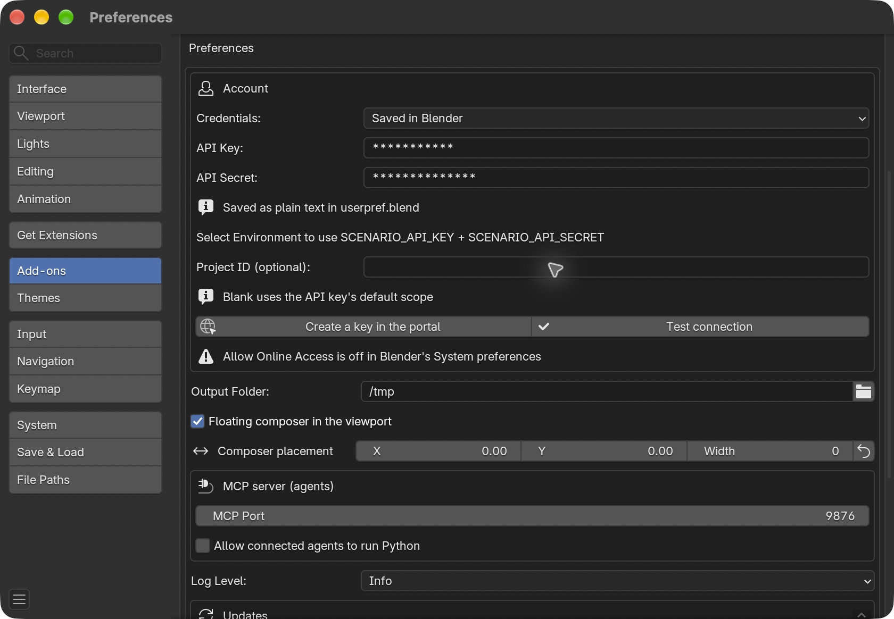
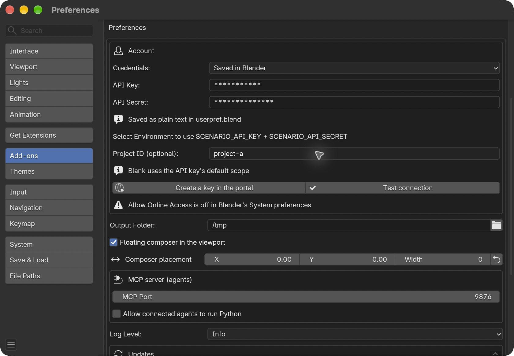
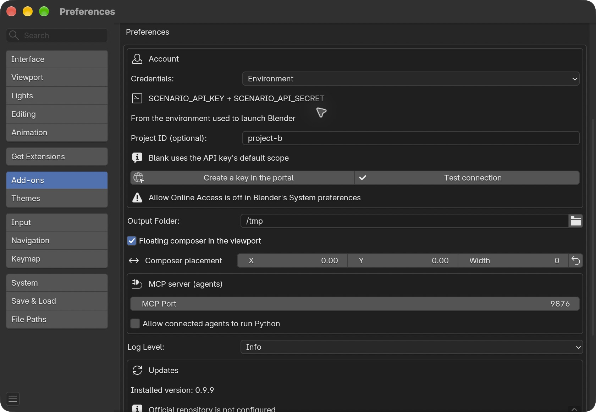
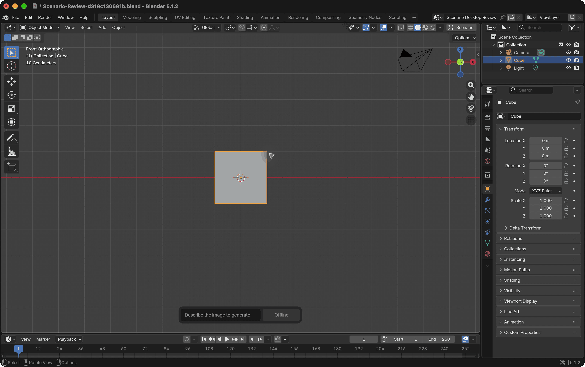

## Tabs and segmented choices

A row of mutually exclusive choices (lane tabs, picker modality tabs and category chips, Edit 3D tasks, Environment modes) is a **continuous segmented control**: cells touch (no gaps), each takes an equal share of the full width, and the icon sits next to its label with the pair centred in the cell.

- Use `panels.equal_segments(row, struct, prop, values)` (or `panels.draw_enum_tabs(layout, struct, prop, rows)` for multiple rows). It draws each value with `prop_enum` inside an `align=True` row (Blender merges the borders) and forces equal widths with a chain of even `split()`s.
- Never use `prop(..., expand=True)` for these (it pins the icon to the left edge) or `grid_flow` (it leaves gaps).

## Sections

Each group of controls is a `layout.box()` with a one-line header: `box.label(text="Title", icon=...)`. Order inside a lane: Model, Prompt, References, Settings, then the Generate button. Put `layout.separator(factor=0.5)` between the tabs and the form, and above the Generate button.

Every section header carries an icon so the panel reads as a stack of peers: `Model` (`NODE_MATERIAL`), `Clip to render` (`RENDER_ANIMATION`), `Camera path` (`CAMERA_DATA`), `Rendering Style` (`BRUSH_DATA`), `Settings` (`PREFERENCES`). Sections do not collapse (no chevron): a header is a static label, not a toggle, so the form is always visible.

## Buttons

- The **Generate** button is the one primary action: `row.scale_y = 1.5`, icon `PLAY`, and it always shows the live price (`Generate (15 CU)` / `Generate (from N CU)` / `Generate (estimating...)`).
- Icon-only buttons keep Blender's fixed size; a button that must fill a row carries a short label (Blender never stretches an icon-only button). The three prompt tools are `New`, `Rewrite`, `Translate`.
- Destructive actions (`Delete`, `Clear path`) ask for confirmation (`invoke_confirm`).

When Blender online access is disabled, the composer shows **Offline** on its
disabled generation button and **Online access disabled** instead of a loading
message when no model is available. Pending edits retain their estimate request
until online access and credentials are available. Only the selected scene is
priced: another scene's pending form shows no price error and is priced once
that scene is selected. A price that arrives while another scene is selected is
requested again in the same way. The generation controls
remain disabled until a ready quote handle exists; the submission path still
rechecks its exact inputs, origin and approval. A model list is only described as
loading while a catalog request is active.

The composer's prompt, model chip, price, status line and **Generate** belong to
the form that Generate submits. With the 3D tab in Edit mode, that form is Edit 3D:
the 3D tab stays highlighted and **Settings** opens the 3D dialog with its mode
switch, while the prompt, model, price and enablement come from the Edit 3D quote.
A ready Text, Image or Multi-view price never enables or labels an Edit 3D
submission. The pricing pump, the sidebar and Settings forms, the composer and the
Generate operator resolve the form through one lane rule (`props.effective_lane`).
The model picker maps a chosen model to its form in the other direction, then
shows that form's tab and mode.

The composer's text belongs to the form it was synchronized from. **Settings** and
the model chip commit and blur a focused prompt before their dialogs open, because
either can switch the form. If the form is still replaced while the prompt is
focused (another window or a tool), the composer never writes into the new form.
The card keeps describing the original form, disables **Generate** and notes
*The form changed: press Esc to show it*. Typing is refused with a warning, and a
click or double-click in the field keeps the original text. Esc, Enter, Generate,
a lane tab, collapse and dragging leave focus without writing either form; Enter
or Generate then submit nothing, and the tab shows its current form. Otherwise a
lane tab commits the text and keeps the prompt focused on the new tab's form.
When the form's model takes no prompt, as for several Edit 3D tasks, the field
reads *This model takes no prompt* and takes no focus, as the sidebar hides its
prompt row: a click or double-click does not focus it, and a lane tab that shows
such a form leaves focus. If another window or a tool loads such a model while
the prompt is focused, the next text key leaves focus with that warning and
writes nothing.

Installed tests on the packaged ZIP run the real composer draw function, with
recording drawing primitives, and the real modal handler. Run against the previous
composer, they fail where a 1.5 CU Text price labeled the Generate that the
operator routes to the Edit form's 7.25 CU quote, and where keys typed after a
mode switch still edited the Text prompt. They also cover the replaced-form and
no-prompt rules above. The lane tab, double-click and model-change rules came
after the GUI check below; their installed tests fail on the composer code that
check ran. An offline GUI check ran the exact ZIP
`89c07a5b0642ca02b53d5c1fcb57968f03fde32b3ae942ac7f048690f9272011`
on macOS 27.0.1 arm64 with Blender 5.0.1, 5.1.2 and 5.2.1. It drove the composer through
Blender's own event queue (`--enable-event-simulate`, a window opened without
focus, no OS input injected). The steps were: typing into the Text form, Settings
with a switch to Edit and Done, typing into the Edit form, a replacement while
focused, Enter, Generate, the model chip dialog, then a click outside, wheel zoom
and the front-view shortcut. Each prompt kept its own text, the key after Settings
reached the viewport's Scale transform, and screenshots show the note and
warnings. Offline, no price was ready and the dialog showed its loading state, so
the mode switch was a property change while it was open. Blender treats the blur
click as handled, so it does not also select in the viewport; the next click does.
This path is unchanged; the [Studio view](#explicit-studio-view) records its
first-click header evidence. Physical keyboard and pointer input, IME and focus
across applications remain #66 desktop acceptance.

## The model chooser

A `Model` section (a box with a `NODE_MATERIAL` header, like the others) holds a wide button (icon + model name) that opens the picker, with the native dropdown as a small fallback on the right. Its one-line description belongs in the picker, not the panel.

A form is described as loading its model only while that description read is
pending. A failed read shows its sanitized reason in the form and composer note,
with **Retry loading model** repeating the same background read. A later read,
success, another model or changed credentials clear it; drawing never retries.
Online, a form with neither a pending read nor a failure recorded this session,
such as one in a reopened file, offers the same retry instead of a saved error.
A model-load error saved with the file is not drawn in the form, below Generate
or in the composer note unless this session recorded it. With online access disabled, the form says so and offers no retry. An MCP call
needing the description, such as `model_schema`, starts the next read, or joins the
pending one, and waits for it off the main thread
([MCP quote contract](MCP.md#model-quote-and-submission-contract)); a read that
fails again returns its new reason.

### Trained models in the picker

The Image tab's last chip, **Trained**, lists LoRAs and compositions instead of
base models ([#97](https://github.com/scenario-labs/blender-plugin/issues/97)):
the selected connection's private trained models first, then public Scenario
LoRAs and compositions. Other chips and the base lanes never list them. Each row
says how the model runs in the form the choice lands in (Image, or Render Image
when the picker opened from it), for example **Private LoRA via FLUX.1 Dev**. A
model no checked base runs stays readable but greyed, with its reason: the base
models are still being checked, no base in this form accepts its type, it is not
trained yet, or Blender has no route for its type (**Not available in Blender**).
Private plain custom models are not listed here.

Base-model descriptions declare the LoRA inputs, so they are read only when the
Trained chip opens: in lane order, once per connection, with a progress line and
the reason when reading stops. A catalog refresh never starts these reads, and
neither does a trained list that arrives after the dialog closed on this chip.
Descriptions a stopped scan never reached are read the next time the chip opens;
only a refresh lets a later Trained chip retry the ones that failed. The open
dialog is refreshed as descriptions arrive, through the same popup refresh as
Studio. Its list shows ten rows, fewer when the window is too short for the whole
dialog at the current UI scale, so OK and Cancel stay on screen.

The highlighted model's box shows its kind, **Runs with** for a single base or a
**Run with** choice among several (the form's current base when it runs the model,
otherwise **Choose a base model**; OK refuses until one is chosen), and for a LoRA
a **Strength** field bounded by the base's declared range. As in the Scenario web
app, it starts at the LoRA's own strength (the scale of the first entry of its
concepts, when its record carries one), otherwise at 0.75, clamped to that range;
Reset to Default Value returns the field to that start. A base's declared default
does not move the start. The chosen base and strength stay while base
descriptions keep arriving and the rows are rebuilt; another row or a new dialog
starts again from the form, and a new dialog highlights the form's first trained
model. A composition shows how many LoRAs it combines with their own strengths. One line
states the effect on the form: adding to the LoRAs already chosen, changing this
LoRA's strength, or replacing the form's trained models. Choosing through another
base, choosing a composition, or choosing a LoRA over a composition replaces the
form's choice; that line says so before OK. The whole new choice is checked against
the base's current schema before the form changes, and then the price is
invalidated. The box ends with **Experimental: LoRAs and compositions not
accepted**. Drawing reads this state only.

The base's LoRA inputs are never drawn as text fields. Every request writes the
form's choice into the base's declared inputs with the same route function local
MCP and the quote check use; a base change, a model no longer listed, a choice
saved under another connection or project, or a route the current schema refuses
keeps the choice and blocks the price with its reason. An ID that an earlier
version saved in the base's model text field (such as **LoRA or Composition
Model**) becomes the form's choice when it has none, so it is neither dropped
silently nor sent unchecked; it gets the same checks and remove button.
Dropping any value an earlier version saved in an input the form no longer
draws, such as the LoRA lists it drew as text, prices the form again, so a price
error saved with the file gives way to the current reason.
**Reload parameters** restores the job's LoRAs or composition that
are still listed, never adds a strength the job did not send (the base's declared
default applies, otherwise the price asks for one) and warns about the trained
models it could not restore. Before the trained list has loaded (still loading, or
its read failed), it keeps every model the base's LoRA inputs describe, unchecked,
says they are checked once the list loads, and the price waits with the list's
reason. Until then the Trained models box shows each by its ID: the job's
composition, from the base's model ID input, as a composition without a strength,
and its LoRAs, which keep the strengths they ran with. When the list arrives, the
models it names get their listed kind and name (a composition sends no strength)
and the form is priced again; one it does not name stays and blocks the price with
its reason until it is removed.

### Trained models section and project defaults

The Image and Render Image forms show a **Trained models** box (`SHADERFX`) right
after the **Model** box, in the sidebar, in Studio and in Render Image alike; any
other form shows it only when it holds a choice. Each chosen LoRA has a row with
its name and a remove button, then a **Strength (min to max)** field bounded by
the range the current base declares. Editing a strength clamps it to that range
and reprices the form. Resetting the field to its default (Backspace over it)
returns it to the start the picker gives a newly chosen LoRA, rather than 0: the
LoRA's own strength, otherwise 0.75, within the base's range; a base's declared
default does not move it. Each LoRA keeps its own strength in form order, so
removing one never shifts another's strength. When the base's description
changes its range, the fields take the new range and the form is priced again,
even after a background catalog refresh, but a strength outside the range is
kept and the price is blocked with the range until the user edits it; nothing
changes silently. On a base that declares no range, including after the form switches to
one, each LoRA loses its field, as a LoRA chosen there gets none, and the form is
priced again with what that base sends, described below. Both apply as well to a
LoRA that **Reload parameters** restored before the trained list named it. A
refreshed description that changes anything else in the base's LoRA inputs, such
as its declared default or the LoRA types it accepts, also prices the form again.

A LoRA without a strength, such as an ID adopted from an earlier text field, gets
a **Set strength** button when the base declares a range: the strength then starts
at that same start and the price is requested again. A base that declares a
default shows **Strength: the base model's default (N)** and sends that default
until a strength is set, with **Set strength** below it when the base also
declares a range. A request never adds a strength the user did not see. A
composition row reads **Name (composition)** with its LoRAs and their own strengths listed
read-only below it. The reason a choice cannot run is drawn in the box with
`ERROR` (or `TIME` while trained models load), and **Add LoRA or composition**
opens the picker on the Trained chip. The box ends with the experimental line.

The project-default row stores one explicit choice per form for the selected
credentials and optional Project ID, through the
[runtime owner](JOB_STORAGE.md#runtime-owner). It reads **Project default:
FLUX.1 Dev · Studio LoRA (+1)** or **No project default for this form**, then
**Use**, **Save** and **Clear**. **Save** stores the form's base model, LoRAs and
strengths (or composition) only when that choice runs now, and only over the
revision and selection drawn on the button; replacing a saved default and
**Clear** ask for confirmation. Saving or clearing prices nothing and changes no
payload. **Use** replaces the form's choice with the default after the same route
check and reprices it.

A form with no explicit choice in this scope (no model chosen and no trained
model, as in a new scene or file) takes the saved default: the main-thread pump
applies it once the base description and the trained list are loaded. Until
then, the price reads **Applying the project default ...**; if the default cannot
run (a model no longer listed, a base the form no longer offers, another type, a
refused route, a base described without inputs, no connection to write it
under), the price reads **Project
default ... is unavailable: choose a model or clear the default.** with the
reason, and an unreadable stored row reads **Could not read the project
default**. Generate stays disabled, and this reason comes before the form's other
request checks. It never falls back to the base model alone: a write into the
form that fails part way restores the form's empty model key and leaves no
trained choice, so the form stays blocked. A default lands
only on a base the form's own model list offers. A default's missing base
description is read at most once per base and selection; a read that could not
start is tried again by the pump. Choosing a model or a trained model makes the
choice explicit, and the default no longer changes that form. Applying a default
in another scene reprices only that scene's form. Local MCP render inspection and
quotes apply the same step first, and so does `render_form` `configure` without a
`model_id`, which changes nothing and returns the reason while the default waits or
cannot run; a failure writing the default is logged and the form keeps waiting.
Naming `model_id` in `configure` is an explicit choice, even for the model already
shown, and the default is not applied first.
Drawing reads cached defaults only; the owner is opened by the pump, requests and
operators.

The compact composer's model chip names the choice as **Base · LoRA (+n)**. A
long LoRA name is shortened before the count, so the number of further LoRAs
stays readable; with a trained choice the chip opens the picker on the Trained
chip. Strengths are
edited in the sidebar or Studio, and the composer note says so (**Edit LoRA
strength in the sidebar or Studio**) when nothing more urgent is shown. Job views
name the base with its trained choice the same way while the session that
submitted them lasts; a recovered saved job names its base model only.

## Duration and Match timeline

The video model's `Duration (cost)` drives the camera-path duration for **Render
Video** when **Match timeline** is on. The planner tells users to build the path
before capture. Capture uses the displayed preview/scene range without implicit
padding or trimming. Uploaded clips remain unchanged when timeline/model settings
change. The base **Video** lane keeps the reverse setting direction: the model's
duration follows the scene frame range through `generation.apply_match_timeline`.

## Reference inputs

A file input's add options match its kind (`props.addable_sources_for`): a **3D** input offers a model file and **Upload selected mesh** when a mesh is selected; an **image** input offers Upload plus the viewport/camera stills and the render result; a **video** input offers Upload plus the clip captures. Never offer a source that produces the wrong asset type (no image capture on a 3D character input).

A selected mesh appears as a candidate for each empty **3D** input. **Upload
selected mesh** explicitly exports the selection as one GLB and uploads that
snapshot. A pending or completed explicit reference replaces the pinned candidate;
do not offer a second mesh upload into an occupied slot. Edit 3D still requires
an input mesh. Later scene edits do not change an already uploaded snapshot.

Across generation forms, attaching a local file does not send it. Image inputs
also support explicit viewport, camera and Render Result snapshots. Video inputs
support viewport/camera clips over the preview range, or scene range when no
preview is enabled, without implicit padding or audio. Grey clay capture is
applied when selected. Do not offer an image Render Result for a video input.
The separate **Upload reference** button sends an immutable snapshot before a
final price can be requested. Show upload progress and **Inspect uploads** when
review is needed. Do not offer automatic retry for uncertain uploads or mutate
the reference during drawing. The maintenance pump attaches a completed asset
only to the unchanged original scene, lane, model, input type and reference slot,
then invalidates the old price. A removed/edited slot must never receive a late upload result.
Transient timer context without the originating scene pauses attachment. Local
validation rejected before task admission permits correcting and retrying the input;
uncertain admitted work retains its duplicate-upload guard.

**Inspect uploads** offers explicit known-status refresh, unclaimed preparation
cancellation, **Upload again** for an unfinished upload whose suggested recovery is
a restart, and finished staging cleanup; cancellation, restart and cleanup require
confirmation. When a transfer stops or a recovery finishes while the view is shown,
the maintenance pump refreshes those suggestions. Drawing reads them and records
only an in-memory time of its last draw. Popups report no close, so a view not
drawn for two seconds stops that store read until it draws again.
A restarted upload never attaches itself to the slot.
**Use saved upload** and an input's **Saved uploads** open the same paginated
view. Offer attachment only for imported uploads matching the input kind
(image, audio, video or 3D). Attaching one needs a separate confirmation of its
scene, lane, model, input and reference destination. A changed destination must
be reviewed again. Pending or uncertain marked uploads block generation so the
prototype path cannot upload the same file a second time. Recheck that destination
on confirmation, keep drawing read-only and invalidate the prior generation price after attachment.

Render forms show **Capture and upload scene** in their scene/clip section, with
that slot's progress, inspection and removal controls. Render Video's optional
first frame always exposes a file field and native folder picker, followed by a
separate **Upload first frame** action after choosing an image. Do not draw these slots
again as style references. The scene snapshot precedes styles; a first frame
precedes other images in the same array. Disabled first frames are omitted without
canceling or deleting their upload. Changed first-frame paths require explicit
replacement. Result reuse must not silently replace a role-tagged single-file
scene or first-frame slot; require explicit removal first. A saved image reaches
the first frame only through its own reviewed
[first-frame handoff](#saved-image-first-frame-handoff), never through
**Use as reference**. Changing the path or automatic Spark option invalidates the price.
An empty look with automatic Spark enabled blocks quoting; display its unavailable
status until separate Spark approval is integrated. Drawing remains read-only.

## Generations

Saved-job controls in Jobs, Generations and every view that reuses them come
from the shared [action descriptors](BLENDER_JOB_CONTEXT.md#active-saved-job-controls):
the same label, icon and operator properties for the same job. Add a saved-job
action as one descriptor, never as a surface-specific button. Hide an action
that is not offered rather than drawing it disabled, and keep any approval in
the operator's own dialog.

**Reload parameters** is available only when a result records a supported
generation lane, or a generic job records a supported kind. A catalog lane
without a native form never falls back to its kind's form, which would drop
that lane's rules. Film tasks and generic jobs without that information keep
their saved-result controls; they must not overwrite the Image form.

**Remove background** prepares the Image form and never submits directly. Its
message tells users to upload the reference, review the price and choose
**Generate**. Validate the file and available model/schema before replacing the
form; reset the old prompt/settings/references and invalidate the previous quote.
Existing jobs and admitted uploads keep their own lifetime and origin guards.

Each result collapses on its own; the panel header has a **Collapse all / Expand all** toggle. A failed result shows a red error control in its header whose tooltip is the whole message (with the Error ID) and which opens the full text with a Copy button on click (a `description()`-driven operator, since Blender labels have no per-instance tooltip). Never truncate an error to a single clipped line as the only way to read it. Below the model row, a failed result also draws `Failed: ` and its whole error in red, the first line with the `ERROR` icon and the next ones aligned after it, wrapped by the width Blender's interface font measures (`label_wrap`, with the preview status lines' inset). For a shared job that error is the [reason Scenario gave](BLENDER_JOB_CONTEXT.md#failure-reasons) when it is plain text, otherwise a fixed sentence, at most 400 characters with its support error id kept. **Generation details** draws the whole error the same way in a box with **Copy error**; the composer's job card declares its requested popup width, so its first draw wraps like Studio's. Drawing reads only the view's error; the maintenance poll sets it. Installed tests on Blender 5.1.2 macOS arm64 draw a failed shared job's reason through the real Generations panel, **Generation details**, the composer strip and the job card with store reads refused; a desktop screenshot of the wrapped reason remains #66 evidence. The prompt box carries a trash button that deletes its text, greyed out when empty.

## Jobs status and remote progress

A shared Jobs row names its saved state in words (`waiting to submit`,
`submitted`, `canceling`, `finished on Scenario`, `downloading results`,
`download failed`), never a raw state identifier. A model or workflow job
that finished on Scenario stays a Jobs row as `finished on Scenario` while its
results still need a download; Generations never lists it as a success before
then. Prompt Spark, Translate and Blockout results are text that their tools
read into memory without saving a result download, so such a job is finished
once Scenario reports success: Generations lists it, including after **Inspect
saved jobs**, and it never draws a Jobs row or a download line. The projection
decides from the saved request (its operation and model), never from drawn
text. While a known remote job is polled, the latest validated Scenario status
replaces `submitted`: `queued` (Scenario's `pending` and `queued`), `starting`
(`warming-up`), `generating` (`in-progress`) or `finalizing`. The composer's
job strip uses the same words, capitalized. Draw a native progress bar with its
whole percentage only while generating or finalizing and only from 1%; never
draw a percentage for zero, a fraction below 1%, unknown or queued states, and
never show an estimated time. With online
access disabled, a `submitted` or `canceling` row
adds `Status paused while online access is disabled` and a `finished on
Scenario` row adds `Download paused while online access is disabled`, whether or
not a reading exists yet. Otherwise, when the reading is not being kept current,
add one information line: `Status is not updating`. Drawing reads only the
projected view; it performs no I/O, store read, session creation or property
write. The pump redraws when the drawn rows or online access change, so the bar
moves without hovering, but it does not redraw for the brief in-flight refresh
that hides saved-job controls. Studio Jobs reuses the same draw.

Installed tests on macOS arm64 Blender 5.0.1, 5.1.2 and 5.2.1 check the drawn
label, bar factor and text, the offline and stale lines, a finished generation
drawn through the real Jobs panel with its offline download line and absent from
Generations, finished Prompt Spark, Translate and Blockout jobs inspected with
online access off and listed only in Generations without an offline line, the
absence of storage reads and writes during draw, and one redraw per projected or
online access change. No desktop interaction or screenshot of the bar is claimed
yet; that remains #66 acceptance.

## Wording

- Verbs on buttons say exactly what happens: `Generate`, `Add to scene`, `Use as reference`, `Refresh cloud`, `Save for recovery`.
- Singular/plural is correct: `1 Job` / `3 Jobs`, `1 marker` / `3 markers`.
- Prompt helpers request a free exact server price first. Show the formatted CU amount below the tools with a separate action-labelled approval button. Do not use a fixed price or a tooltip as spending authorization. Keep pending/error text readable; an uncertain job offers inspection, never automatic resubmission.
- CU labels follow the web generation indicator: up to three decimal places,
  no trailing zeros, and thousands separators below 10,000; at or above 10,000,
  use K/M/B/T with three significant digits (`0.123 CU`, `1,234.568 CU`,
  `12.3K CU`). This is display formatting only. Keep the original server decimal
  in the quote, approval action and saved job; never reconstruct it from the label.
- No internal names in user text (a person sees `Reference Images`, not `referenceImages`).

## Tooltips

Every operator sets `bl_description`: one sentence, action first, the cost when it spends credits. Blender adds the trailing period.

## Icons

Modality icons (image, video, audio, 3d) are Scenario's own PNGs (`scenario/icons/`, loaded by `blender/icons.py`, `icons.kwargs(name)` with a built-in fallback for headless). Section and action icons are Blender built-ins chosen to read at a glance.

## Status messages

`runtime.set_message(...)` lines are transient: `runtime.message_visible()` hides them after 8 s so a stale line never reads as current.

## Experimental status

Film and capabilities whose result handling is not accepted keep an explicit
experimental status. It describes acceptance only: it never hides or blocks a
model, task, estimate or approval. Use the built-in `EXPERIMENTAL` icon and
short wording. Drawing reads the status and changes nothing.

- The **Film** sidebar panel shows **Experimental** on the right of its header,
  visible while collapsed and above its nested panels. Studio reuses panel bodies
  only, so it draws the same line on every Film page.
- For models offering `audio2txt` or `video23d`, the model picker's
  highlighted-model box and the persistent **Model** row show a read-only
  **Experimental: speech-to-text not accepted** or
  **Experimental: video-to-motion not accepted** label. The Model row is shared
  by the sidebar and Studio lanes, Render Image/Video and Edit 3D; the viewport
  composer's model chip does not show it. These models can be submitted and
  results stay in saved jobs; provider behavior and result handling are not
  accepted. Generic Import is offered by file type, so a returned model (GLB,
  glTF, FBX, OBJ or mesh PLY) or media file may import, but motion and
  transcription handling is not accepted ([#190](https://github.com/scenario-labs/blender-plugin/issues/190)).

Installed native tests assert the registered header preset draw call, the Studio
line, the picker status and the Model row status. Physical placement in a desktop
session has not been captured.

## Composer placement

With region overlap, Blender draws the 3D View toolbar and sidebar over the
viewport's main region. The floating composer therefore places itself in the
span those regions leave uncovered, not in the whole region. Each draw and each
pointer event measures every visible toolbar or sidebar region whose x-range
overlaps the main region, from its actual position, so a flipped sidebar counts
on the left. Without region overlap they sit beside the viewport and change
nothing.

- The pill and card start at the bottom centre of that span.
- A saved or resized card width shrinks to the span minus margins. The card
  needs its minimum width of 420 px plus a 24 px margin on each side, all
  times the UI scale. The UI scale is Blender's custom-interface multiplier
  (`preferences.system.ui_scale`: the display DPI times the Preferences
  resolution scale), not the pixel size, which is a line width that already
  includes both. A narrower span shows the pill in its place. At a UI scale of
  4 (Retina with a Preferences resolution scale of 2), an open sidebar easily
  leaves less than the 1,872 px the card needs. The viewport also needs the
  card's 132 px height plus a 24 px margin above and below, times the UI scale
  (720 px at scale 4): a shorter viewport shows the pill too, instead of
  drawing the card's rows over each other. Drawing, hit testing and drags then
  use the pill geometry. The stored expanded choice and card width stay
  unchanged, so the card returns by itself once the sidebar closes or the
  viewport grows.
- While the card has no room, a click on the pill, expanded or collapsed, opens
  the current lane's form in the Settings dialog (the dialog of the card's
  **Settings** chip) instead of expanding. A short message in the status bar
  (and in the sidebar panel when it is open) suggests closing the sidebar or
  enlarging the viewport, and a drag still moves the pill. A prompt that had
  focus when the card gave way is committed and left, as a click outside would.
  If its lane's prompt changed elsewhere meanwhile, focus is left without
  overwriting that text and a warning is reported.
- The pill narrows to its minimum of 200 px times the UI scale while keeping its
  margins. A narrower span then eats into the margins. In a span narrower than
  the minimum itself, the pill keeps that minimum width and ends at the right
  edge of the span, the sidebar edge when one is open, with its Generate label;
  it runs under the toolbar or past the viewport's left edge instead.
- The model chip opens the model picker and shows the sidebar, which holds the
  rest of the lane's form. When showing the sidebar would leave the card no
  room, the chip opens the picker alone, so the card does not give way to the
  pill while the picker is open. A hidden sidebar reports no width, so the
  composer assumes it reopens at Blender's default width of 220 px times the UI
  scale; a sidebar widened before it was hidden can still leave less room than
  that, and the pill then stands in as usual.
- The seven lane tabs share their row in proportion to their full labels' length
  plus a fixed allowance, so Render Video gets more room than 3D. Equal cells
  would clip R-Img on the minimum card and shorten Render Video on the default
  one; with these widths the default card shows every full label and the minimum
  card every short label whole.
- A lane tab shows its full label when it fits the tab, otherwise a short one:
  **Img**, **Vid**, **3D**, **Mat**, **R-Img**, **R-Vid**, **Env**. Each tab
  decides from the measured text width, so Image and Video can keep their full
  labels beside R-Img. Only a short label that still does not fit is clipped with
  an ellipsis, as a last resort and never below its first character, so a tab is
  never blank.
- A saved or dragged offset keeps the whole pill or card inside the viewport,
  between any toolbar and sidebar: it stops at a bare viewport edge as it does
  at a side-region edge, so Generate and the minus button stay in view. The
  pill and the card share one offset, so a pill moved against an edge expands
  into a card against that same edge, and a card parked at the sidebar stays
  whole when the sidebar closes and the card widens. Only the drawn placement
  is clamped; the saved offset is kept until the next move.
- A move or resize starts from the placement as drawn. A composer parked past an
  edge (a sidebar that opened, or a viewport that shrank) therefore follows the
  pointer at once instead of waiting for it to cover the hidden excess.
  Releasing a move stores the drawn offset, and releasing a resize also stores
  the drawn width; Esc during the drag restores the saved placement.
- Drawing and hit testing share one layout, so every control is drawn exactly
  where a click reaches it.

The card and the pill avoid only the side regions so far. Horizontal regions
drawn over the viewport are not avoided by them: the asset shelf along the
bottom (in Pose Mode, for example), the tool header and a transparent header
along the top can still cover part of the composer or its default spot. The
[job strip](#compact-job-strip) does avoid them.

Installed tests cover these rules with synthetic overlapping regions, including
the modal's move, resize and release handlers with the sidebar opened and
closed, a scale-4 Retina layout whose sidebar leaves no room for the card, a
viewport one pixel too short for the card at scales 1, 2 and 4, the model
chip's choice to show the sidebar or not, and the background viewport's real
regions. A physical macOS Blender 5.2.1 check at
that scale found the card running under the sidebar and blank or ambiguous tab
labels, which motivated the pill fallback and the short labels. A physical
Blender 5.1.2 check found the minus button and Generate past the bare right
edge after the pill had been moved right and expanded, and after a card parked
at the sidebar widened when the sidebar closed in a 1018 x 671 pt window, which
motivated the whole-composer clamp. Installed tests drive both cases through
the modal. Repeating physical desktop drags and screenshots remains a separate
acceptance check under #66.

### Double-click

A double-click on the card background, its resize corner or the
[job strip](#compact-job-strip)'s background puts the composer back at its
default place and width, and a double-click in the prompt selects the word (or
the run of spaces) under the pointer, so typing replaces it.

Blender never hands a modal operator a double-click: before calling it, the
window manager turns the second press into a plain press (only key maps see the
double-click value), in Blender 5.0, 5.1 and 5.2 alike. The composer therefore
pairs presses itself, by Blender's rule. A press completes a double-click when
it lands on the same composer target (a control, the card or strip background,
the prompt or a strip chip) as the previous press, less than Blender's
double-click time preference after it (350 ms by default) and within the
composer's 4 px drag threshold times the UI scale. Another key or button
pressed in between (Escape, which cancels a held press, included), a drag or
resize past that threshold, or a press outside it starts over, and a completed
pair is spent, so a third quick press is a plain press again. The resize grip
follows the pointer from its first move, but jitter within the threshold while
the button is held keeps the press. Time is taken when the composer handles
each press, since Python events carry no timestamp. A click that changes the
layout under the pointer (the pill expanding into the card) never pairs with
the next press. On any other control the second press of a double-click does
nothing more, so a double-click on Generate submits once and one on a strip
chip runs its operator, or opens its dialog, once.

Installed tests send the composer's modal what Blender really delivers, two
press and release pairs at pinned times, and check the word selection, the
reset, the timing and distance limits, jitter on the resize corner, the presses
that start over (Escape included) and the single submission. Job strip tests
send the same pairs to the strip's background, which resets the placement
within the time and distance limits only, and to a strip chip, which dispatches
once. Unit tests cover the pairing rule itself. Physical double-clicks on
Blender 5.1.2 macOS selected nothing and reset nothing before pairing; a
physical recheck, the strip included, remains under #66.

### Errors and file loads

The composer's modal operator runs one session at a time. A pointer move over
the composer starts one, and so does a pointer move anywhere in a 3D viewport
while the prompt is focused. The session lasts until a click outside the
composer, or until the pointer leaves it while the prompt is unfocused. A
refused Generate, such as a failed poll or an error report from the submission,
is reported as a warning and the session goes on, and so is an error from the
operator a [job strip](#compact-job-strip) chip runs. If handling any other event
raises, whether a click, a key, a pointer move or a drag, the composer ends its
session and Blender reports the error. So does an error that F2 or a
composition's second press raises while opening the
[native text field](#composer-text-input), unless it is a `RuntimeError` or an
`AttributeError`, which that call reports as a warning. The composer leaves a
focused prompt and marks no session as running, so the next pointer move over
it starts a new session. Blender can also end a session without an event,
because its window closed or a file loaded. The operator's cancel callback then
ends it the same way: it leaves a focused prompt, stops a selection drag, puts a
dragged composer back where the press found it and marks no session as running,
so no 3D view keeps drawing a caret that types nothing. Either way, as at every
session end, the composer forgets a pending click and an untyped press: the next
session's first click completes no [double-click](#double-click) and its first
untyped press starts a new composition run. It also gives the window its own
cursor back when a drag, or the pointer resting on the resize corner, had set
one, so no resize cursor stays over the viewport. Every file load (Open, Revert,
File > New) also collapses the card to the pill, leaves the prompt and restores
the saved placement through the composer's load handler, which persists across
loads.

A physical Blender 5.1.2 macOS check found the composer frozen for the rest of
the session after one Generate refused by the GUI spend guard: clicks on it fell
through to the viewport, and a file load did not help because Blender had
dropped the non-persistent load handler at the first load. Generate refusals
became warnings in a later change. Installed tests on the packaged ZIP now send
the modal a Generate refused by the spend guard's poll and an error raised while
a key is typed in the focused prompt. They call the cancel callback during a
placement drag and during a selection drag in the focused prompt, and run three
file loads in a row. The error, cancel and file-load tests fail on the previous
composer. Another test raises from the text field call on a composition's
second press and on F2. A session-end test ends a session by an error and by
the cancel callback, after a click and after an untyped press. Without the error
handling, the text field test fails and so does the session-end test's error
case; when a session end keeps the pending click and the untyped press, both of
its cases fail. A cursor test ends a session the same two ways while the pointer
rests on the resize corner; when a session end restores the cursor only after a
drag, both of its cases fail with the resize cursor still set. The tests call
the operator's handlers directly in background Blender, which cannot start the
modal itself: there, an `INVOKE_DEFAULT` call of a modal operator is refused
before `invoke` runs, even with a window, area and region override. No event-simulated GUI check (`--enable-event-simulate`) has run for
this change, because it was prepared without opening a Blender window. Blender's
window manager has therefore not yet been seen dropping the handler after an
error, calling cancel on a file load or a closed window, or keeping the load
handler across File > Revert in an interface session. The
[#66 follow-up](https://github.com/scenario-labs/blender-plugin/issues/66#issuecomment-6120385854)
lists those event-simulated checks and the physical rechecks, with their
expected results.

## Composer text input

The composer prompt is custom drawing fed by key events. Blender composes
input-method (IME) text only in its own text fields: an add-on can neither turn
composition on nor read it. Its composition events reach a modal operator with
no Python event type (reading one returns an empty string and logs a warning)
and no text. The composer therefore hands such text to a native field instead of
drawing a pre-edit it cannot receive.

- **F2** in the focused prompt opens a popover with one native text field, as F2
  rename does: the label **Type into the Image prompt** (the current tab's name),
  the field editing on display (`activate_init`), and the dimmed hint
  **Enter adds it to the prompt, Esc cancels**.
- The field starts empty. Blender selects all of a native field's text when it
  starts editing, so a field holding the whole prompt would replace it with the
  first composed character. Enter types the field's text at the prompt's caret,
  replacing a selection, as typed keys would; the composer keeps its focus.
- A composition that starts in the focused prompt opens the same popover, so it
  continues in a field that shows it. Left pending, it can land in the next
  native text field that opens, such as an Outliner rename: Blender 5.1.2 and
  5.2.1 insert a pending composition into a field on a click outside it.
- A composition starts with two presses in a row that have no Python type and
  no text: its start, then its first update. A dead key sends one such press,
  then its release or the key carrying the accented character, so the popover
  opens on the second press only. A release, a placement drag, an untyped event
  without focus, any named or text-carrying press in between (a click included)
  or the end of the composer's modal session starts the count again. Each
  untyped press is also a key between two clicks, so it starts
  [double-click](#double-click) pairing over, as any other key does. A key
  repeat (a held key) does not count: Blender never marks input-method events
  as repeats. In an input mode that commits each key, the first key's text
  arrives in that second press, which the composer consumes, so that character
  is lost.
- An untyped key that carries text (French ù, for example) is typed like a named
  key: without Ctrl, Cmd or Alt, at the caret. The modal reads each event's type
  once and handles an untyped event without reading it again, so each untyped
  event logs one warning rather than one per comparison.
- Drawing the popover reads the composer state and changes nothing. The field's
  update callback types the text and empties its window-manager property.
- Text from these paths follows the composer's form rules for typed keys (see
  [Buttons](#buttons)). When another form replaced the one the focused prompt
  belongs to, an untyped key with text, F2 and a composition's second press are
  refused with the same warning, open no popover, and the prompt keeps its focus
  and original text until Esc. When the form's model takes no prompt, they leave
  focus with *This model takes no prompt*. A refused composition is not handed
  to a field, so it can still stay pending. A popover confirmed after its form
  changed in either way adds nothing to either form, and the add-on's status
  message says why.

Installed tests drive the modal with synthetic untyped, dead-key and F2 events
(the popover call stubbed), set the field property and draw the panel into a
recording layout. Another installed test sends a dead key between two clicks in
the prompt, a click between two untyped presses and the end of a modal session
between presses, and checks that neither a double-click nor the popover follows.
Installed Edit form tests send an untyped key with text, F2, a composition's two
presses and a popover confirmation to a replaced form and to a form whose model
takes no prompt, and check that neither form's prompt changes.
Physical composition, dead keys, candidate-window placement and focus after the
popover have not been checked on a desktop; they remain under #66.

## Compact job strip

The expanded composer shows the current job of the form it describes in a
separate tray as wide as the card: the newest job this Blender session
submitted from that scene and form, through the composer, the sidebar or MCP
`generate`. Its scene and form come from the display-only
[scene lane binding](BLENDER_JOB_CONTEXT.md#remote-progress-and-scene-lane-binding);
workflow, Film, restarted and recovered jobs have none, so they never appear
here and stay in Jobs. Another scene, another lane tab or another connection
shows its own job or no tray.

- The tray sits above the card, else below it, else it is hidden; the card's
  controls never move. It stays in the span the toolbar and sidebar leave
  uncovered and wholly between the headers, tool header and asset shelf drawn
  over the viewport. The collapsed pill draws only a thin line inside its
  bottom edge in the job's tone; it keeps its own click.
- One line reads title · status · price · +N more, cut with an ellipsis. The
  status uses the [strip wording](../scenario/core/ui/job_strip.py), whose remote
  words are the Jobs rows' words capitalized (`Queued`, `Starting`,
  `Generating`, `Finalizing`), with a tone dot that is never the only signal.
  While a job is active, a thin bar under the line fills to the reported
  percentage from 1% to 99%, else it stays a dim full track. Unlike the Jobs
  bar, it shows no percentage while finalizing. Without online access, states
  that wait on Scenario add `(offline)`;
  a remote reading that polling is not keeping current adds `(last known)`.
  A paused delivery's own message replaces the status in the review tone, and
  **Inspect** shows it in full. A failed job keeps the error tone and reads
  `Generation failed: ` followed by the reason Scenario gave, cut with the line;
  **Inspect** shows the whole reason. **+N more** counts the form's other jobs
  that are not applied, canceled or failed.
- Chips come only from the shared
  [saved-job action descriptors](BLENDER_JOB_CONTEXT.md#active-saved-job-controls):
  **Inspect**, which is never dropped, and at most one primary action before it:
  a receipt retry, a cancellation, download recovery, the single result action,
  or **Apply... (N)** / **Reuse... (N)**, which opens the job card to choose.
  As in Jobs, **Cancel generation** appears only once a poll confirmed an
  inference job, the only type Scenario documents as cancellable.
  A submission in flight or unconfirmed, and an Image result being imported
  automatically, offer only Inspect. Refresh is never a chip; the pump polls.
  On a narrow tray the primary chip is dropped before the line gets shorter
  than 96 px at 1x; the tray hides when even Inspect does not fit.
- A chip runs its existing operator with `INVOKE_DEFAULT`, never `EXEC`, so the
  operator's own confirmation or destination dialog is the approval. Before
  dispatch, the click is compared with what the region last drew (request,
  saved revision and chips); a job that changed since consumes the click with
  *The job changed; check its updated actions*. A focused prompt is committed to
  its own form first, with the same guard as a click outside: a conflicting
  edit keeps focus and both texts and dispatches nothing.
- The job offers no action while an automatic status refresh or another command
  runs, except a prepared job's local cancellation. The tray keeps showing the
  actions it last offered for the same saved revision instead of blinking every
  poll, including those the poll that starts the command still lists until the
  next poll, but then only the chips that open the job card (**Inspect**,
  **Apply... (N)** and **Reuse... (N)**) dispatch; another chip answers *The job
  is updating; try again in a moment*.
- The cross hides that job's tray for its scene and form. The job continues in
  Jobs; a newer job there shows the tray again, and loading a file forgets
  dismissals. Only the 64 most recent dismissed scene forms are remembered, so
  an older one's tray can show again.
- **Inspect** opens a native job card: an unfinished job as its Jobs row, a
  finished one as its Generations result, always expanded, plus **Show all jobs
  in the sidebar**. The pump refreshes the open card like Studio. A job this
  connection no longer shows offers **Inspect saved jobs**. The card reuses the
  Generations result drawing, including its existing file-based image actions,
  which do not take durable application claims; the tray's own chips use only
  claim-backed descriptors.

Drawing reads ModelJobs' in-memory views and bindings only: it creates no job
owner or session, reads no saved job and writes no scene, WindowManager or job
state. Its only writes are the composer's Python display caches (the drawn
signature per region and the held actions); dismissals, which the modal
records, are Python only too, and a file load clears all three. Each keeps only
its newest entries: 32 regions, 64 jobs and 64 scene forms. Drawing and the
modal share one geometry, so a chip is hit where it is drawn; a press on the
tray's background drags the composer, and a [double-click](#double-click) there
resets its placement, since the modal pairs presses on that same geometry.

Installed tests on the packaged ZIP drive the real draw handler with recording
primitives and the real modal handler with synthetic events over jobs submitted
through the synthetic SDK transport. They check the line, chips, bar and caches
with draw-time ensure calls and store reads patched to fail; each chip's
`INVOKE_DEFAULT` call and exact descriptor properties; the stale-click, busy and
focused-prompt guards, the busy guard also on the poll that starts a refresh;
dismissal, its bound and file load; scene, lane and credential
changes; an unconfirmed submission offering only Inspect; a job Scenario has
not confirmed as an inference job offering no cancellation; a double-click on
the background and on a chip; and **Resume download** through the real operator
downloading once without a paid request.

Blender's text drawing turns GPU blending off, as offscreen draws on Blender
5.0.1, 5.1.2 and 5.2.1 show, and the tray draws its line before its bar, so
every filled shape enables alpha blending itself. Without that, a physical
Blender 5.1.2 macOS check saw the dim track paint as bright as the fill: the bar
looked full at every percentage, like the states that report none. Installed tests
draw the tray and the pill's line through the composer's own shape and text
primitives over a recording GPU that turns blending off after text, and check
the dim track, the fill's width at the reported fraction and the blending of
every translucent shape.
Physical desktop evidence is pending: the dialogs and popup a chip opens from
inside the composer modal, viewport input afterwards, alternate UI scales,
the bar's fill after the blending fix and screenshots need an unlocked desktop
session under #66 and #68.

## What Blender cannot do (so we do not fake it)

- Text is left, centre or right aligned, never justified.
- A panel text field is single line; a taller prompt box grows the field, it does not wrap for editing.
- Dialogs and the sidebar cannot take the composer's custom colours; their layout follows this guide, their palette is the Blender theme's.
- Input-method composition happens only in Blender's own text fields; the composer opens one rather than faking a pre-edit (see [Composer text input](#composer-text-input)).

## Prompt approval interaction evidence

These earlier offline Blender 5.1.2 macOS arm64 captures show the price before
approval and the delivered text afterward. The model, price and transport are
synthetic; they are not current service pricing or live generation evidence.
They predate the shorter CU labels described above. The price request made no
submission; the separate approval produced exactly one.
Native field editing, focus transfer and viewport selection/zoom were exercised.
Computer-control focus guards interrupted some typing attempts; this does not
establish exhaustive keyboard or clipboard acceptance. The isolated run exited
cleanly and left the normal profile unchanged. A disposable Blender copy used a
distinct application identifier and local development signature to distinguish
its window; the extension ZIP was unchanged. Supported-version packaged tests
remain separate from this single-version desktop check and unresolved #263.

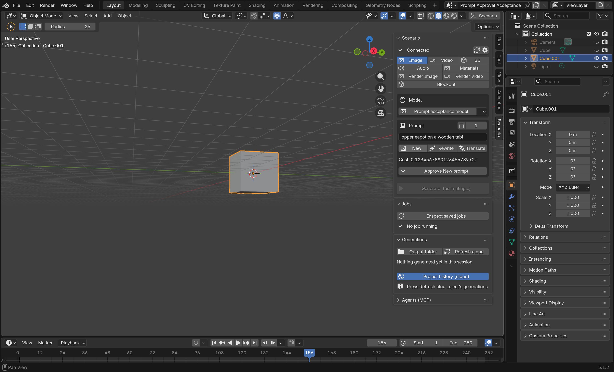

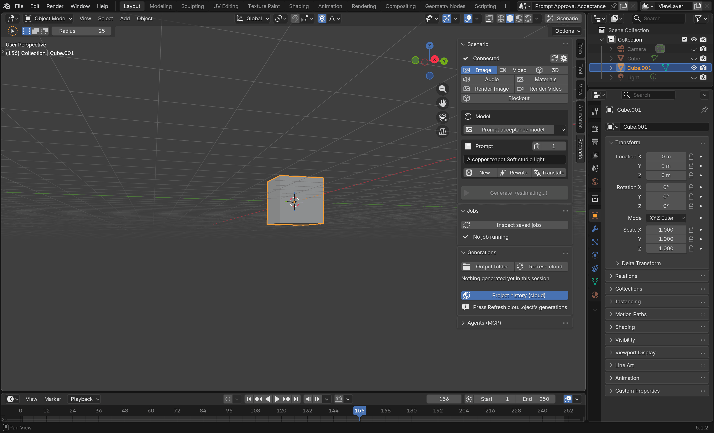

Render forms label the empty-look option **Prepare look with Prompt Spark**.
Its price and approval remain inside the Look section, separate from Generate.
The following offline Blender 5.1.2 macOS arm64 fixture shows that boundary before
and after one synthetic approval. Native focus, a keyboard edit and viewport
selection/zoom were checked; the run exited cleanly with the normal profile
unchanged. As above, the test-only Blender app identifier/signature differed,
while the candidate extension ZIP was unchanged. This is not live render evidence.

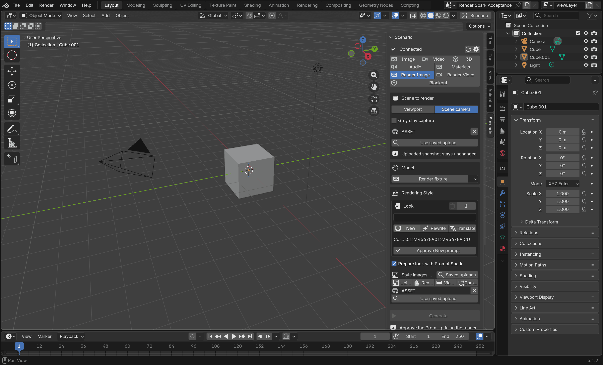

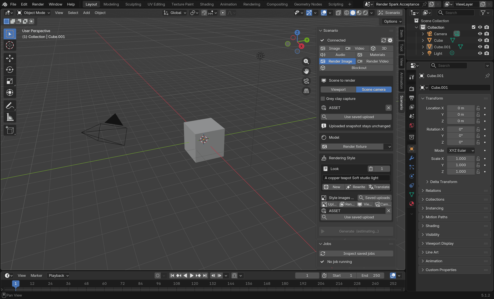

## Saved video and audio confirmation

Shared saved jobs show a separate **Add video/audio strip (N)** action for each
supported result. Its confirmation states the destination scene, exact frame,
one-strip operation, unused channel, unchanged timing and local-file dependency;
video additionally states that embedded audio is omitted. Cancel discards the
approval. Drawing reads the prepared fields without accessing files or changing
jobs. A changed scene, frame, record or credential context requires new review.

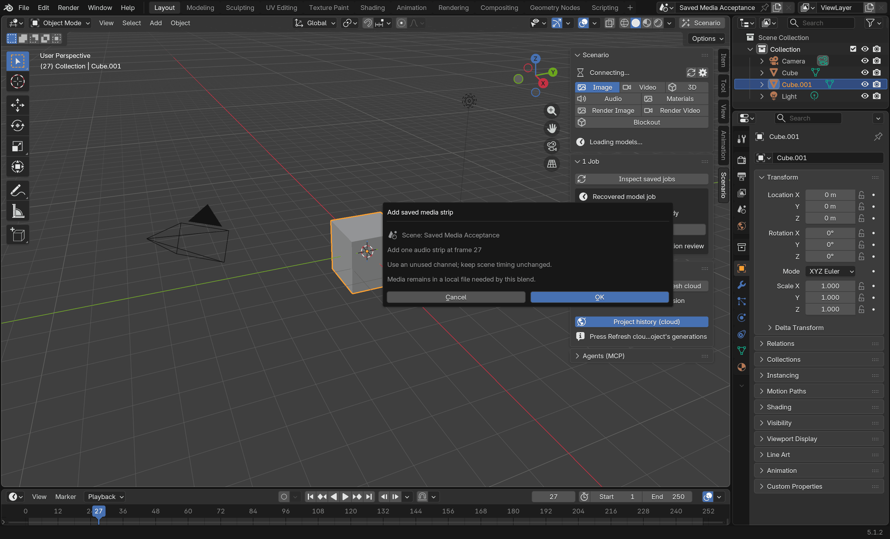

Offline desktop acceptance used the exact packaged ZIP
`3d831dc70efe10e0e5c2cf377e2044015e49f32814ed2da6b8649822ff76a2d2`
in an isolated Blender 5.1.2 profile on macOS arm64. The fixture began with one
mock generation and a saved WAV; mouse approval inserted one sound strip at
frame 27 without another mock submission or request. Viewport selection/zoom,
editor switching, scene selection and the Home key in the Sequencer worked.
Blender exited cleanly and the normal profile fingerprint was unchanged. The
test-only app copy used a distinct bundle identifier and local ad-hoc signature
for reliable window targeting; the vendor executable code and extension ZIP
were unchanged. This is desktop interaction evidence, not human listening,
paid provider acceptance, other OS desktop coverage or resolution of #263.
Native exact-ZIP tests separately decode synthetic MP4, WebM, MP3, WAV and OGG.

## Saved media playback and waveform

Each downloaded saved video or audio result gets one row of saved-job
descriptors: **Play video (N)** with **Play in Blender (N)**, or **Play audio
(N)** with **Waveform (N)**. Numbering counts every saved asset, like **Add
video/audio strip (N)**. Jobs, Generations and the Studio pages that reuse them
draw the same row from the same descriptors. These controls are read-only: they
generate, download, apply and spend nothing and leave the scene unchanged, so
they open no confirmation, and their tooltips say so. They are not job actions:
MCP `job_status` does not list them, and no MCP tool launches a player. Play
reports through the status line once the private copy opens or fails, and is
unavailable in background Blender.

The waveform box follows the job's controls: a `SOUND` header naming the result,
with a close button, then status text wrapped to the box, **Cancel** while
loading, the waveform icon when ready and **Retry** after an error or
cancellation. Blender clips a label wider than its row, and its interface font
is proportional, so status text wraps by the width Blender's interface font
measures at the widget text size, not by a character count. The available width
is the drawn region's less the panel, box and icon space of the sidebar layout.
In Studio it is the width Studio requests for its popup: Blender lays a popup
out before it sizes the popup's region, which is 0 px wide on that first draw,
and a popup's context region is the header that opened it. Lines break only at
ordinary spaces, never after a hyphen in a word that fits: a value keeps its
unit ("1.00 s", "44.1 kHz") and a wrapped line ends with its `·` separator. A
word wider than the whole line splits after its last hyphen that fits, else
after its last character that fits. Text and icon size use
`preferences.system.ui_scale` (1 when background Blender reports 0), never the
pixel size times the resolution scale, which would count that scale twice.
Drawing reads only the controller's cached state: no file, store or session
access, decode or property write. The icon is built in the controller's timer,
outside drawing.

Installed exact-ZIP tests on Blender 5.1.2 macOS arm64 cover the descriptor
rows and their operators, recording-layout draws with file and store reads
refused, the UI-scale sizing, measured wrapping in a 561 px sidebar at an
interface scale of 2 (UI scale 1.0 on a Retina display), in a sized popup and
in Studio's first draw before its popup is sized, the Jobs panel drawing the
box, and an offline waveform decoded by the real child Blender.

Two private physical desktop passes on Blender 5.1.2 macOS arm64 at UI scale
1.0, with system mouse and key events and a ZIP built before the measured
wrapping, showed the rows in the sidebar Jobs panel and on the Studio Jobs page.
**Play video** opened the system player; **Play in Blender** opened Blender's
animation player, which Escape closed with Blender's window frontmost again; and
**Waveform** went from its loading lines to the summary and envelope icon. A
screenshot from the second pass sets the waveform text inset. A third pass, on
a ZIP with the measured wrapping but before its later Studio popup width and
hyphen amendments, drew the sidebar rows at UI scales 1.0 and 2.0, with a
1122 px sidebar at 2.0. **Waveform** reached its summary and envelope icon at
both scales; the loading lines wrapped inside the box, and the summary kept
"1.00 s" whole and ended its first line with a `·` separator. The wrapped lines
started at the box's left edge rather than under the first line's text. All
three passes predate the credential-free system player launch: **Play video**
then went through Blender's `wm.path_open`, which runs the same macOS `open`
command with Blender's whole environment. A later private check with
Environment credentials and a ZIP with that launch confirmed that **Play video**
opened the system player on the private read-only copy, whose SHA-256 matched
the saved result, and that **Play in Blender** started a player whose
environment had no `SCENARIO_`, `PYTHON` or proxy names. Play
audio, the waveform's Cancel, Retry and close on the desktop, clicking **Play
video** or **Play in Blender** at UI scale 2.0, Studio at UI scale 2.0, viewport
interaction, other platforms and human listening are not yet recorded; they
remain #189 and #68 acceptance.

## Saved result previews

Shared saved jobs whose results are downloaded show preview tiles above their
saved-job controls, in Jobs, Generations and the Studio pages that reuse them:
four at a time, primary results first (video, audio, embedded model, base
color or untagged image), then other maps. Each tile is the preview icon or,
until it is ready, the result kind's built-in icon at the same size, with a
caption that starts with the number of its saved-job controls: **(1) Video**,
**(3) Albedo**. Blender keeps the start of a caption that does not fit, so a
narrow sidebar clips the role before the number. Below the tiles, one
information line per distinct status names the waiting tiles as the controls
do, such as **Video (1)**: preparing, waiting for Scenario, or `Preview paused
while online access is disabled`. When the scheduler refuses a request, for
example at its limit of pending previews, the tiles it left without a preview
show its reason on that line until the request is made again, while ready
tiles and the page stay. A missing, failed or unreadable preview gets
an `ERROR` line with its reason and an explicit **Retry preview (N)** button;
nothing retries after the polling window without that click. Previews are
read-only and open no confirmation; Retry's tooltip says nothing is generated,
applied, spent or changed in the scene. Shared image rows no longer load a
draw-time thumbnail.

Blender panels cannot scroll sideways, so a job with more than four previewable
results gets a pager instead of a fifth tile: a **‹** button before the tiles,
a **›** button after them, each one interface unit wide and as tall as the
tiles' images, and a range line such as `3-6 of 6` under the row. The range uses
a hyphen-minus. A page steps by four and the last page ends at the last result,
so it is always full: six results show 1-4, then 3-6. An arrow at its end stays
in place, drawn disabled, so the tiles never shift. The arrows run an operator
that changes the job's page offset, transient state of the preview controller
that is never saved with the file and never written while drawing; a changed
set of previewable results, a connection, project or file change, or the job
leaving the first rows each panel draws starts it on its first page again. Only
the drawn page's previews are requested; paging requests the next page at once
and shows its icons as the timer builds them. Jobs, Generations and the Studio
Jobs and Results pages draw the same pager, because they draw the same tiles.

Icon size follows the drawn region's width, or in Studio the width it requests
for its popup, divided by `preferences.system.ui_scale` (1 when background
Blender reports 0). An unpaged row's icons scale from 2.5 to 5 with that
width. An icon scale step is 20 interface units. Blender estimates a caption
10 steps wide and narrows every item of a row wider than its region, which
narrows the images but neither the icons' cells nor the arrows. A paged row
therefore sets each tile's column to its share of the row beside its arrows,
with Blender's 8 units between a row's items, and its icons take that share,
from 1.75 up to 5. Blender 5.0 to 5.2 draw a preview image 0.15 steps inside
every edge of its icon (`PREVIEW_PAD`), so each arrow starts 0.15 steps below
the row's top, after a separator, and is 0.3 steps shorter than the icon: as
tall as the image. At 1.75 a caption's **(99)…** still fits under its icon. A
region narrower than a row of those smallest icons still narrows it, and there
the images are shorter than the arrows.
Status lines wrap like the waveform box's, by the width Blender's interface
font measures less the sidebar's panel, job box and icon space, and a caption
such as **Model (2)** stays whole on one line. Drawing
reads only the controller's precomputed tiles and pages: no file, store or
session access, decode, request or property write. Requests, image decoding and icons happen in
the controller's timer, outside drawing.

Installed exact-ZIP tests on Blender 5.0.1, 5.1.2 and 5.2.1 macOS arm64 draw
tiles through recording layouts with file and store reads refused, and through
the real Jobs panel. They check that each caption starts with its number and
that the number with an ellipsis fits the tile's icon width in Blender's UI
font. On Blender 5.1.2 they also measure the status lines in a 561 px sidebar
at an interface scale of 2, in a sized popup and in Studio's first draw before
its popup is sized, where the icons also size from the requested width. Pager
tests on Blender 5.1.2 page six maps forward and back, clamp at both ends,
refuse a stale connection or job, start again on the first page after the
results change or the connection retires, find the same arrows and range line
in Jobs, Generations and Studio, and draw a paged row with file and store reads
refused and no change to tiles, pages, offsets or requests.

A private physical desktop check of the pager on Blender 5.1.2 macOS arm64, at
UI scales 1.0 and 2.0, found paging, the disabled arrow at each end, the range
line, no pager for four results and viewport input after an arrow click
working in Jobs, Generations and Studio. In the sidebar at its default width,
280.5 interface units at both scales, the arrows were about 1.65 times as tall
as the icons, because the paged row's icon scale was raised to 2.5 and the row
overflowed; in Studio and in a widened sidebar they matched. Its recheck, with
the arrows as tall as the icons, found them as tall as the icons' cells, 78
and 156 px, but about 1.3 times as tall as the images, 60 and 119 px: Blender
had inset each image and narrowed the tile columns, sized for their captions,
below their icons. Blender 5.1.2's row layout and preview inset give exactly
those images, the unpaged row's 85 and 170 px, and Studio's 188 and 177 px.
Paged rows now size their columns and arrows as described above. Native tests
check, in the sidebar at that width and in Studio, at interface scales 2 and 4,
that a paged row's columns fill the row and are at least as wide as its icons,
that each arrow starts 0.15 steps down and is as tall as the image, that a
narrower sidebar takes the 1.75 floor, and that unpaged rows keep their icon
scale. The physical recheck of these arrows at UI scales 1.0 and 2.0 is
pending.

Two private physical desktop passes on Blender 5.1.2 macOS arm64 at UI scale
1.0, with system mouse and wheel events and ZIPs built before the measured
status wrapping, showed tiles going from their placeholder and status line to
ready in Jobs, and ready tiles in Generations and on the Studio Jobs and Results
pages. Wheel scrolling the sidebar and the Studio Jobs page kept the tiles in
place, and the next clicks hit the intended controls. The second pass read
number-first captions in the sidebar at its default width, where the 3D job's
two clipped model captions kept their numbers, and a screenshot from it sets the
status line inset. A third pass, on a ZIP with the measured status wrapping
but before its later Studio popup width and hyphen amendments, ran in the
sidebar at UI scales 1.0 and 2.0, with a 1122 px sidebar at 2.0. When a cached
still was removed while its preview was being prepared, the tile kept its kind
icon with an `ERROR` line, wrapped and aligned after the icon, and **Retry
preview (N)**, which prepared the preview again: for a video's still and a
decoded image at 1.0, and for the video at 2.0. At 2.0, four tiles fit one row
with their numbers visible, and status, error and grouped loading lines wrapped
inside the box with captions whole. Stills removed while idle were prepared
again after a file reload, without **Retry preview (N)**. Online Access
disabled, focus and viewport interaction while tiles update, the Studio pages
at UI scale 2.0 and other platforms are not yet recorded; they remain #66 and
#68 acceptance.

## Saved static model confirmation

Show one import control for each supported GLB result, labelled as in
[Saved model package review](#saved-model-package-review). The confirmation
names the selected scene and cursor coordinates, states that it adds one model
group with packed textures, preserves existing objects/selection, and excludes
external-file GLBs. A changed cursor or scene requires fresh
approval. Drawing only reads prepared values.

The screenshot and acceptance below predate saved package import and show the
earlier wording. The current controls are described in
[Saved model package review](#saved-model-package-review).

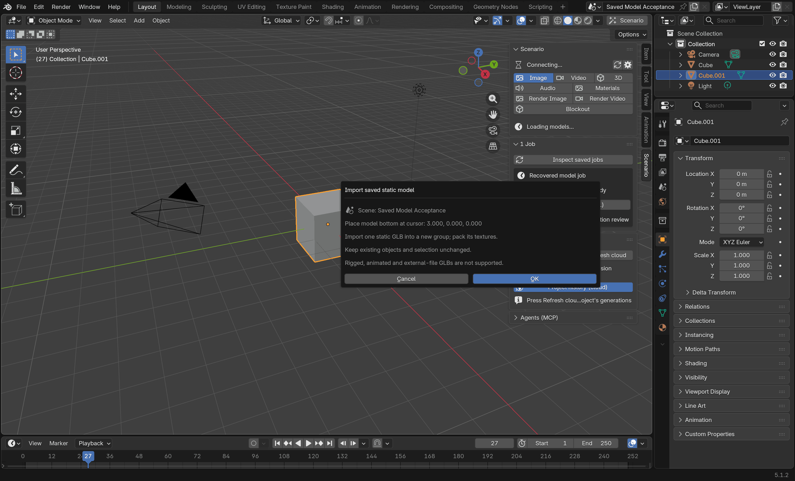

Offline desktop acceptance on macOS arm64 Blender 5.1.2 used the exact ZIP
`bac52e333078c09bc1581e5a530dac67a749d94c179b230a3d0ace7b2afb410f`. Mouse confirmation imported one textured
triangle hierarchy into one new group at cursor (3, 0, 0), without another mock
generation or request. Existing selection stayed intact. Viewport clicking,
front-view keyboard input and zoom worked after import. Blender exited cleanly
and the normal-profile fingerprint was unchanged. The test-only app copy used
a distinct bundle identifier and local ad-hoc signature for window targeting,
with vendor executable code and the extension ZIP unchanged. Synthetic tests
and desktop evidence do not establish paid provider acceptance, rig/animation or
in-place editing, other OS desktop behavior, release readiness or #263 resolution.

## Saved model package review

Each importable unit of a saved job gets one control from the shared
descriptors: **Import <format> model (N)** for the primary unit and
**Import alternate: <format> (N)** for the others, in classified order, with
GLB, glTF, FBX, OBJ or PLY as the format and N counting every saved file. Splat
units use their own labels (see [Saved splat review](#saved-splat-review)); an
unsupported model is not drawn. The 480 px review adds a **Selected**
line naming the saved files and whether they are the primary or an alternate
result (for example `Selected: OBJ + MTL + 1 map (alternate result)`), then the
cursor, the new group, packed textures and preserved selection. Format lines
follow: GLB and glTF keep scene FPS and the timeline, FBX packs embedded textures,
rejects external texture files and keeps the file's clip timing, OBJ leaves out
maps that were not saved, and PLY says a file without splat data imports as a
mesh. A last line says the files are checked again first. Every line stays within 66 characters, the longest line
the earlier 480 px desktop capture showed. Drawing only reads the prepared
values; cancel discards the approval.

Installed native tests on macOS arm64 Blender 5.1.2 check the labels drawn for a
job with a GLB alias and an OBJ package, the review lines, read-only drawing and
cancel. Physical desktop evidence of this dialog, its fit at other sizes and DPI,
and viewport interaction after a non-GLB import is pending.

## Saved splat review

SPZ and `.splat` units are drawn as **Import splats: SPZ (N)** or
**Import splats: .splat (N)** for the primary unit and
**Import alternate splats: <format> (N)** otherwise. A PLY keeps the model label,
because only its bytes decide between a mesh and splats. The same 480 px review
names the selected file and the cursor (**Place splats bottom at cursor** for SPZ
and `.splat`), says the import makes a new group with its own new material, and
for SPZ that versions other than 2 and 3 stop unchanged. SPZ, `.splat` and PLY
reviews then draw two dropdowns, **Points** (250,000, 500,000, 1,000,000 or
2,000,000) and **Saved axes** (**OpenGL: Y up** or **OpenCV: Y down**), and
three lines: splats show as coloured points because Blender has no splat
renderer, denser files are thinned evenly, and the default axes follow the file
format so the result should be checked upright. Invoke sets the dropdowns from
the prepared approval's defaults. Changing one calls `check()`, which exchanges
the approval for a new handle with the same scene, cursor and unit; a changed
destination shows an error line instead, and confirmation fails closed. A
refusal at confirmation, such as a busy local render, is reported with its
reason after **Model import was not started:**. Drawing only reads prepared
values, every line stays within 66 characters, and cancel discards the current
handle.

After an import, the job row adds status lines from the session summary:
**Shown as points: K of N splats** and, when an SPZ declares extensions,
**This SPZ declares extensions; check its axes**. They disappear when undo
history changes.

Installed native tests on macOS arm64 Blender 5.0.1, 5.1.2 and 5.2.1 check the
labels, the review lines and dropdowns, read-only drawing, option revision under a new handle, the
old handle's refusal, confirmation, the busy-slot refusal reason and cancel.
Physical desktop evidence of the dropdowns, the dialog fit at other sizes and
DPI, the post-import status lines, and viewport navigation after a
1,000,000-point import is pending.

## Environment lane

**Environment** is appended to the lane tabs, in the Audio / Materials row; a
saved blend stores a tab as its item index, so new tabs are only appended. Its
form starts with a segmented **Generate / From image / HDRI / Upscale** control
and a wrapped line describing the mode, then follows the usual order: Model,
Prompt (when the model has one), References, Settings, then Generate. The model
picker and dropdown list only the mode's verified panorama contract models; a
model left from another mode is not priced. GPT's size is a **Panorama size**
dropdown of its 2:1 presets instead of free width and height. Contract-forced
settings are drawn greyed, with **Greyed settings are fixed by the Environment
lane** below them. A result line never calls an LDR result HDR: **Result: LDR
2:1 panorama, saved until you set it as World** or **Result: HDR OpenEXR
environment, saved until you set it as World**.

An input that takes a 360 panorama offers **Saved panorama** in its header
instead of **Saved uploads**, and only **Upload** as a source, with **A saved
360 result or a 2:1 PNG/JPEG** below. Its references never offer **Use saved
upload**; a capture left on such an input shows a remedy instead of an upload
button. **Use saved panorama** lists the selected connection's downloaded LDR
360 results in a dialog; confirming attaches one and invalidates the price.
Still inputs (GPT references, HY World's image, upscale style images) keep the
ordinary image sources.

Saved-job controls label a server-declared 360 result **360 panorama (LDR)**,
**360 HDR environment (OpenEXR)** or **360 panorama and HDR environment**, keep
**Set panorama as World (N)**, and offer **Make HDRI (N)** on settled jobs with a
downloaded LDR panorama. Make HDRI only opens the HDRI form with that reference;
it never prices, generates or changes a World. A material map, such as a 3D
package's PBR maps or a texture set, is never a World candidate, a Make HDRI
source or a **Use saved panorama** choice. The floating composer shows an
**Environment** tab (**Env** when its full label does not fit) that drives the
Generate mode; choosing it selects that mode, and while the sidebar shows
another Environment mode the composer drives Image. As on every tab, its
**Settings** chip commits focused text to the original form before the dialog
opens, so a mode change there cannot retarget that text; a form that changed
under the text refuses to open and keeps both texts. Make HDRI and Reload
relist the target mode's models even when the scene already shows that mode,
because the list is shared by scenes. Reload attaches a panorama input's
recorded asset as a saved panorama only while the selected connection still
holds it as a downloaded LDR 360 result; any other asset ID is restored bare and
refused until a panorama is chosen again. A saved job's local files do not name
their input, so Reload never puts one on a panorama input; they fill only still
inputs such as Upscale's style images. Mode, size and model changes happen in
property callbacks or operators; drawing never writes. Contract values and the
recorded model choice that a catalog load fills in are stored without RNA
updates, like seeded schema defaults, so they keep captured origins current.

Installed tests on macOS arm64 Blender 5.1.2 cover the appended tab values
through a saved and reopened blend, mode model lists and price invalidation,
contract values, read-only drawing of every mode, picker restriction, Quick
settings, Reload, the composer tab, the panorama upload preflight, material
maps kept out of every Environment and World control, and a fake service quote,
submission, saved result, restart, Make HDRI and World approval in a newly
selected scene.

A physical desktop pass on macOS arm64 Blender 5.1.2 at UI scales 1 and 2 used
the exact packaged ZIP of this lane before it was rebased onto the World
candidate fix (#394), with free price quotes only. The tab, modes and mode lines
in the sidebar and Studio, the mode-restricted dropdown and picker, the Flux,
GPT and HDRI settings and result lines, the upscale factor cap message, World
application of saved PNG, OpenEXR and JPEG panoramas, Restore previous World,
reapplying after a Blender undo, Esc and viewport keys after each dialog, and
the controls at scale 2 behaved as described here. That pass also found material
maps offered as World panoramas; the rebased lane uses #394's World candidates,
which an installed test checks, but the fix was not rechecked physically. Nor
were the composer's label-sized tab row, a local file through **Upload
reference** or From image beyond its quote. No screenshot is committed.

## Saved panorama approval and restoration

**Set panorama as World (N)** prepares one PNG, JPEG or OpenEXR result and
identifies the selected scene and current World. A **Selected** line states the
saved media type's declared format, using the same wording as MCP `format`:
PNG or JPEG as LDR, or OpenEXR as float with ACES AP0 in ACES2065-1.
Invoke computes that text; drawing only displays it. Explain the
2:1/equirectangular requirement, packed image, preserved original World, LDR/HDR
distinction and session-local restore limit. The action's presence is a
media-type offer that excludes results declaring a texture role and images whose
file header, read for the current download receipt, declares a size that is not
2:1 within the World pixel limit. The job owner reads those headers on the
preview lane and keeps the sizes in memory; drawing never reads a file, a size or
the job store. A size not read yet, or a header that declares none, keeps the
button, so a late or inconclusive display read never hides a usable panorama: a
square image can show the button for a moment after its download. Byte
compatibility is still checked during application, never in drawing, and that
check remains the authority. Drawing reads the saved-job projection's candidate
list and numbers each button by the result's position among all results, like
the model import buttons such as **Import GLB model (N)**. Cancel discards the
prepared handle.

After completed application, **Restore previous World** uses a separate prepared
approval. It names the current scene/World and explains that edited owned data
prevents restoration. Do not silently clear edits, reapply the job or reset its
completed state after restoration. Reference [the user guide](USER_GUIDE.md#apply-a-saved-panorama-to-world)
for screenshots and [the World guide](WORLD_APPLICATION.md#saved-result-ui-and-mcp-approval)
for reuse and file-load restoration boundaries.

Offline desktop acceptance on macOS arm64 Blender 5.1.2 used exact ZIP
`c570617fdcc2e4ff5e5b424e08768843186a38a95eb6e58252cec6c471b262f1`.
Mouse approval applied a synthetic saved 2:1 PNG as one packed World; a separate
confirmation restored the original World and removed the restore action while
the job stayed applied. Mock submissions and request counts remained unchanged.
Viewport selection, front-view keyboard input and zoom worked afterward. Blender
exited cleanly and the normal-profile fingerprint was unchanged. The test-only
app copy used a distinct bundle identifier and local ad-hoc signature for window
targeting; vendor executable code and the extension ZIP were unchanged. This does
not establish actual HDR/seam quality, other OS desktop support, resolution of
#263 or release acceptance. That capture predates the **Selected** format line
and the JPEG and `image/aces` offers. Headless native tests cover their invoke,
draw and cancel handling, and every new dialog line stays within 59 characters,
the longest line verified in that capture. Desktop interaction with the new
wording is not yet recorded; that check is an open follow-up under #98.

## Saved material approval

**Apply saved material** names the scene, mesh, slot and saved texture roles.
Explain packing, replacement of that slot only, height-as-bump, retained AO/edge
nodes and the absence of a global undo entry. Preparation requires a local UV
mesh with one object user in one scene; drawing reads the prepared snapshot and
never opens files or changes assignments. Cancel discards its approval. A changed
mesh, slot or scene revision requires a new review rather than retargeting.

Offline desktop acceptance on macOS arm64 Blender 5.1.2 used exact ZIP
`b30a62ff2864507ad62dfd8eb743d3b17a17e7487bf1c94185072efcff405f67`,
which passes 607 full native tests on each of Blender 5.0.1, 5.1.2 and 5.2.1.
Mouse confirmation applied one synthetic saved albedo map as a packed material
to the approved mesh slot. The job became applied with mock submission/request
counts unchanged. Material preview, viewport and Outliner selection, front-view
and orbit keyboard input, zoom and material-property inspection worked afterward.
Blender exited cleanly and the normal-profile fingerprint was unchanged. The
test-only app copy used a distinct bundle identifier and local ad-hoc signature;
vendor executable code and extension ZIP were unchanged. The earlier attempt
could not access the window; it was not counted as interaction evidence.
This check does not establish live provider quality, other OS desktop support,
full Materials acceptance or resolution of #263. See the
[user guide](USER_GUIDE.md#materials) for the approval and result screenshots.

## Completed-result reuse approval

Completed shared jobs show **Reuse saved results** above the supported saved
application actions. Each native approval adds **Use saved results again; no new
generation.** while retaining its destination, selected assets and limitations.
Drawing uses the prepared snapshot only. Unfinished local claims suppress new
application actions; a known receipt failure offers persistence-only recovery.

Offline desktop acceptance on macOS arm64 Blender 5.1.2 used exact ZIP
`28d7dced697249cf9389ddbc0c7bb300d99faa66623c0ffc0caaf2303ba1e6eb`,
which passes 619 full native tests on each of Blender 5.0.1, 5.1.2 and 5.2.1.
An already imported synthetic albedo result was applied as a packed material to
the approved mesh slot through the visible reuse confirmation. The original job
stayed applied, its separate material application completed, and mocked request
and submission counts did not increase. Material preview, viewport and Outliner
selection, front-view keyboard input, zoom and material-property inspection
worked. Blender exited cleanly with the normal-profile fingerprint unchanged.
The test-only app copy had a distinct bundle identifier and local ad-hoc signature;
vendor executable code and extension ZIP were unchanged. See the
[user guide screenshots](USER_GUIDE.md#reuse-saved-results). This does not establish
live provider quality, other OS desktop support, resolution of #263 or release
acceptance. An earlier window-targeting attempt was not counted as interaction
proof.

## Saved image first-frame handoff

A saved job shows **Use as video first frame (N)** for each downloaded PNG,
JPEG or WebP colour result that the shared owner accepts; numbering counts every
saved asset, as for other per-asset controls. Normal, height and other texture
maps, EXR files and results that are not downloaded get no button, and the
button is hidden, never drawn disabled, while the job has other work pending.
The 520 px confirmation titled **Use as video first frame** names the scene,
the Render Video form, model, input and saved image. When the model can't use an
exact first frame with the scene clip, or has no first-frame input, two lines
under the input say so and that the image is sent as image 1 of that input, as
the form does under **First frame** once a frame is chosen. It states that the saved
Scenario asset is reused with nothing uploaded, no new generation and no file
path stored in the blend, and lists which chosen first-frame file it replaces
and whether it turns the first frame on only when they apply. It says the Render
Video and Prompt Spark prices become invalid and that removing the slot undoes
the change. **Use as first frame** confirms; Cancel discards the approval.
Refusals report their reason as a Blender error instead of opening the
dialog. Invoke computes every line; drawing only displays them.

The binding is asynchronous: confirming queues verification and shows
**Verifying the saved image for the Render Video first frame**. The form then
shows the slot, labelled with the image name and `(saved result)`, with its
Remove button and a read-only **From a saved result** line. There is no
thumbnail because no file path is kept. Do not switch the active lane from the
pump; the message names Render Video. Drawing that line reads only the slot's
provenance.

Installed tests on macOS arm64 Blender 5.1.2 cover the per-asset buttons drawn
through the shared descriptors without store reads, the exact dialog lines with
fixed lines within the 59 characters verified for a 520 px dialog, cancellation,
refusal reasons, single use of an MCP-prepared approval through the operator,
the provenance line and memfile Undo/Redo of the binding in the runner's window.
No desktop interaction, screenshot, focus, DPI or small-window evidence is
recorded yet, and the undo step recorded from the maintenance-pump timer is not
yet shown on Blender 5.0, 5.1 or 5.2; those checks remain #66 and #68 acceptance.

## Saved mesh edit review

**Apply mesh edit (N)** names the captured scene, source mesh and selected saved
GLB. The dialog shows the replacement policy, scene/local coordinate placement
and Keep original choice before confirmation. Explain geometry/UV/material
replacement, exact-topology UV/retexture restrictions, no automatic fitting, preserved
object context and the dependence of undo on Blender settings. Defaults keep an
original copy. Explain that history changes affect the scene only, not saved jobs
or spending.

Option changes use `check()`, outside drawing, and revise the existing captured
approval instead of selecting a new target. A stale target or scene requires
cancellation and fresh review. `draw()` only reads the prepared labels and
operator properties. Completed-result reviews retain the reuse notice.

Mirrored or zero-scale source transforms cannot use scene-coordinate mapping.
The native dialog opens with **Object local coordinates** and a visible
explanation for those sources. Review and confirmation remain explicit; choosing
the unsupported scene-coordinate option cannot start verification or application.
For **Apply to captured source**, inspect the retained source's transform before
choosing that default. A different selected object's transform must not affect it.

A captured-source follow-up on macOS arm64 Blender 5.1.2 uses ZIP SHA-256
`03074fe0f5ff70e360e392502a14064f36312dd463058866edeeee58077c541e`,
which passes 719 native tests on each supported Blender series. With another
positive-scale mesh selected, mouse input opens the mirrored captured mesh's
review with object-local coordinates and its explanation. Escape preserves both
meshes and the saved job; Return applies only to the captured mesh, retaining
its negative scale and Keep original copy. Native Edit > Undo/Redo restores the
source and copy without changing durable job state or request counts. Viewport
selection, front-view keyboard input and zoom work after the dialogs. The
synthetic transport makes no additional service requests or submissions during
review, application or history changes. The isolated run exits cleanly, removes
its profile and leaves the normal profile unchanged. Zero-scale and reversed
selection cases have native regression coverage; other OS desktop and live
provider acceptance remain separate.

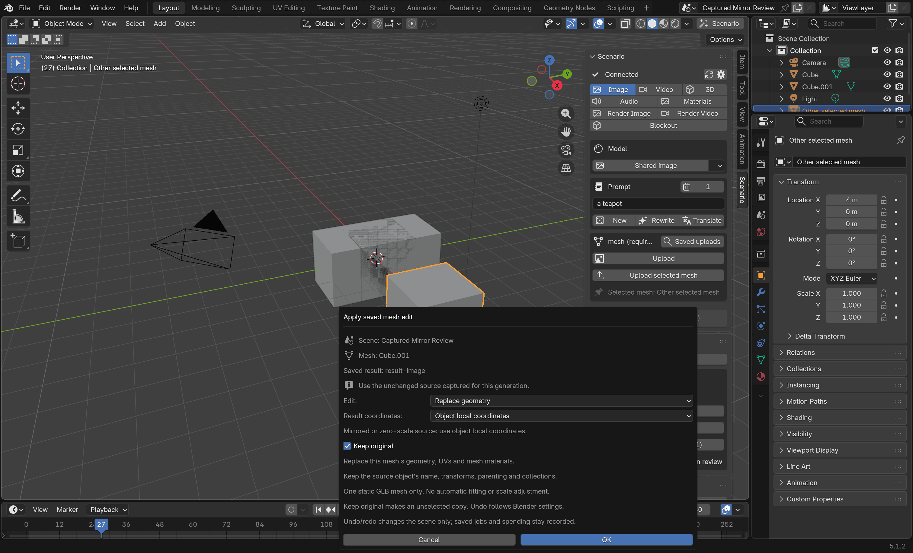

An isolated macOS arm64 Blender 5.1.2 desktop check used ZIP
`21edce46cf2c0e94095ba27668c2acef3b6b68968dc0dc0082921f1bd0760000`,
which passes 670 installed native tests on each of Blender 5.0.1, 5.1.2 and 5.2.1.
The mirrored-source dialog opened with local coordinates selected. Escape
cancelled; selecting scene coordinates showed rejection, and returning to local
coordinates allowed Return confirmation. Source scale remained negative, Keep
original retained a copy, and a second explicit reuse persisted `mesh_edit`
without more mock requests or submissions. Viewport selection, front-view input
and zoom worked. Blender exited cleanly with the normal profile unchanged.
The test app used a distinct local bundle identity with unchanged vendor
executable code. This synthetic check does not establish provider alignment,
other OS desktop behavior, global undo or release acceptance.

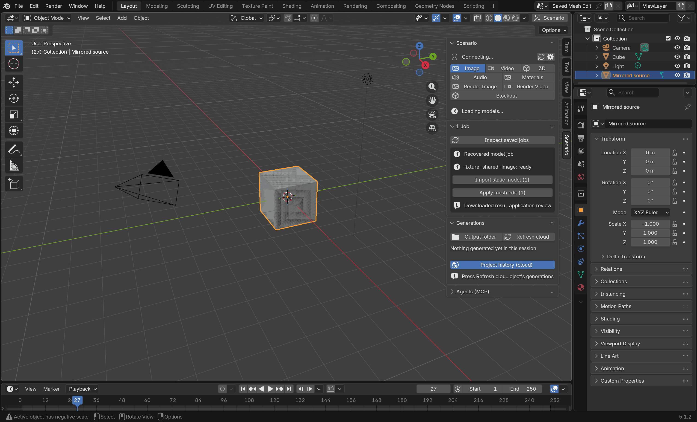

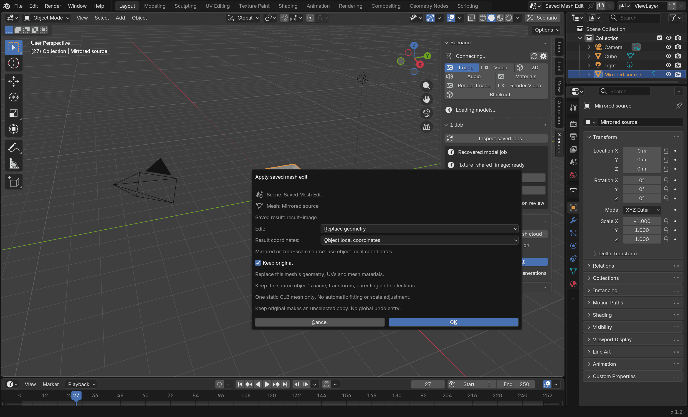

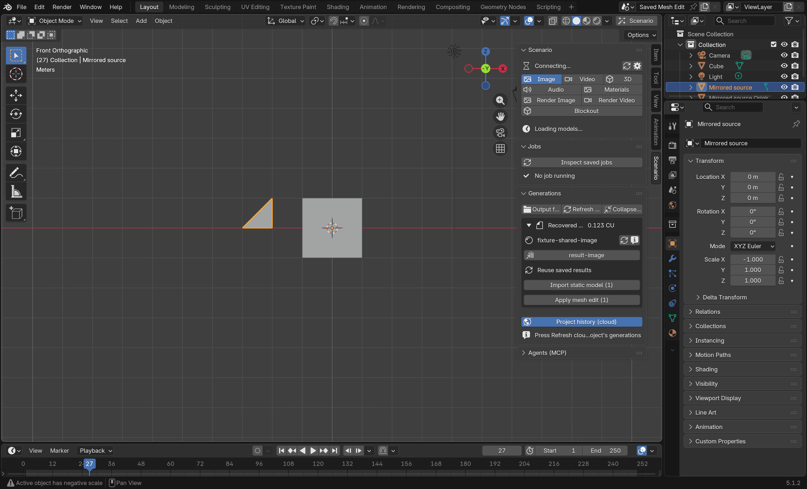

Offline desktop acceptance on macOS arm64 Blender 5.1.2 used final ZIP
`e1eed465de2c9376231e54a7e623f1391974f4102ba54f2845fddbec369dda38`,
which passes 659 full native tests each on Blender 5.0.1, 5.1.2 and 5.2.1.
Mouse input opened the explicit source review. Escape cancelled without applying;
viewport selection and front-view keyboard input then worked. A fresh review
named the selected source, and Return confirmed geometry replacement with Keep
original enabled. The source became the synthetic three-vertex result, its
original copy remained, and the durable job became applied without another mock
submission or request. The temporary message acknowledges approval rather than
continuing to describe verification after it has already finished.

The preceding desktop check used ZIP
`cc603cfa3c98e29430d5ea72c2c54a1ce6f7480324695c158d460f5f437e42f0`;
the only subsequent production change was that message text. It additionally
verified both policy and coordinate menus, Keep original toggling, cancellation,
viewport focus after application and explicit completed-result reuse confirmed
with Return. Reuse preserved the completed generation and recorded one separate
applied local claim without another mock request or submission.

Both isolated Blender processes exited cleanly and their normal-profile
fingerprints were unchanged. The test-only app copy had a distinct bundle ID and
local ad-hoc signature; vendor executable code and extension ZIP were unchanged.
The fixture freezes catalog loading and mocks service responses; its loading
labels are not live connection evidence. These checks do not establish provider
alignment, pre-generation source binding, remaining edit policies,
other OS desktop behavior, #263 resolution or release acceptance.

[Before application](images/saved-mesh-edit-before.png),
[approved replacement result](images/saved-mesh-edit-result.png).

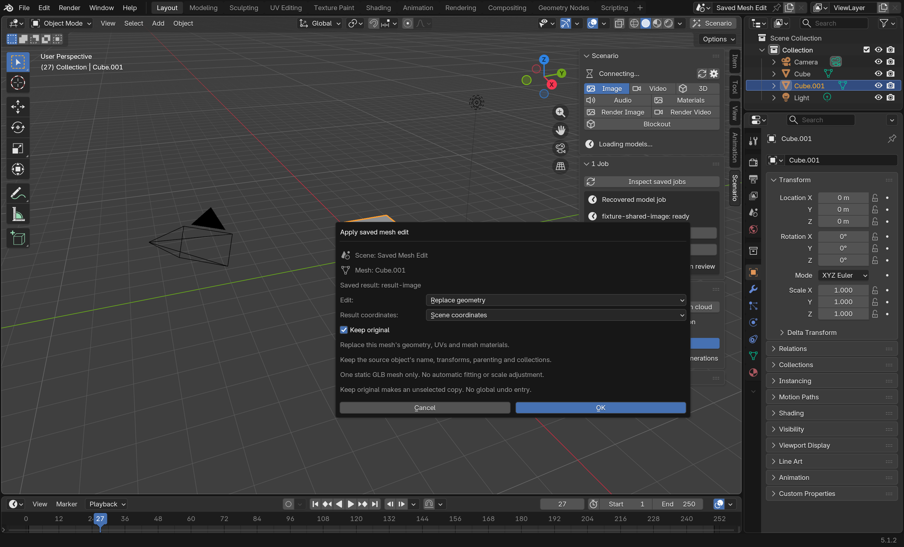

## Captured mesh source interaction evidence

The saved-job **Apply to captured source (N)** action opens the existing mesh
review with the original exported object, independently of active selection.
Its extra line identifies the unchanged captured source. **Apply mesh edit (N)**
keeps explicit current-destination review; both require confirmation.

On macOS arm64 Blender 5.1.2, an isolated installation of ZIP SHA-256
`f9f57e8efd3679bf8143713067e938eb4545d433ff5e27cc349a938a61fac976`
was exercised with synthetic transport and a real source export. With another
mesh active, mouse activation named `Cube.001` as the captured source. Escape
canceled without changing the saved ready record or either mesh; viewport focus
and numpad front view still worked. Reopening and confirming with Return replaced
the source's eight vertices with the saved three-vertex fixture, retained an
original copy, and left the other active mesh at eight vertices. The job became
applied with no additional mock submission, service request or download. The
normal Blender profile was unchanged and the isolated process exited cleanly.

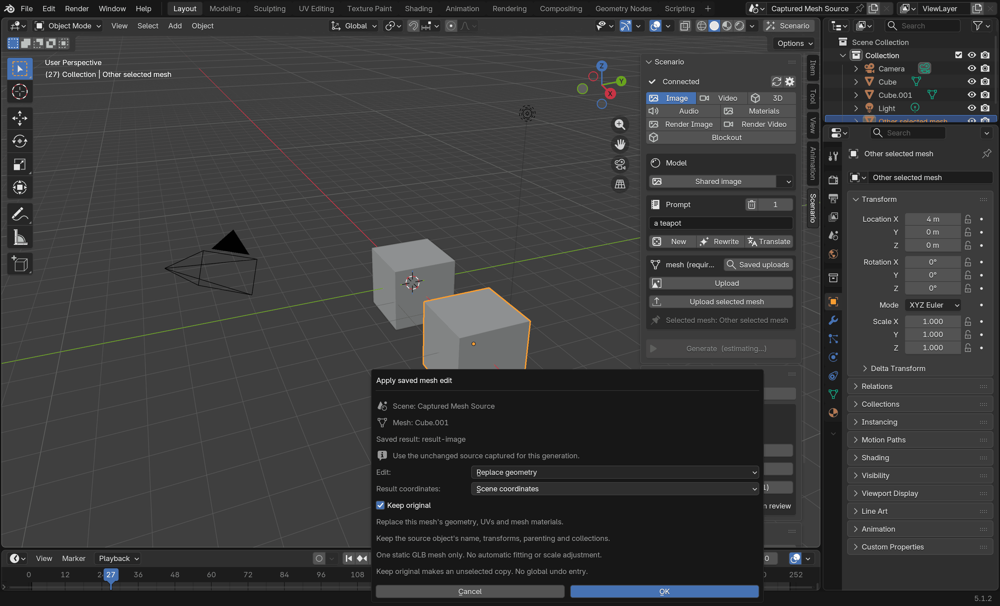

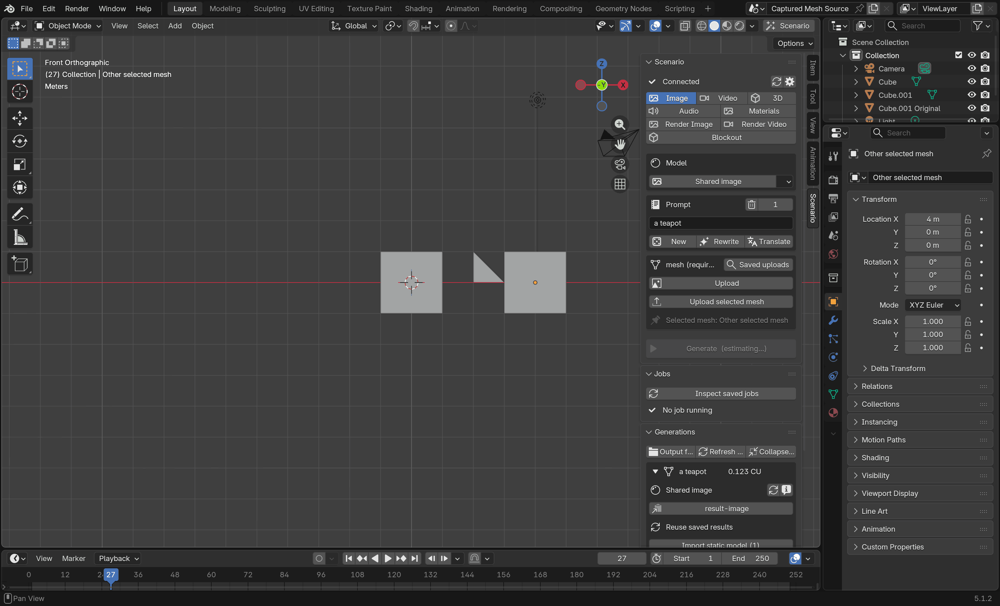

The same interaction was repeated with the integrated export/quote changes on
macOS arm64 Blender 5.1.2 using ZIP SHA-256
`a2254eb9ae5b24608eacf1e850dbbb95d9a1e4ff7b6b4b881bd4de2ef5e56610`.
Mouse activation again identified the exported source despite a different active
mesh. Escape preserved the ready job and both meshes; viewport focus and numpad
front view remained usable. Return applied the three-vertex result to the source,
kept its original copy and left the other mesh at eight vertices. Mock request,
submission and download counts stayed unchanged through application; a socket
guard recorded no network attempts. Installed bytes were verified before and
after the run, the normal profile was unchanged, and the process exited cleanly.
The images above remain captures from the earlier named artifact.

This proves the local source-selection, cancellation and confirmation interaction.
The synthetic form's pending estimate is not live pricing evidence. It does not
establish provider alignment, other OS desktop behavior, #263 resolution, remaining
edit policies or release acceptance. See
[the source contract](MESH_APPLICATION.md#applying-to-the-captured-mesh-source).

## Retexture review

The mesh review's **Replace textures** choice preserves geometry and adopts all
result UV layers and mesh material assignments. Its two explanation lines name
that replacement and require exactly matching indexed topology and positions.
Keep original and coordinate placement remain explicit, and drawing stays read-only.
Both current-destination and captured-source review use this policy.

Offline interaction on macOS arm64 Blender 5.1.2 used exact ZIP
`53587fc3756f6eb9acaa40df066b0fc8dc80defb5a009059ec3148f5ecf54b61`,
which passed 683 installed tests on each of Blender 5.0.1, 5.1.2 and 5.2.1.
Mouse selection exposed the new policy and its geometry-preservation explanation.
Escape canceled without changing materials, geometry or local claims. A fresh
review selected the policy using the native menu and keyboard; Return applied
it with Keep original enabled. Vertex positions stayed identical, the saved
material replaced the fixture's blue material, and one separate local claim
became applied while the completed generation stayed applied. Mock submissions
and requests remained unchanged. Viewport click, front-view and orbit keys,
Outliner selection and zoom worked. The isolated process exited cleanly and the
normal profile was unchanged. The test-only application identifier/signature
changed for window targeting; executable code and extension ZIP were unchanged.

The fixture uses synthetic transport and pauses catalog loading. These images
are local interaction evidence, not live pricing or provider appearance quality.
Provider indexing/alignment, other OS desktop behavior, #263 and
full release acceptance remain unverified.

[Before retexture](images/saved-retexture-before.png),
[applied retexture with original retained](images/saved-retexture-result.png).

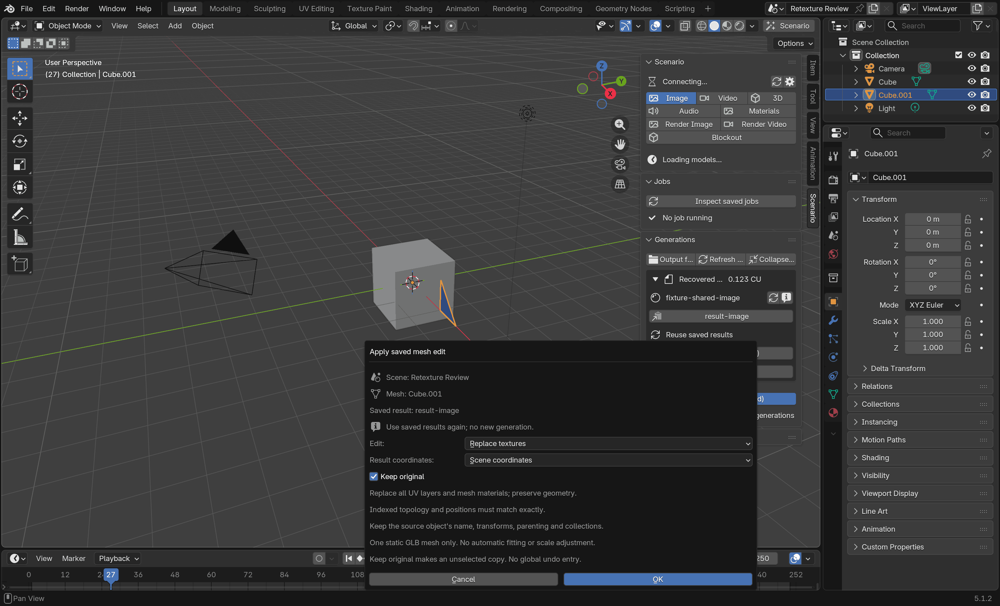

## Saved mesh undo interaction

The approval dialog explains that Keep original retains an unselected copy,
Blender settings control undo, and history changes leave jobs and spending
recorded. The shared command uses native history for all three mesh policies;
see [the contract](MESH_APPLICATION.md#native-undo-for-saved-mesh-edits).

An isolated macOS arm64 Blender 5.1.2 desktop check used exact ZIP SHA-256
`0d0a8da1ff9667e2bf7ea289f4e73ec01183ecb0268bddc81d50305b8308c862`.
The same ZIP passed 688 installed tests on each of Blender 5.0.1, 5.1.2 and 5.2.1.
Mouse input opened captured-source review while another mesh was selected, and
Return confirmed. The source changed from eight to three vertices with its
original copy retained; the other mesh stayed at eight vertices. Edit > Undo
restored the eight-vertex source and removed the copy. Edit > Redo restored the
three-vertex result and its copy. The saved job stayed applied and mock submission
and request counts stayed unchanged throughout. Viewport zoom and front-view
keyboard input worked after Redo. The isolated process exited cleanly and the
normal profile fingerprint was unchanged.

This is synthetic local interaction evidence, not live pricing/provider output,
other OS desktop acceptance, resolution of #263 or complete release acceptance.
The fixture pauses catalog loading. Its test-only application identifier and
signature differ for window targeting; executable code and extension ZIP do not.

After review, ZIP `3f36db535d94416bdf351b086a1356ea1993fb1d4c482c1d7759275a32e0e072`
passed 689 installed tests on all three versions. A fresh isolated 5.1.2 desktop
run repeated approval, menu Undo/Redo and viewport input. Public job status
remained readable throughout; `mesh_edit` became null on Undo and remained null
after Redo instead of following recreated objects by name. Geometry and original
copy restoration still worked, with unchanged durable job and mock request
counts. The process exited cleanly and the normal profile was unchanged. The
screenshots below show the preceding identical UI; the follow-up changes only
transient status ownership and adds a failed-import history regression.
A final receipt-recovery guard keeps that status retired even when saving a
pending success receipt after Undo; it changes no native UI or scene application.
Its exact ZIP and full matrix validation are recorded in the PR.

[Undo restores the source](images/saved-mesh-undone.png),
[Redo restores the edit](images/saved-mesh-redone.png).

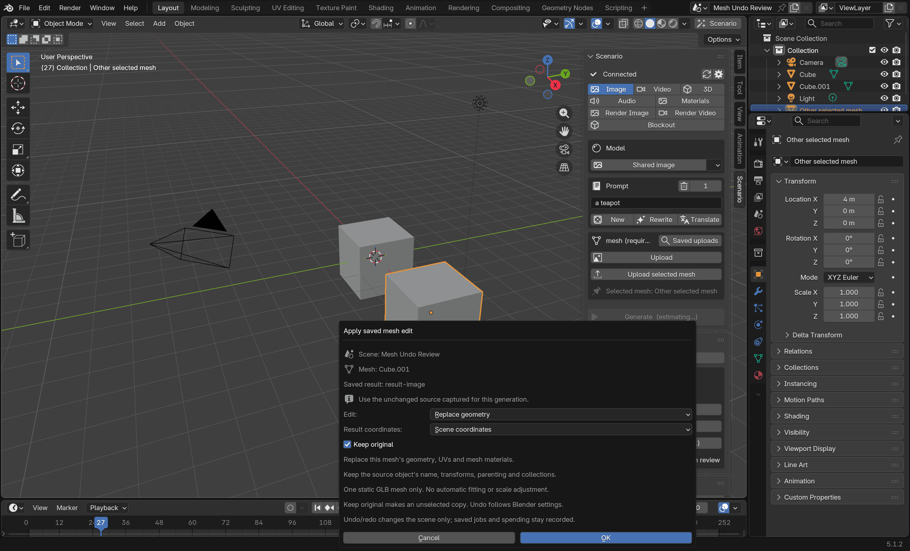

## Parts application interaction

The saved-mesh review offers **Replace with parts** as an explicit policy. Its
read-only explanation identifies the source, empty mesh parent, named children,
2-to-128 part limit, unchanged source context and Keep original behavior. It
states that every mesh in the chosen GLB is treated as a part. It does not infer
variants or automatically fit the result. The shared UI/MCP command applies the
[parts contract](MESH_APPLICATION.md#apply-static-parts).

An isolated macOS arm64 Blender 5.1.2 desktop run installed the exact ZIP with
SHA-256 `ad88e5b70dcf879d182a4805415dcb0ecab114d32a7287e711b84923f6f86be7`.
Native clicks and keyboard input selected the policy, cancelled without mutation,
then confirmed application to the captured source while another mesh remained
selected. The source became an empty mesh parent with two named triangle parts;
Keep original retained its eight-vertex copy and the other mesh kept eight
vertices. Edit > Undo restored the eight-vertex source and removed the parts and
copy. Edit > Redo restored both children and the copy. The public job stayed
applied, transient mesh status retired on undo, and mock submission/request
counts did not change. Viewport zoom/front-view input and Outliner expansion
remained usable. The owned test process exited cleanly and the normal profile
was unchanged.

Transport and result geometry were synthetic; the frozen model/estimate labels
in the screenshots are fixture state, not live provider or estimate performance
evidence. This proves the scoped local interaction, not provider alignment,
other-platform desktop behavior or integrated release acceptance.

[Applied parts and preserved selection](images/saved-mesh-parts-applied.png).

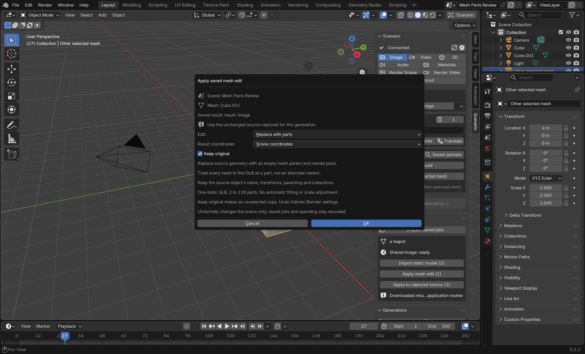

The error-message update's ZIP
`b5e207c2bd571e89e31e45e1dce24a43fd341ba1f23766bc2792e4be6445eb9c`
passed 700 installed tests on each supported Blender version on macOS arm64.
In an isolated 5.1.2 desktop check, confirming single-mesh replacement with a
two-mesh fixture failed without changing either source or selection. **Job needs
review** opened the full message identifying the saved GLB, source and edit policy.
Escape closed it and front-view keyboard input worked in the viewport. Mock
submissions, requests and downloads stayed unchanged, with no network attempts.
The process exited cleanly, its profile was removed and the normal profile was
unchanged. Earlier screenshots retain their original artifact provenance.

## Animated model import interaction

The shared saved-result button was **Import model** in this capture; it is now
named by format, as in [Saved model package review](#saved-model-package-review).
Its review names the scene
and cursor and explains a new group, packed textures, preserved selection,
retained rigs/clips and unchanged timeline. Drawing remains read-only. The
[import contract](MESH_APPLICATION.md#rigged-and-animated-model-import) describes
clip timing, staging isolation and the separate in-place transfer boundary.

The exact ZIP with SHA-256
`ee5dc51cd853739685458c589975aca6acf326c460dd9e12eefecb4e74ec0adf`
passed 705 installed native tests on macOS arm64 Blender 5.0.1, 5.1.2 and 5.2.1.
An isolated 5.1.2 desktop check opened the review, cancelled without importing,
then confirmed a new character with two bones and two clips. The original cube
remained active. Native viewport zoom/front-view input and Outliner expansion
worked. Clicking frame 30 on the timeline animated the rig and skinned/morphed
triangle from its frame-zero state; evaluated vertices moved two units in X and
one unit through the morph. FPS stayed 30 and the range stayed 1 through 90.
The saved job stayed applied and mock submission/request counts stayed unchanged.
The completed test exited cleanly with the normal profile fingerprint unchanged.

Transport and geometry were synthetic. Frozen catalog/estimate labels in these
screenshots are fixture state, not live performance evidence. This scoped check
does not establish provider rig compatibility, in-place retargeting, other OS
desktop acceptance or integrated release acceptance. An earlier interrupted test
exit crashed in the fixture's temporary-preference cleanup during Python
finalization; the completed repeat used explicit fixture cleanup before quitting.

[Frame zero](images/saved-model-animation-start.png),
[frame thirty](images/saved-model-animation-end.png).

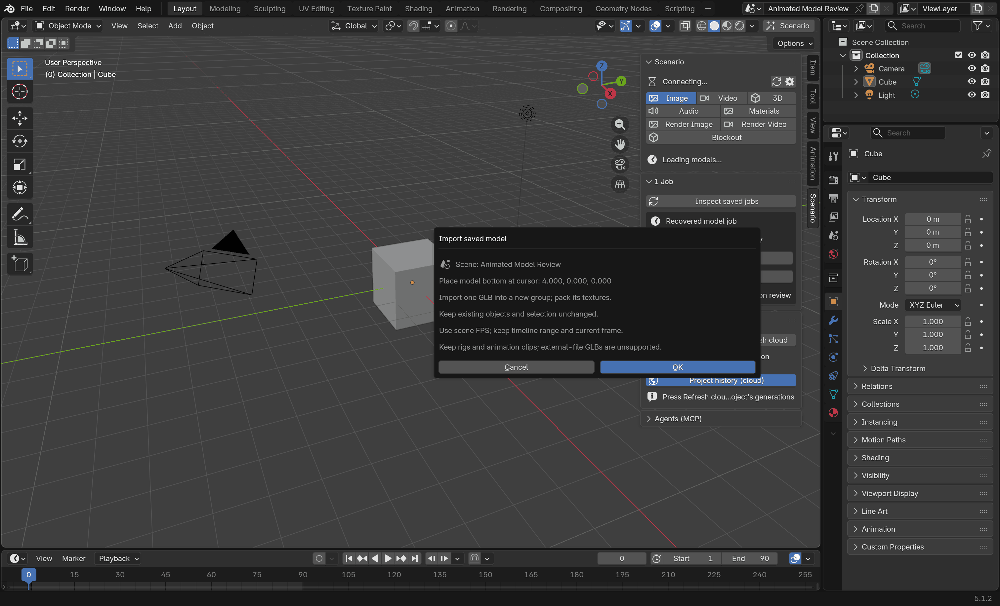

## Rig attachment interaction

The saved-mesh review offers **Attach rig**. It names the captured source and
explains matching geometry, retained source UVs/materials, bone weights and clips,
Keep original and native undo. It also explains that the source and new rig group
must move together afterward. Drawing stays read-only; the shared UI/MCP command
implements the [skin attachment contract](MESH_APPLICATION.md#attach-a-returned-rig).

The final ZIP with SHA-256
`43d303619c6eb4d0ebf9e6bad2dd40f210f4cce0890587a8bade647326264a2b`
passed 715 installed tests each on macOS arm64 Blender 5.0.1, 5.1.2 and 5.2.1.
Isolated 5.1.2 desktop input selected Attach rig, cancelled without mutation and
confirmed against the captured triangle while another mesh stayed selected.
The source retained its geometry, gained two bone groups and an armature modifier,
and Keep original retained an unselected copy. Native Edit > Undo removed the
rig, groups and copy; Redo restored them. The saved job stayed applied and its
transient mesh status retired on undo. Mock submission/request counts stayed
unchanged. Viewport zoom/front-view input and Outliner expansion worked; clicking
frame 30 moved the skinned source two units in X while the original stayed still.
The completed repeat exited through explicit fixture cleanup and verified that
the normal profile remained unchanged.

Transport and geometry were synthetic. Frozen catalog, estimate and price labels
are fixture state, not live pricing or performance evidence. This check does not
establish provider compatibility, existing-rig retargeting, other OS desktop
acceptance or integrated release acceptance. An earlier interrupted exit crashed
in the fixture's temporary-preference cleanup during Python finalization; its
interaction observations were repeated before a clean exit.

The screenshots and cancellation/selection sequence used the preceding ZIP
`8623714355635f3d3f2a36539992161547add46ed462910086f4f33e71c91fd5`.
The final ZIP differs only by formatting in one Python member (identical AST);
attachment, native undo/redo and frame-30 deformation were repeated on that final
ZIP, followed by a clean exit and unchanged normal-profile fingerprint.

[Animated source, original copy and preserved selection](images/saved-mesh-rig-animated.png).

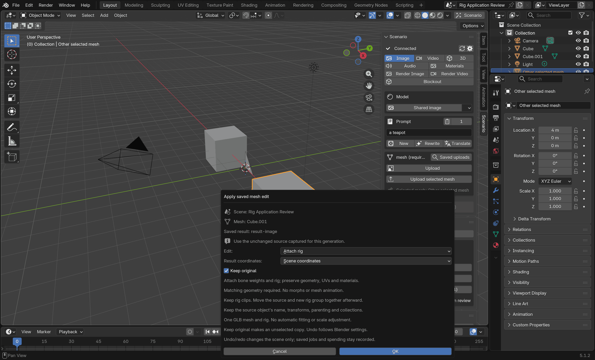

## World restoration across scenes

Reusing a panorama in another scene preserves the earlier scene's
**Restore previous World** action. Each review still identifies the selected
scene and its current World; restoration changes only that scene. The
[World contract](WORLD_APPLICATION.md#saved-result-ui-and-mcp-approval) describes
identity, ownership checks and session limits.

An isolated macOS arm64 Blender 5.1.2 desktop check used exact ZIP
`8676574595eb6fcc21cee719467184bc87c6d3f73a9986741edc643749f2e9dc`,
which passed 692 installed native tests on each of Blender 5.0.1, 5.1.2 and 5.2.1.
The synthetic fixture applied one saved panorama to two scenes. Native input
opened the first restoration review and cancelled without mutation; a fresh
confirmation restored its original World while preserving the second panorama.
The native scene selector switched to the second destination; its separate
review restored that scene's original World. Viewport focus and front-view
keyboard input worked afterward. The saved generation and local claim stayed
applied, and mock submission/request/download counts did not change. The
process exited cleanly, with no network attempts and an unchanged normal profile.
This is synthetic local restoration proof, not live panorama quality, other-OS
desktop or integrated release acceptance. Catalog loading text is fixture state.

A subsequent lifecycle correction was checked with exact ZIP
`24c7731dc6f339d55f826dfd27e68f0b90052b2c987fe9572431d5dbe6c353ca`:
694 installed native tests passed on each of the same three Blender versions.
The scene identity survives the render-thread origin revision reset; Undo/Redo
still retires live ownership, and deleted or retired destinations no longer
offer restoration. Regression tests invoke the actual render-thread and history
callbacks, verify rejection of stale approvals and prune expired handles.
They do not establish physical desktop Undo/Redo behavior.
The isolated 5.1.2 desktop flow above was repeated after the fixture invoked
the render-thread callback: cancel, independent confirmations, native scene
selection and viewport keyboard input all worked. Both original Worlds were
restored with unchanged applied records and mock counts, no network attempts,
clean exit and an unchanged normal profile. The screenshots below retain the
earlier artifact's provenance.

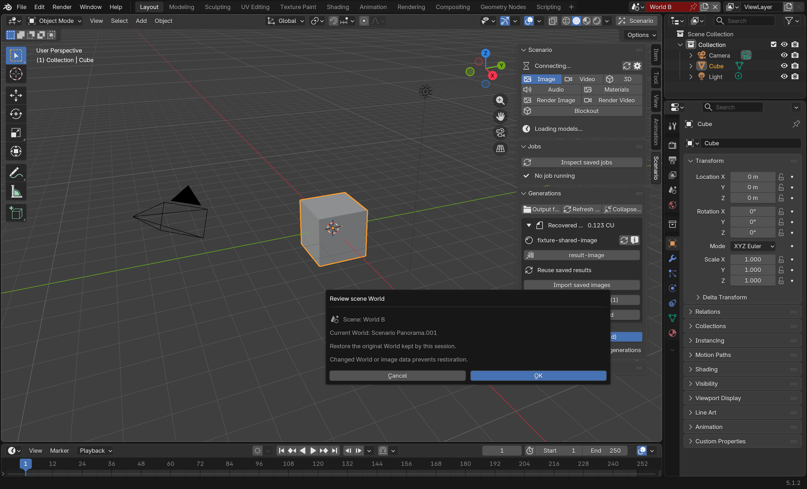

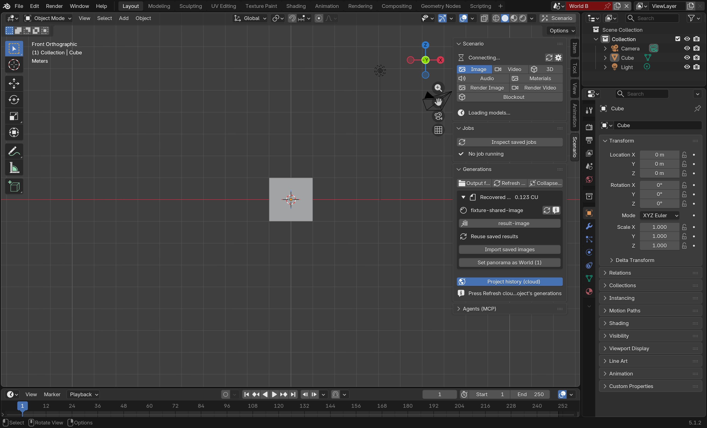

## Blockout plan approval interaction

Blockout uses **Get design price**, then **Generate plan (cost)**. Refine has its
own quote. A completed plan exposes **Build plan**; generation itself leaves
geometry unchanged. Clear opens a confirmation dialog. Drawing is read-only.

The exact ZIP with SHA-256
`44edc43008d64f1e2836c95c0cb526f5c727a4278f6468676d4d7ef71b8fc47e`
passed 732 installed native tests each on macOS arm64 Blender 5.0.1, 5.1.2 and
5.2.1. An isolated 5.1.2 desktop check edited the prompt with native input,
requested a quote with zero submissions, approved once, and received a plan
without changing geometry. Build created the grouped tower while the existing
cube remained selected. Native Edit > Undo removed the tower and restored the
earlier empty plan; Redo restored both. Cancelling Clear preserved the result.
Viewport zoom and front-view input remained available. The single mock submission
and eight total mock requests did not increase during local operations.
The test exited cleanly and verified the normal profile fingerprint unchanged.

The transport and tower were synthetic; the frozen Connecting label is fixture
state, not service performance evidence. The initial fixture failed while waiting
for the sidebar region and exited without profile changes; the completed repeat
waited for that region. Native runs retain a small Blender shutdown allocation
diagnostic. Live provider compatibility, other OS desktop behavior and explicit
recovered-plan import into a new scene are not established by these checks.

[Before quote approval](images/blockout-plan-approval.png).

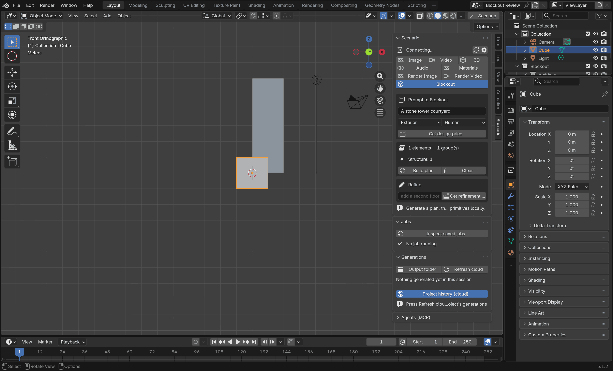

The refinement-instruction follow-up uses ZIP SHA-256
`5c66b30ebe403ab46658fa556fa906fd49dcd2a48816d7867f18c5ab83a27c42`,
with 732 installed tests passing on each of the same three Blender versions.
It replaces mixed design/refinement wording with the explicit complete-plan
update instruction. The desktop interaction and screenshots above use the
preceding ZIP; no new UI behavior or live provider acceptance is claimed here.

## Saved Blockout plan recovery

Saved jobs expose **Read saved Blockout plan**, followed by **Use saved Blockout
plan** after complete text validation. The confirmation names the scene and
element/group counts, warns before replacing an existing plan and explains that
geometry remains unchanged until a separate Build plan action. Cancellation
discards the review. Drawing does not read the service or mutate the plan.

The exact package with SHA-256
`9b9bb818f0ec81e0af4ed95ba6d70390d17e12af72c24b5040d6814316b31ed2`
passes 740 installed tests on each macOS arm64 Blender 5.0.1, 5.1.2 and 5.2.1.
These cover native operator execution, MCP parity, restart with and without a
saved manifest, discarded/single-use reviews, changed fields and scene
replacement, retired contexts, offline reads and malformed text. Saved-job
drawing skips invalid scene references, and status reports a deleted scene
without rebinding a same-name replacement.

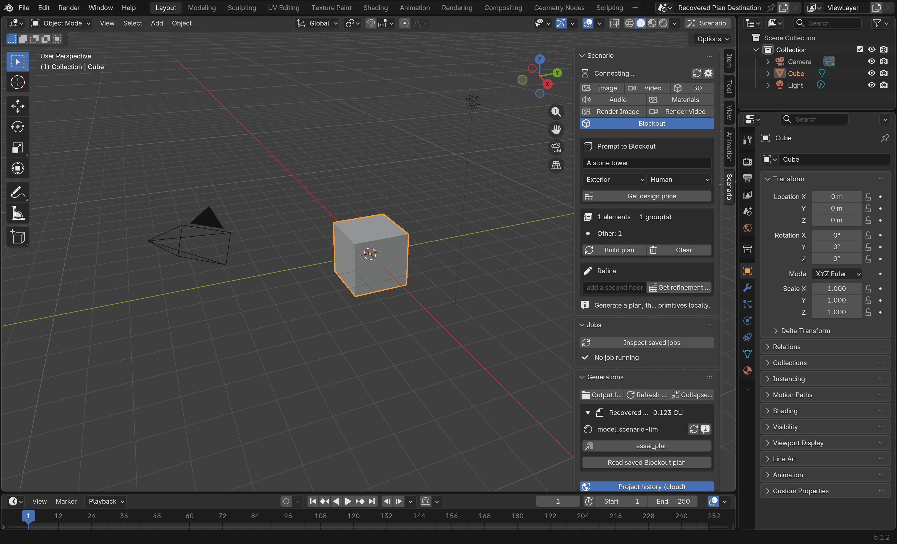

Desktop interaction with the same ZIP passes on macOS arm64 Blender 5.1.2 in an
isolated profile, using a synthetic saved job and blocked external networking:

- **Read saved Blockout plan**, then **Use saved Blockout plan**, opens the
  destination/count/replacement dialog. Escape cancels and discards the review
  while preserving the previous stored plan and all geometry.
- After a fresh read, Return confirms the dialog and replaces only the stored
  plan. Blender's **Edit > Undo** restores the previous plan; **Edit > Redo**
  reapplies the recovered plan. Geometry stays unchanged throughout.
- A viewport click selects the existing cube, and Home frames the scene,
  confirming viewport focus and keyboard navigation after the dialog.
- A separate **Build plan** click creates the recovered tower and preserves the
  existing cube, light and camera. Approval, Undo/Redo, viewport interaction and
  building issue no further service requests or submissions.

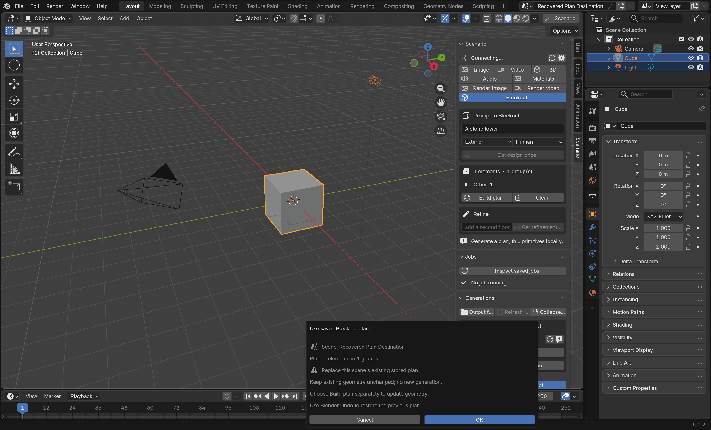

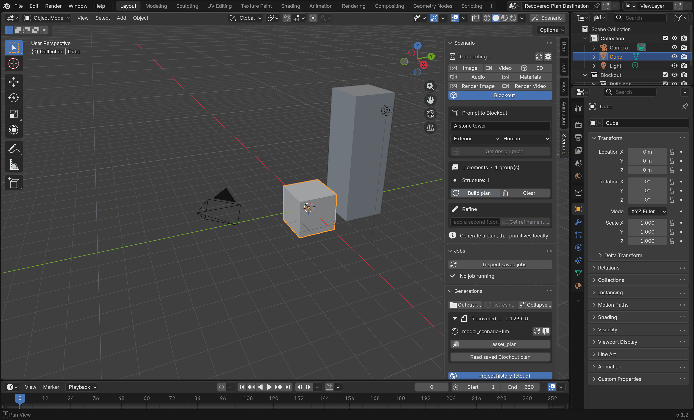

The test app uses the vendor Blender binary and the unchanged extension ZIP;
the harness removes its disposable profile after the interaction. The normal
profile remained unchanged. Transport and plan contents are synthetic, with no
live generation. This proves the scoped recovery interaction at the tested
window size, not other OS/DPI combinations, live provider behavior or integrated
release acceptance.

The recovery review fixes were retested with ZIP SHA-256
`b0bc4c291aa5d910beb53d34974526c74e5971d3462b326006cb521c697faeec`:
746 installed tests pass on each macOS arm64 Blender 5.0.1, 5.1.2 and 5.2.1.
These add deleted-destination review cleanup, pending-read drainage, finished
action reclamation without retiring uncertain jobs, and guided invalid-plan
refinement errors before any quote request. Desktop checks on Blender 5.1.2
repeat Escape cancellation, Return confirmation, stored-plan Undo/Redo and
separate Build; viewport front-view and zoom input work afterward. The synthetic
fixture establishes an Undo checkpoint after preparing its starting scene.
Local approval, Undo/Redo and Build add no service request or submission; both
disposable runs exit cleanly with the normal profile unchanged. The screenshots
above retain their original artifact provenance. These checks do not establish
live provider or integrated release acceptance.

## Cloud history recovery controls

A cloud row matched to the current scoped job store offers **Inspect saved jobs**
instead of **Download and open**. Its saved-job controls retain the explicit
download and destination-approval steps. Drawing uses the saved-ID snapshot from
explicit history reads plus live shared-job views, without database I/O, session
activation, service requests or scene/job changes. Import commands independently
recheck current storage. A changed credential selection hides the old row actions
until refresh; a failed saved read disables those actions until a successful read.

Each row's price adds the job's documented add-on charges to its main charge.
A workflow run has its own row with the node-tree icon and the sum of its step
charges; when a step cannot be read, it shows **Cost unavailable** rather than
0 CU. Its steps keep their rows with a linked note that they are included in
the run's total once it is known, which stays true while the run is running or
its cost is unavailable. A row whose own charge is malformed also shows
**Cost unavailable**, while the other rows still load. Workflow rows offer no
**Save for recovery**; their model steps do. Step reads happen on the history
worker, never while drawing.

The exact ZIP with SHA-256
`30b0e2c03268e81a64ad83d0cc2924be9d0afaac8d7aebf9a80b3aafc9349b2c`
passes 749 installed tests on each macOS arm64 Blender 5.0.1, 5.1.2 and 5.2.1.
Regressions cover native operator execution, read-only draw routing, stale-page
acknowledgement, old-cache collisions, missing storage, restart and credential
changes, including rejecting MCP import with incomplete credentials. These are
synthetic installed tests.

Desktop input with the same ZIP passes on macOS arm64 Blender 5.1.2 in an isolated
profile. The fixture preloads a synthetic cloud page, a matching scoped saved
job and a colliding old cache entry. Clicking **Project history (cloud)** shows
**Inspect saved jobs** on the matching row. Clicking it opens the shared recovery
controls with a separate **Resume download** action. It does not import the old
file or change the saved record, scene objects or images. The request count stays
unchanged, and neither legacy import dispatch nor job tracking runs.

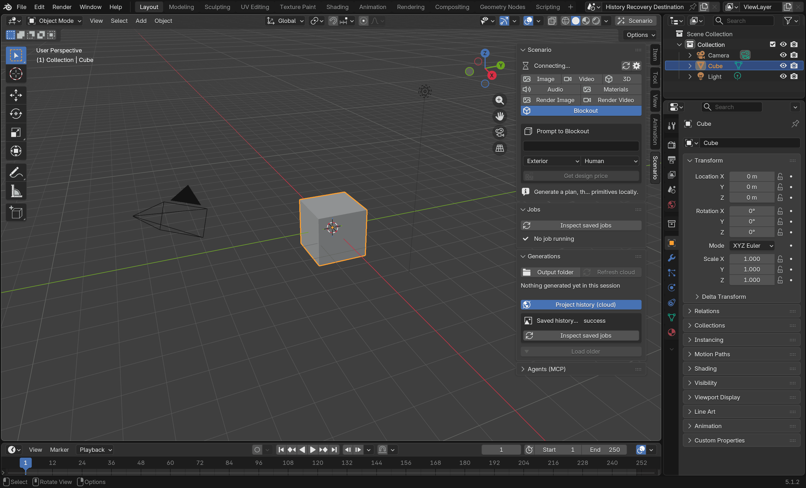

A viewport click selects the light, and Home frames the scene, confirming focus
and keyboard navigation after inspection. The harness closes the test and removes
its disposable profile; the normal profile remains unchanged. External networking
is blocked. This proves the scoped row-to-recovery interaction, not a live cloud
refresh, download/import completion, arbitrary cloud-job adoption, other OS/DPI
combinations or integrated release acceptance.

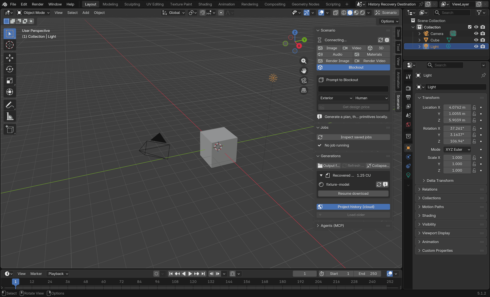

The redraw fix uses ZIP SHA-256
`27ebeece6da712d7b6fd50a8047736df8351e501679b1a4ad1503b62f82e7ac5`.
All 751 installed tests pass on each of the same three Blender versions.
Regressions reject database reads during 30 consecutive panel draws, retain
saved-job routing for late shared-view acknowledgements, and verify storage
failure/retry and credential-change invalidation. The existing screenshots and
desktop interaction evidence above belong to the preceding ZIP; desktop input
on the changed artifact remains unverified.

## Completed cloud job recovery controls

A successful cloud row without a scoped record offers **Save for recovery**.
The metadata read is available in Edit, Sculpt and Pose modes as well as Object
mode, subject to the same online-access and credential checks. Switching scenes
while it runs does not discard the saved record or authorize scene application.
Admission errors show their actionable reason, such as a different model read
already pending for that job; unexpected failures keep a generic sanitized message.
While its shared worker reads the job, the disabled label is **Reading cloud
job...**. Success exposes **Inspect saved jobs** and a paused recovery record;
download and destination approval remain separate. A sanitized read error allows
an explicit retry. Legacy cache rows and files cannot substitute their old
actions or hide this control. Drawing only inspects the current store/facade.
Saved recovery rows keep their place when prototype jobs report progress or the
application pump runs again. A shared row takes precedence over a legacy row
with the same local ID. The prototype's 50-row limit does not trim saved recovery
rows. These are display rules; they do not delete stored jobs or resume work.

The exact ZIP with SHA-256
`e572909c23aae8ddd027aa48e489f338eb34dd35b2eacdaf35cbb9a7c57f11ec`
passes 760 installed tests on each macOS arm64 Blender 5.0.1, 5.1.2 and 5.2.1.
Native desktop interaction with that same ZIP passes on macOS arm64 Blender
5.1.2 in a disposable profile. The fixture preloads one synthetic cloud row and
uses the real installed SDK adapter with a GET-only mock transport; external
Python network connections are blocked.

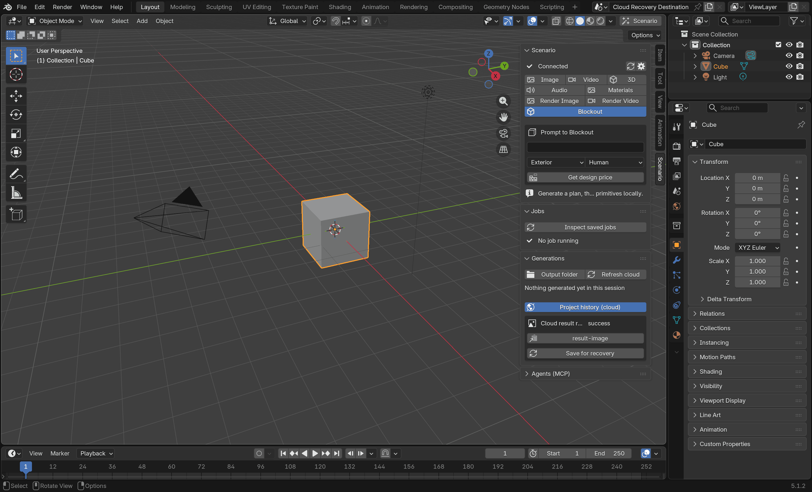

Clicking **Save for recovery** starts one job read and disables the pending
control. Pressing N closes the sidebar while that read is held by the fixture.
Releasing the synthetic response delivers one paused cloud record with the
sidebar still closed. Reopening it shows **Resume download**. Repeated
**Inspect saved jobs** does not alter the record or issue another request.
The scene's objects and images remain unchanged, with zero downloads or paid
submissions. A subsequent viewport click selects the light, and Home frames
the scene, confirming mouse focus and keyboard navigation after recovery.

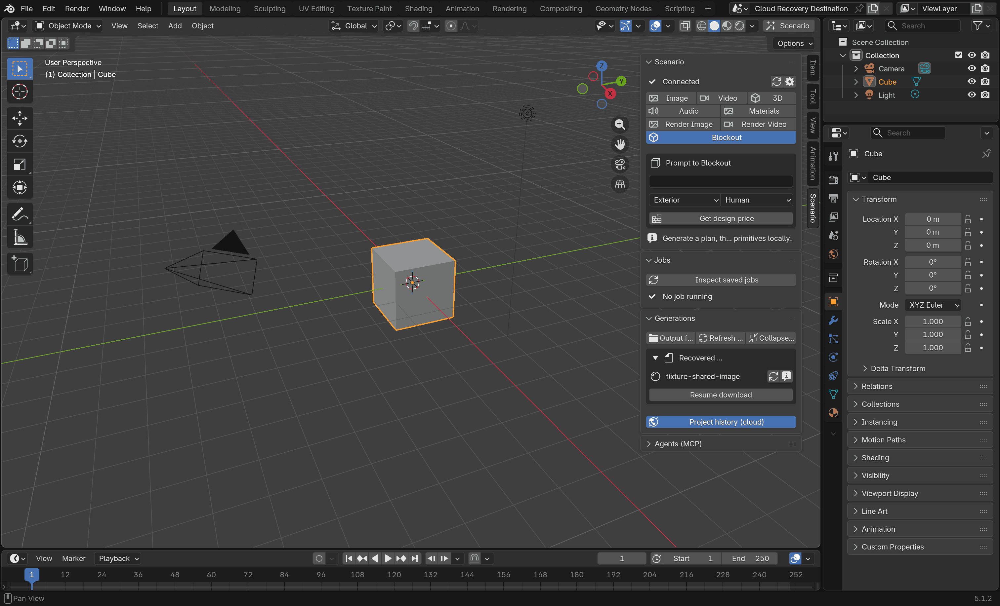

A separate run exercised a sanitized read rejection after selection changed
while the read was pending; explicit retry saved one paused record without a
submission or download. Both completed runs exit through harness cleanup, remove
their disposable profiles and leave the normal profile unchanged. The isolated
application has a test-only identifier to distinguish its window; the extension
ZIP is unchanged. These checks establish native recovery controls with synthetic
responses, not live cloud history, provider latency, completed result application,
other OS/DPI combinations or integrated release acceptance.

Scene-independent metadata delivery has separate native input proof on macOS
arm64 Blender 5.1.2, using exact ZIP SHA-256
`38f0a51edea77643f4988c737090e759b578c4b1844cdfd25f4ec43c3f3183d6`.
That ZIP passes 822 installed tests on each Blender 5.0.1, 5.1.2 and 5.2.1.
With external network connections blocked and a GET-only SDK fixture, clicking
**Save for recovery** in Edit Mode starts one metadata read. While it is held,
Tab exits Edit Mode, the scene selector switches to another scene, and N hides
the sidebar. The response saves one paused record while that sidebar is closed.
Reopening it shows **Resume download** in the second scene. Repeated inspection
leaves the record and request count unchanged; neither scene receives a result.
Returning to the original scene, selecting the light and pressing Home confirms
viewport mouse focus and keyboard framing. There are zero downloads or paid
submissions, cleanup removes the disposable profile, and the normal profile is
unchanged. Sculpt/Pose admission and actionable admission errors have installed
regression coverage; this desktop run exercised Edit Mode and scene switching.
The live-provider, other-OS and release limitations above still apply.

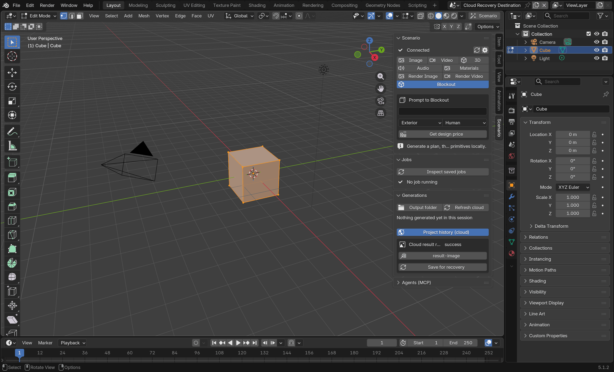

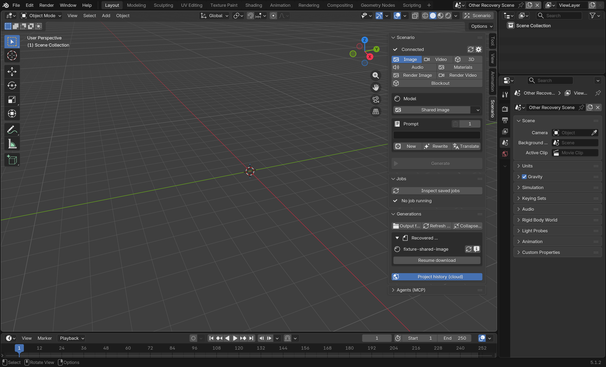

## Film task controls

Film tasks occupy an optional, initially closed **Film** sidebar panel. Loading
a recipe validates it before changing persistent scene properties and preserves
the production identity. Task rows are saved properties, not transient enums or
mutations during drawing. **New production** requires confirmation.

**Use saved upload** opens a cached list of imported uploads and confirms the
unchanged task, recipe, production, scene and connection before association.
**Estimate task** makes a free quote request; the separate **Generate** confirmation
shows its exact decimal CU price and states that results remain saved for explicit
application. The panel draws cached handles only; it does not open storage or
contact Scenario.

Current submitted and associated task rows show **Submission saved** or
**Upload associated**, without offering another estimate or association action.
The maintenance pump invalidates ready prices when their captured scene revision
changes, and approval rechecks before persistence. Drawing remains read-only.

Offline desktop acceptance on macOS arm64 Blender 5.1.2 used exact ZIP SHA-256
`b1ad71d94a1355bc7d8d825b4d1232b7a14cf91c53d8c11aa37737e4a0907590`,
which separately passed 799 installed tests on each supported Blender series.
Native mouse input loaded the JSON through Blender's file picker and selected
both task rows. Escape cancelled upload association without saving it; Return
confirmed the separate association. The Generate dialog displayed the full
synthetic price `0.1234567890123456789 CU`. Escape preserved the ready estimate
without submitting; the automated-GUI-probe guard also rejected approval without
creating a job. Discarding released that estimate.

With the fixture's SDK transport and result bytes mocked and external sockets
blocked, a fresh quote and explicit confirmation produced exactly one saved job
and one downloaded result. The result stayed ready for explicit application;
objects and image datablocks were unchanged. Re-estimating the reserved task was
rejected without another submission. Cancelling New production preserved its
identity; confirming changed it while retaining the recipe and previous job.
Viewport Light selection and Home framing worked after the dialogs. The isolated
run exited cleanly, removed its test profile and left the normal profile unchanged.
The test-only Blender app copy had a distinct bundle identifier and local signature;
the vendor executable code and extension ZIP were unchanged.

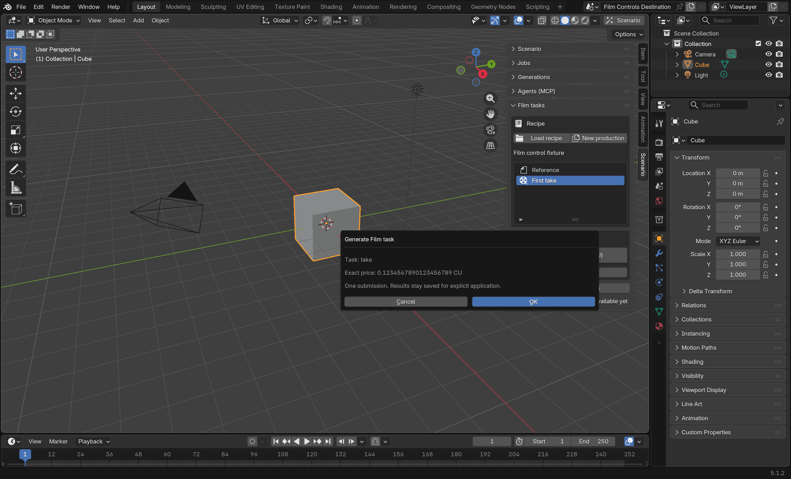

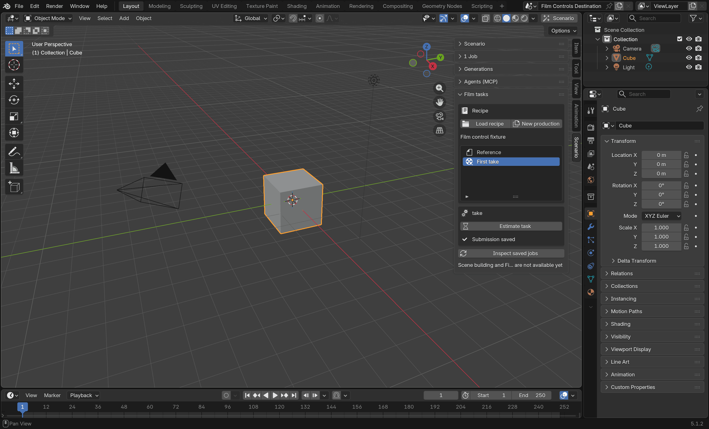

These are offline interaction checks, not live pricing or provider acceptance.
The screenshots and desktop evidence above predate the current stale-price and
saved-row review fixes. Those changes have separate installed native regression
coverage; fresh physical input and screenshot proof remain pending.
They do not establish other OS desktop behavior, Film scene construction/capture,
finishing/export, resolution of #263 or integrated release acceptance.

### Film shot controls

The **Shots** child panel uses saved shot rows and a stable selected index.
**Prepare shot** presents saved GLB choices per hero before local verification;
**Build shot** requires a second confirmation naming the shot, recipe scene and
hero count. The build preserves the working scene. **Discard review** confirms
discarding unapproved work. **Save build receipt** never repeats a scene build.
**Acknowledge inspection** requires a checkbox and cannot clear saved uncertainty.
**Shot error details** wraps the complete cached error and offers copying.
Drawing uses cached status and never starts a session or polls storage/workers.

Installed synthetic tests cover UI/MCP handle sharing, source/build cancellation,
changed destinations, receipt-only recovery, strict inspection acknowledgement,
saved shot selection and read-only drawing. Exact ZIP SHA-256
`f590b4ef5a601e984d1d0b950f0b5119b764347bd3e3aa4e2b8cc5b26ab14c09`
passes 855 installed tests on each macOS arm64 Blender 5.0.1, 5.1.2 and 5.2.1.

Desktop interaction with that same ZIP passes on macOS arm64 Blender 5.1.2 in
an isolated profile. The fixture supplies two saved synthetic hero GLBs and
blocks external Python sockets. Native mouse input expands Film and opens the
source review; Escape cancels it without creating a review or claiming jobs.
Return confirms local verification. Cancelling the separate Build shot dialog
preserves the ready review, jobs and scenes. Confirmed Discard review retires
only that unapproved review.

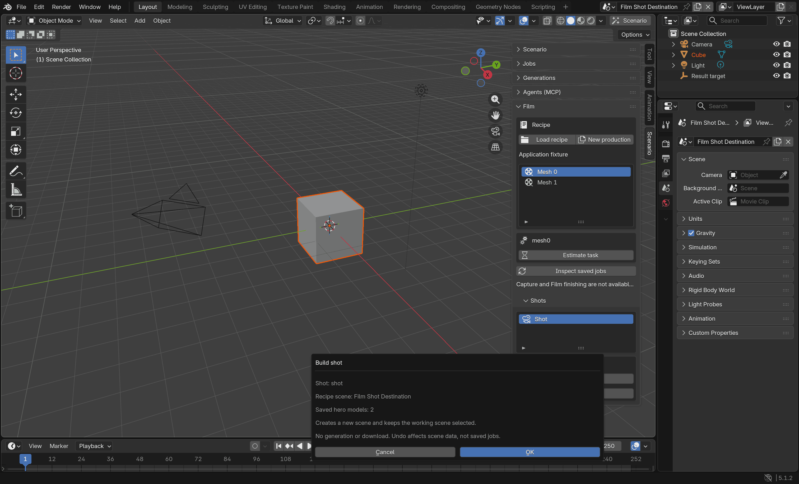

Fresh verification and explicit build confirmation create exactly one shot scene
and save both application receipts while preserving the selected working scene
and its objects. Edit > Undo removes that shot; Edit > Redo restores it. Neither
action rewinds the saved job receipts or permits reuse of the consumed review.
After history invalidates the original scene handles, the panel offers fresh
preparation. A viewport click selects the light and Home frames the scene,
confirming focus and keyboard navigation. The native scene selector opens the
built shot and returns to the intact working scene.

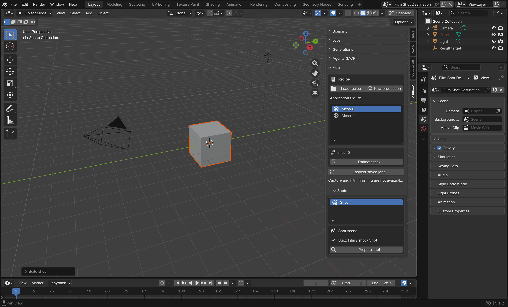

The run records zero service requests and downloads, exits cleanly, removes its
disposable profile and leaves the normal profile unchanged. This establishes the
synthetic shot-control interaction, not live provider compatibility, motion/audio
review, other OS/DPI combinations, timeline/capture/finishing or release acceptance.

### Film capture controls

The **Capture** child panel uses the shot selected in **Shots**. **Render capture**
confirms a matching local scene, still/video, color mode, dimensions and exact
editorial timing. It names optional video tools and distinguishes generated
source duration/trim from captured frames. Cancelling is inert. Prepared MCP
reviews expose **Render prepared capture** with the same exact settings.

Completed output offers **Open capture** and a separate **Upload capture**
confirmation showing size, timing, dimensions and full content hash.
**Cancel capture** retains frames after stopping work. **Discard capture**
confirms deleting only private capture files after work ends; saved uploads
remain. Failed work exposes its retained directory and wrapped cached error.
Drawing reads cached review status, never starts work or mutates properties.
The shared maintenance pump owns progress even with the panel closed.

Installed synthetic tests cover commands, cancellation, read-only drawing and
byte-checked upload handoff. Exact ZIP SHA-256
`50ab56cd3e12fa2991fb0cd3189cca3e9a7d3d700f4c9d13cfbee75bf64a4a85`
passes 892 installed tests on each macOS arm64 Blender 5.0.1, 5.1.2 and 5.2.1.

Desktop interaction with that same ZIP passes on macOS arm64 Blender 5.1.2 in
an isolated profile. The synthetic fixture blocks external Python sockets and
uses the real offline child renderer. Native keyboard input edits the dimensions;
Escape cancels capture approval without rendering, upload or scene changes.
A fresh dialog accepts a 128 by 128 still with material colors and one frame.

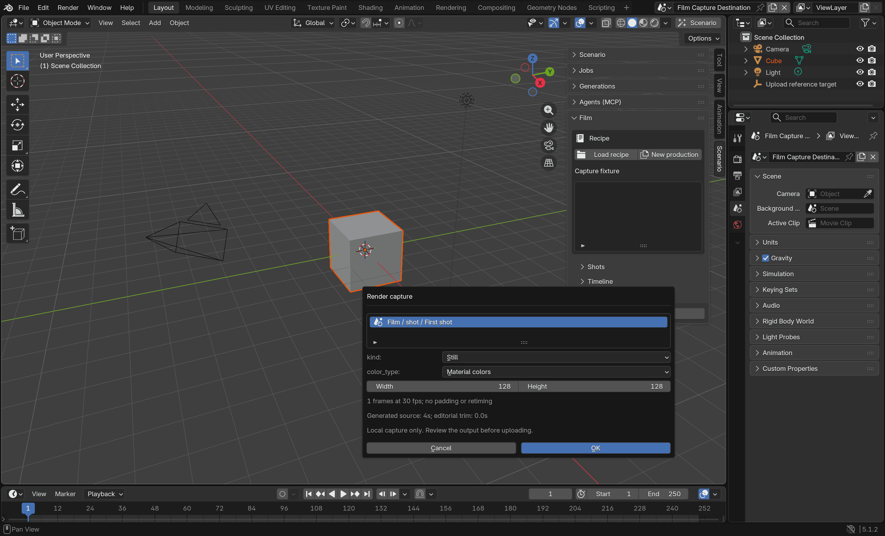

The rendered PNG's bytes match its recorded hash. All original scenes, objects,
frames and render settings remain unchanged, and no generation job is created.
Collapsing and reopening Film preserves the completed capture. The separate
upload dialog shows its size, dimensions, timing and full content hash. Escape
preserves the local capture without creating an upload or calling the transport.

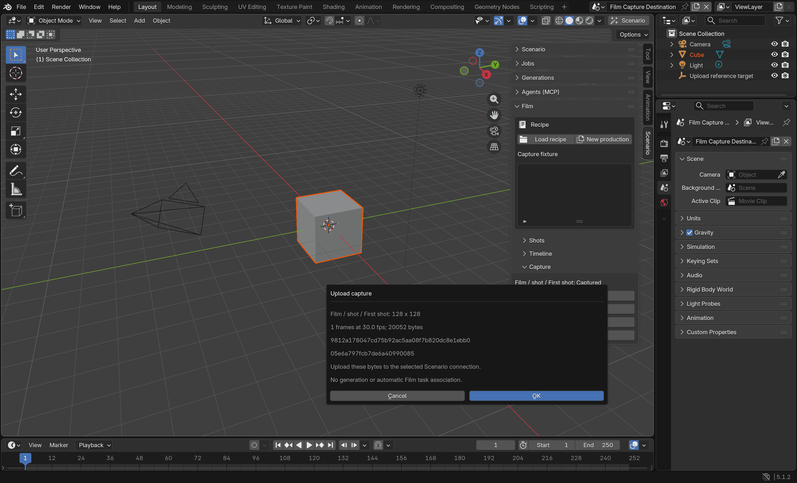

Confirmed upload uses a mocked SDK transport and one synthetic byte transfer;
the captured, staged and transferred hashes agree. The panel reports Uploaded
and the saved-upload dialog shows one imported image. Discard cancellation
preserves the capture. Confirmed discard removes only its private directory,
leaving the imported upload record and separately staged bytes intact. Native
viewport selection and zoom work after the dialogs close.

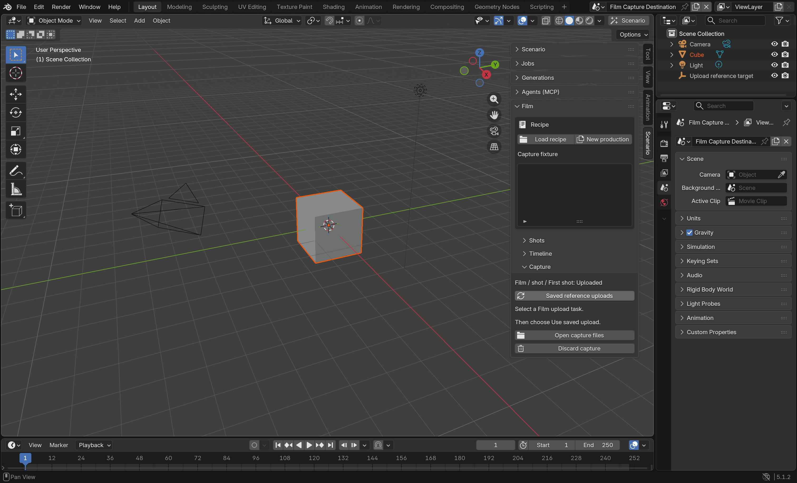

The run exits cleanly, removes its disposable profile and leaves the normal
profile unchanged. This proves bounded still-capture interaction and synthetic
upload handoff. Desktop video cancellation, sustained GPU/audio, human motion
review, live uploads, other OS/DPI combinations, finishing/export and integrated
release acceptance remain separate.

### Film timeline controls

The **Timeline** child panel offers **Build timeline**. Its confirmation lists
the editorial frame count/rate and a local scene choice for each recipe shot.
Missing choices explain that the shot must be built first. The dialog explains
that it creates a new sequence, keeps the working scene selected and references
live scenes whose later edits affect the timeline. Cancel creates no review.
The confirmed selection uses the same session command as local MCP. Build is
disabled outside Object Mode in a Blender window, while MCP preparation remains
available in Edit Mode.

Known rollback errors remain readable and copyable. Incomplete cleanup hides
the build action and requires **Discard timeline review** with its inspection
checkbox; this never deletes Blender data. Dismissed reviews no longer show
their status or Copy error action in the panel; MCP can still inspect the saved
review error. Ordinary status matches the current production and recipe; a
reload hides prior built/error status without hiding unresolved partial cleanup.
Drawing only reads cached status.
Native source/destination guards and single-use approval have synthetic installed
coverage. Exact ZIP SHA-256
`aef03c55e607a3ea99eb839bd4cdef2cc4c7e6517aa5ca5152d302744874f402`
passes 869 installed tests on each macOS arm64 Blender 5.0.1, 5.1.2 and 5.2.1.

Desktop interaction with that same ZIP passes on macOS arm64 Blender 5.1.2 in
an isolated profile. The local fixture supplies two recipe shots and a second
take for one shot, with external Python sockets blocked. Native mouse input
opens the panel and confirmation, which displays 180 frames at 30 fps. Selecting
the nondefault scene for the second shot and pressing Escape leaves every scene
and saved job unchanged and creates no review. A fresh dialog accepts the same explicit scene
choice, and Return confirms the build.

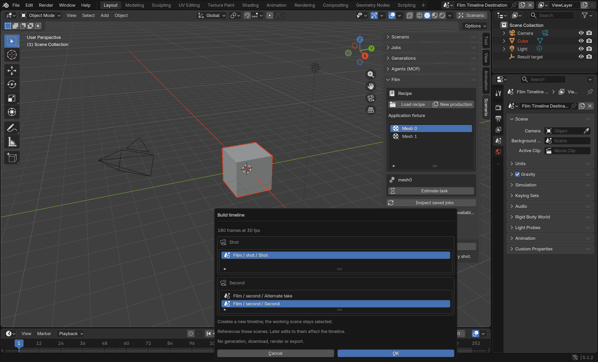

Exactly one new timeline contains the selected shots at frames 1–120 and 121–180,
with the working scene still selected and its objects intact. Saved jobs and
application receipts are unchanged. Edit > Undo removes only the new timeline;
Edit > Redo restores the exact scene sources and frame boundaries. The consumed
review stays consumed. After history invalidates its scene handle, the panel
requires a fresh approval for another build.

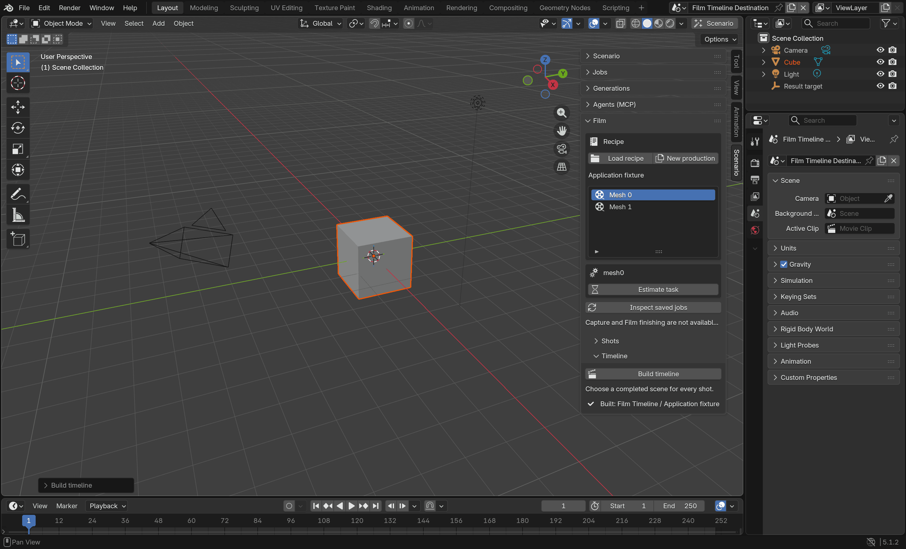

Viewport Light selection and Home framing work after the dialogs. The native
scene selector opens the built timeline. Selecting that scene in the Video
Sequencer's own scene selector displays the two editable scene strips.

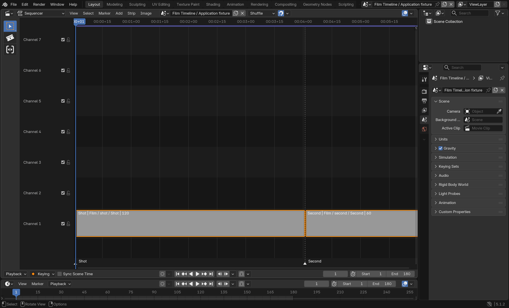

The run records zero service requests and downloads, exits cleanly, removes its
disposable profile and leaves the normal profile unchanged. This establishes the
synthetic timeline interaction, not live provider compatibility, human motion/audio
review, other OS/DPI combinations, capture/finishing/export or release acceptance.

Review follow-up ZIP SHA-256
`c008687d12a1dc370e841e0daf34abade5d7960d3bbf1458ecb03bca929eba20`
passes 958 installed tests on each macOS arm64 Blender 5.0.1, 5.1.2 and 5.2.1.
A fresh isolated desktop check on Blender 5.1.2 supplies a synthetic incomplete
cleanup. Mouse input opens **Discard timeline review**, checks the inspection
acknowledgement and Return confirms dismissal. The old error and Copy error
control disappear, while explicit MCP inspection retains the discarded error.
Dismissal preserves existing scene data, including the partial fixture scene,
and saved jobs.

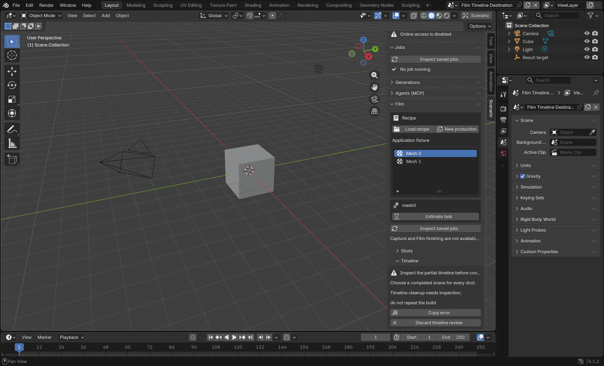

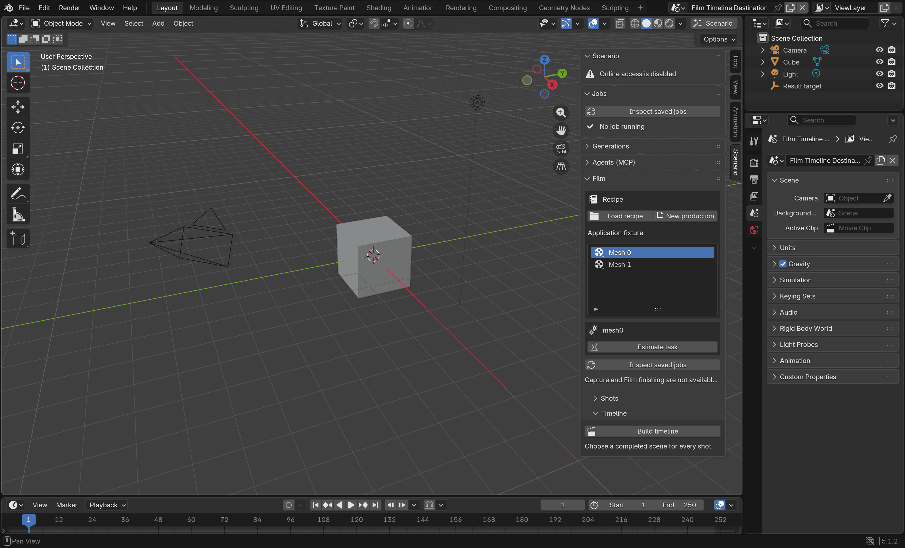

Viewport selection and Tab enter Edit Mode, where **Build timeline** is visibly
disabled. A main-thread probe of the shared command still prepares a ready
review; approval rejects Object Mode absence without consuming it or building.

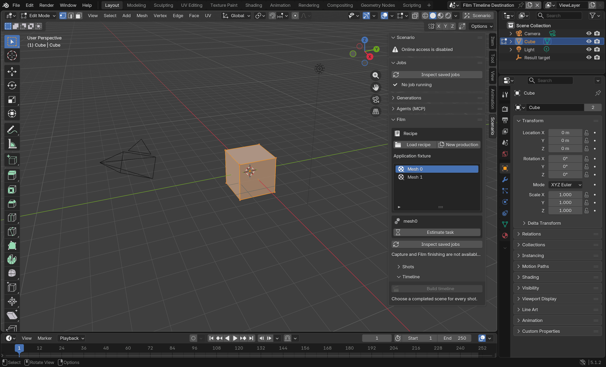

This follow-up records zero service requests/downloads, clean exit, disposable
profile cleanup and an unchanged normal profile. Its physical evidence covers
dismissal, viewport focus and Edit Mode gating; it does not repeat the earlier
build, Undo/Redo, missing-choice or Sequencer journeys.

Recipe-status validation uses exact ZIP SHA-256
`eea65caf46764ed36dae6717c5339da472127d668b389f0564e156c9b8024bc8`,
with 960 installed tests passing on each macOS arm64 Blender 5.0.1, 5.1.2 and
5.2.1. The isolated 5.1.2 desktop fixture displays a built timeline, then calls
the MCP recipe-load handler on the main thread with a replacement recipe. The
old Built label disappears; the prior review and scene data remain inspectable.
Viewport selection and Home framing work. A synthetic incomplete cleanup stays
visible and blocks preparation across another recipe reload. Mouse input opens
its discard dialog, checks inspection and Return dismisses it, clearing the panel.

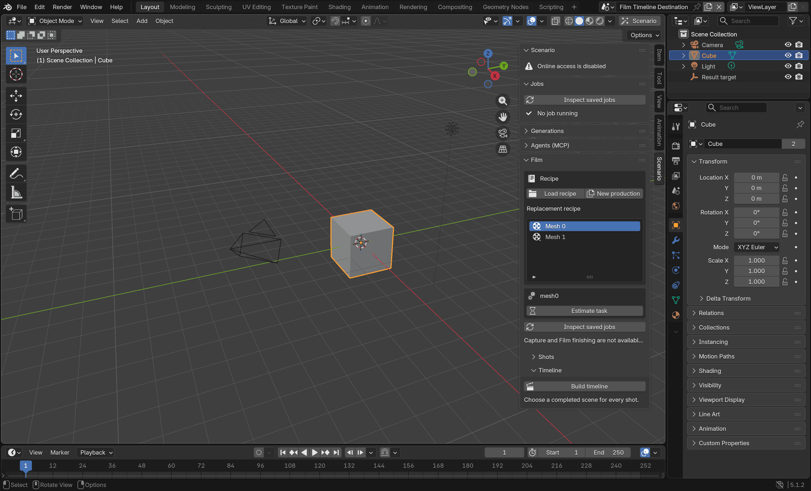

Saved jobs remain unchanged, with zero service requests/downloads, clean exit,
disposable-profile cleanup and normal-profile preservation. This check covers
recipe-status filtering and retained uncertainty, not a new build/Undo journey
or the native recipe file chooser.

### Film composition controls

The **Composition** child panel uses equal Final/Previs segments, then **Prepare
composition**, **Request price** and a separate **Generate** confirmation. The
confirmation shows the original scene, timing, source/layer counts and full exact
CU cost. Discard requires confirmation; cancellation affects only preparation or
the pending price. Saved jobs remain available after either action. Error details
wrap the complete cached error and support copying. Drawing only reads cached
status; the existing runtime maintenance owns progress.

Installed synthetic tests exercise native operator execution/dialog construction,
MCP parity and read-only drawing. The corrected navigation implementation passes
916 installed tests on each of Blender 5.0.1, 5.1.2 and 5.2.1 on macOS arm64.

Final/Previs is temporary WindowManager UI state, shared across the current
Blender session and excluded from saved scene data. Native edits to a scene-owned
custom property tag its owning scene, which invalidated retained quotes even
though the recipe was unchanged. Direct Python assignment in the earlier
regression did not reproduce that native update. The corrected installed
regression also tags the property's owner, preserving the same quote without
service requests after navigation. Frame changes still invalidate the captured
scene revision; that guard is unchanged.

An isolated macOS arm64 Blender 5.1.2 desktop check installed exact ZIP SHA-256
`6f932e81a802f8569378c38ad3d4b820da779a1f86090272585c9b1db8e1335f`.
All 136 packaged Python files matched the reviewed source. Native input cancelled
preparation, cancelled and confirmed discard, prepared a fresh review and requested
its exact synthetic price. Final → Previs → Final preserved the same review,
quote, scene and request count. Editing the current frame invalidated the review
without another request; the full error was readable in its details dialog.

The separate Generate confirmation displayed the original destination, 120 frames
at 30 fps, one source/layer and full synthetic price `0.10000000000000001` CU.
Cancelling preserved the quote with no submission. Confirming created exactly one
mocked durable master; discarding its review preserved that job, visible through
**Inspect saved jobs**. Viewport selection and zoom worked after leaving the
controls. Recipe and source bytes stayed unchanged. The process exited cleanly,
removed its disposable profile and left the normal profile unchanged.

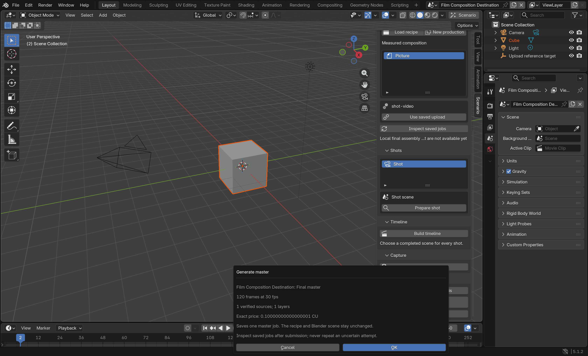
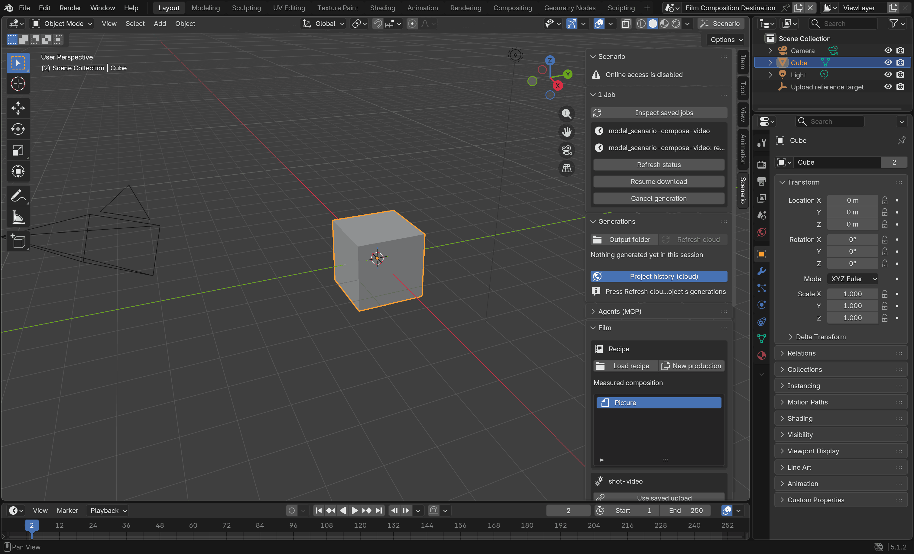

SDK transport and media metadata were mocked, and external socket/DNS calls were
disabled. This proves the scoped native interaction flow, not real media probing,
live provider quality, other OS/DPI behavior, local final assembly/export or
complete Film/release acceptance.

### Film review controls

The **Review** child panel follows Composition. It uses equal Final/Previs
segments, then an **Assemble review** box with a `SEQUENCE` header icon.
**Prepare review** opens a dialog naming the recipe scene and mode. **Include saved
master as muted alternate** is enabled only when a saved master video exists.
The dialog states the 2 GiB private copy limit and the installed `ffprobe`
requirement, and that nothing is downloaded, uploaded or generated. Cancelling it
creates no review. A saved-job storage error while checking the master reports its
storage message rather than asking for a valid recipe.

A ready review shows its frames, fps and shot/source counts, then **Build review
scene**. That separate confirmation names the recipe scene, mode, timing, counts,
private copy size and master inclusion. It states that the build creates a new
scene, keeps the working scene selected and marks generated sources applied, and
that Undo removes only the scene. Build is disabled outside Object Mode with a poll
message. Like the timeline build, the build operator declares only Blender's Undo
option, without the register option behind the redo panel and the Info operator
log. Preparing and ready reviews add "Selecting, editing or Undo here discards
it": object selection or edits and any Undo or Redo invalidate an unbuilt review
and delete its copies. Preparing and waiting reviews show a status line with
**Cancel preparation**; stopping and building show status only. The waiting line
says the scene was left and that reselecting it needs a new preparation: selecting the
recipe scene again invalidates its unbuilt reviews and deletes their copies. Ready,
failed and cancelled reviews offer **Discard review** with confirmation. Uncertain
builds hide preparation and offer **Save review receipt** or **Acknowledge
inspection** (with its checkbox), plus **Inspect saved jobs**. **Error details**
wraps the complete error and offers copying. Drawing reads cached status only; the
maintenance pump owns progress. Studio's Film page adds a sixth **Review** tab,
drawn as two rows of three at narrow widths.

Installed synthetic tests cover operator execution, dialog construction including
the enabled master option for a saved master, dismissed dialogs, a storage error
in the preparation dialog, readable full-queue admission, the warning line on
preparing and ready reviews with selection and Undo/Redo-handler invalidation, a
real `window.scene` round trip, a previs build beside a ready final review, MCP
parity, read-only panel and Studio drawing, mode navigation, Edit Mode gating and
the build operator's options. Physical desktop interaction, screenshots and other
OS/DPI behavior for these controls have not been captured; that evidence is pending.

### Film export controls

The **Export** child panel follows Review, and Studio's Film **Review** tab draws
it below the review controls after a separator. It holds one **Export video** box
with a `FILE_MOVIE` header icon. Without a current export it shows **Export
video...** with two lines: it renders a built review scene to a new MP4, in an
offline Blender process that never overwrites. That action opens Blender's file
browser at the Output Folder's Film subfolder with a suggested portable name. The
browser's side panel shows a list of the recipe's review scenes (an `ERROR` icon
marks a blocked one, with its reason wrapped below), frames and rate, scene size,
media count and whether sound strips are audible. It offers **Audio** (Match sound
strips, Include or None), **Use review scene size** with Width and Height enabled
only when it is off, and the lines "Nothing renders yet." and "Render video asks
again." A scene size outside 64 to 4096 pixels adds an `INFO` line "Outside 64 to
4096 pixels; set an export size", and the browser opens with the option off and
the nearest bounded size. Its confirm button reads **Choose video file**.

A ready export lists the review scene and mode, frames and rate, the destination
file name and "Selecting, editing or Undo here discards it", then **Render video**
and **Discard export**. **Render video** opens a separate confirmation with the
review scene, timing and size, codec and audio track, media count, the full
wrapped destination, "Renders in an offline Blender process; never overwrites a
file.", that the working file and scenes stay unchanged and no credits are spent,
and which verification runs. It is unavailable outside Object Mode, with a poll
message. A running export shows its stage with a `TIME` icon (for example
"Rendering 24/48 frames (50%)") and **Cancel export** with confirmation; stopping
shows status only. A failed save shows "Video verified but not saved", **Choose
new file...** (a file browser), then **Save video copy** (a confirmation of the
exact new file) and **Discard export**. An exported video shows its name with a
`CHECKMARK`, then a row with **Open folder** and **Copy SHA-256**, **Export
video...** again and **Discard private files**. Errors add **Error details**,
which wraps the complete error and offers copying. Drawing reads cached status
only; runtime maintenance owns progress and redraws the sidebar when it changes.

Installed synthetic tests cover the file browser invoke and side panel, dismissal,
numbered suggestions, explicit audio and size choices, the Render dialog and its
inert dismissal, the failed-save copy dialogs, the panel's ready, running and
exported states, read-only panel and Studio drawing and Edit Mode gating. Physical
desktop interaction, screenshots and other OS/DPI behavior for these controls have
not been captured; that evidence is pending.

### Film case-study controls

The **Case study** child panel follows Export, and Studio's Film **Review** tab
draws it below the export controls after a separator. It holds one **Case-study
bundle** box with a `PACKAGE` header icon. Without a current case study it shows
**Export case study...** with two lines: it packs a review, timeline, media,
recipe and ledger into a new ZIP and never overwrites. That action opens Blender's
file browser at the Output Folder's Film subfolder with a suggested portable
`<Title> - Case Study.zip`. The browser's side panel lists the recipe's review
scenes (an `ERROR` icon marks a blocked one, with its reason wrapped below), the
chosen scene's frames and rate and media count, then **Include director
timeline** with a list of timelines and their shot counts (disabled when the
checkbox is off), or "No director timeline", and the lines "Nothing is written
yet." and "Save case study asks again." Its confirm button reads **Choose
case-study file**.

A ready case study lists the review scene and mode, the timeline or "No director
timeline", the scene and media counts with their size, the destination file name
and "Selecting, editing or Undo here discards it", then **Save case study** and
**Discard case study**. **Save case study** opens a separate confirmation with the
review scene, timeline and shot count, contents, a ledger line such as "Ledger: 1
approved task; 1 CU quoted for 1 task" (CU in the shared display format), the full
wrapped destination, "Builds in offline Blender processes; never overwrites a
file.", that the working file and scenes stay unchanged and no credits are spent,
and that the documents omit credentials, URLs, service IDs and local paths. It is
unavailable outside Object Mode, with a poll message. A running case study shows
its stage with a `TIME` icon (for example "Packing the archive (50%)") and
**Cancel case study** with confirmation. A failed save shows "Case study verified
but not saved", **Choose new file...**, then **Save case-study copy** and
**Discard case study**. A saved archive shows its name with a `CHECKMARK`, a row
with **Open folder** and **Copy SHA-256**, **Export case study...** again and
**Discard private files**. Errors add **Error details**. Counts use correct
singular and plural forms. Drawing reads cached status only; runtime maintenance
owns progress.

Installed synthetic tests cover the file browser invoke and side panel, numbered
suggestions, the Save dialog text and its inert dismissal, the failed-save copy
dialogs, progress, the panel's ready, running and saved states, read-only panel
and Studio drawing and Edit Mode gating. Physical desktop interaction, screenshots
and other OS/DPI behavior for these controls have not been captured; that
evidence is pending.

## Explicit Studio view

The viewport header has a separate **Studio** button. It opens a native popup
with Create, Film, Workflows, Library, Jobs, Results and Connection pages.
Opening, closing or switching pages does not start a job or select another
account/project. No startup or file-load handler opens it. The existing **Scenario** button still
opens the sidebar; the compact composer remains the default creation surface.

Studio reuses the actual native panel controls and their operators. Create keeps
the same scene form, model, prompt, references and parameters. Film separates
Tasks, Shots, Capture, Timeline, Composition and Review, whose page also draws
the video Export and Case study panels; each keeps its existing confirmation
boundary. Results
reuse the saved-result and explicit application controls. Connection names the
selected credential source/project and links to Preferences and local agent setup
without displaying credentials.

Navigation is an unsaved WindowManager property group. Native navigation edits
must not tag a scene or invalidate its exact quote. Before opening, focused
composer text is committed only if its original scene, lane and previously
synchronized prompt still match. A conflicting form rejects opening and retains
both texts. Opening Studio never commits pending text into another scene with
an identical old prompt.

The requested popup width is bounded by the invoking area, window and UI scale;
narrow requests use rows of at most three equal navigation segments. Clicking
outside a focused composer commits its text and passes that same click to Blender,
so the Studio header button opens on the first click. Installed tests cover this handoff,
registration, shared drawing, quote preservation, pending-text ownership and
continued admitted work.

An isolated offline desktop check on macOS 27.0.1 arm64, Blender 5.1.2, used exact
ZIP SHA-256 `32d81f8cbbc59023dcac10d71c1e87fc70a04265c8791e373639cef53c97c253`.
Native paste entered `Café 雪 Studio test` in the compact composer. One header
click opened Studio and preserved that text; Film navigation and Escape dismissal
worked. Camera selection, wheel zoom and the front-view shortcut worked afterward.
The default-size captures show readable two-row navigation without overlap.
The test app used a distinct bundle identity and development signature; the
installed extension and ZIP stayed unchanged. The process exited cleanly with
no Python network violations and the normal profile unchanged.

A second offline fixture on that same ZIP populated the actual shared model form
with a prompt, reference and enough settings to require scrolling. The SDK used
an in-memory transport; a running synthetic job was seeded in the local saved
store and resumed without invoking submission. Native navigation through Create,
Film, Jobs, Results and Connection retained the quote identity and exact cost
`0.1234567890123456789`, model, prompt and reference. The same job owner continued
polling while the popup opened, changed pages and closed. No submission occurred.

At Blender window dimensions 1512 × 917 and 1018 × 671, with UI scale 2.0,
the populated popup remained readable and scrollable without horizontal clipping.
Native Home/Shift-End selection, Unicode paste, Enter and Escape changed the
Studio prompt to `Café 雪 Studio edited`; the compact composer showed the same
text afterward, and the shared runtime produced a fresh ready quote. The repeat
exited cleanly with no Python network violations and the normal profile unchanged.
An earlier selection-shortcut attempt exited Blender and hit a test-fixture
credential cleanup error during shutdown; that run is not clean-exit evidence.

These checks supersede the window-attachment and populated-form evidence gaps.
Alternate-DPI interaction and IME composition remain unverified: Preferences
opened, but the attempted scale edit did not change the observed UI scale, and
Unicode paste is not IME composition. Track those native checks under #66 as
acceptance follow-ups; they do not block review of this scoped change. The complete
select/capture/estimate/generate/inspect/apply journey and other-platform desktop acceptance remain separate under #66/#68.

Blur and Studio opening now share the same focused-prompt ownership guard.
A conflicting scene, lane or sidebar prompt keeps both texts and focus intact;
the outside click is consumed with a warning before any native handoff. With no
focused prompt, blur writes nothing. Valid edits still commit and pass the same
click to Blender. Installed modal-path regressions reproduce all four overwrite
cases on the preceding ZIP and pass on fixed ZIP SHA-256
`15f730160c62c2e7a700b25ac6c8a7a1d134122c30ef3e5c85842912c463777b`.
That ZIP passes 1,088 installed tests on each macOS arm64 Blender 5.0.1, 5.1.2 and
5.2.1 (two Windows-only skips per run). A new isolated desktop attempt displayed
the correct fixture, but control-tool clicks did not visibly activate the composer
or Studio. It supplies no new physical-input acceptance; the screenshots and
interaction results above remain evidence for their explicitly identified ZIP.

The main-thread pump refreshes the live temporary popup region with
`tag_refresh_ui()`: normal area redraw alone can leave a completed asynchronous
quote showing as loading. Popup ownership is weak and removed regions are
discarded. The [desktop regression checks](#studio-and-library-desktop-regression-checks)
record the earlier scoped input evidence for this behavior.

This view exposes existing creation/Film/result controls and the workflow form
below, plus Library browsing, model-reference reuse, reviewed
[collection and tag organization](#library-organization) and the review of
[waiting workflow steps](#waiting-workflow-steps). Complete retained Studio
acceptance remains separate.

### Workflow controls

Studio's Workflows page has explicit private/public refresh actions, a local
name search and a Workflow ID fallback. Loading inputs asks for confirmation
before replacing the form. A saved per-scene schema drives labeled text, numeric,
boolean, fixed-choice and structured fields. Structured values remain editable
as JSON; file fields accept asset IDs, Library selections and the
[explicit uploads](#workflow-input-uploads) below. A field's
inclusion checkbox omits it from the request, allowing declared defaults.

**Request workflow price** starts a shared session quote. **Generate** opens a
separate confirmation with normalized inputs, scene and the full exact CU price.
Each input value is named by the label the form draws for it, so an input
without a schema label keeps its readable parameter name, as in the form.
Cancel submits nothing; confirmation rechecks the form, scene, selected session
and original quote. When the workflow definition has loop nodes, or its loop
coverage cannot be checked (for example, a node type the extension does not
know), the button reads **Generate (from N CU)** and a warning states
that the price covers one loop pass and the final charge can be higher. The
confirmation repeats it, and the submitted job's session result row shows
**from N CU**. The warning wraps by the width Blender's interface font measures
(`label_wrap`); when it needs more than one line, each sentence starts its own
line. The confirmation declares its requested popup width, so its first draw
wraps like Studio's. Installed tests draw the confirmation as that first draw,
at UI scale 1.0 and 2.0, and Studio's page 960 and 240 units wide; the desktop
look awaits the physical recheck under #66. A recovered workflow job shows
**from N CU** too, because the saved record keeps no loop count. The warning
does not disable approval. Drawing is read-only and never starts catalog or job workers.
Page search/navigation use unsaved WindowManager state; scene form edits require
a new price. The maintenance pump completes metadata and quote requests even
after the popup closes. Saved jobs use the existing Jobs and Results controls.

A workflow job waiting at an approval or selection step is reviewed and decided
as described in [waiting workflow steps](#waiting-workflow-steps). The Generate
confirmation states that these steps wait for review in Jobs and that a running
step cannot be canceled, only stopped at a waiting step.

Always-required fields use the shared parsed requirement rules, including
`required: {always: true}`, and start included. Catalog lists have session-only
delivery authority: editing a form while listing does not discard the catalog
or permit it to overwrite the form. Input loads and prices keep their original
scene/form checks. At the 32-view cache limit, opening another scene reclaims an
idle projection and its unused price; saved inputs and admitted jobs remain.
Pending requests are never evicted. Returning to an evicted price requires a
fresh estimate.

Installed tests verify synthetic native registration, shared UI/MCP quote use,
changed-input rejection, view changes, continued work and saved-form reload.
The desktop regression checks below record prompt editing, exact price refresh,
cancel/confirm and saved-job visibility with a synthetic service on their named
candidate. Broader DPI, IME and platform acceptance remains tracked under #66/#68
separately from review readiness.
Live outputs remain outside this implementation.

### Waiting workflow steps

A workflow job waiting at an approval or selection step shows the status row
**Workflow waits for your decision** in its Jobs row, followed by one review
button per waiting step: **Review approval**, **Choose 1 to 2 of 3** (or
**Choose 1 of 3** when the bounds are equal) for a selection, or **Review blocked
selection** when only stopping is offered. A step inside a loop adds its loop
index. A step whose node ID cannot be sent shows **This step cannot be decided
here** without a button. Studio's Workflows page lists the same buttons above
its form under **Waiting for your decision**, with the workflow name and job,
but without the recovery controls. Every surface draws the shared saved-job
descriptors from the in-memory step projection; drawing performs no I/O, starts
no request and changes no property. Offline, the review buttons are disabled.

**Review** opens a dialog that captures the step when it opens. It shows the
workflow name (from the loaded catalog or form, else its ID), the Scenario job ID,
the job's exact approved price, the step and its ID, any last decision error,
and either the result asset IDs an approval reviews or a selection's candidates
in listed order. Asset candidates are checkboxes named by asset ID; text
candidates are numbered checkboxes followed by the text, wrapped, up to 12 lines
each. A line counts the selected items against the bounds. The decision is one
[segmented choice](#tabs-and-segmented-choices) of two equal cells, **Approve**
(or **Select**) and **Stop workflow**. Stop is never the default, so rejecting
always needs that explicit choice; a blocked selection disables Select and
explains why, including a selection whose step links could not be read in a
workflow with a loop. When an approval's step links could not all be read, the
dialog warns above its result list that results to review may be missing and
should be checked in Scenario. The dialog states the consequence of
the chosen decision: continuing runs the remaining steps, which spend credits,
and their charge is not verified against the approved price; stopping rejects
the step and cancels the workflow, completed steps stay charged, and inside a
loop Scenario may stop only that loop, so the refreshed status is authoritative.

**Send decision** is single use. It sends the choice through the same
`runtime.decide_workflow_step` entry as local MCP `decide_workflow_step`, which
checks the context, saved revision, step review, decision and selection bounds
again and queues one request that is never retried. Selected items are sent in
listed order. A changed step, revision or connection, a command in flight or
disabled Online Access sends nothing and reports why. Opening the dialog sends
nothing either.

While the decision is sent, the row shows **Sending your decision...**. A
refused, uncertain or unsent decision then stays as wrapped error rows until
another decision, a newly waiting step or the job leaving `remote`; the dialog
shows it too. A running workflow job with no waiting step shows, without a
button, that Scenario cannot cancel a running workflow step and that it finishes
or pauses at its next approval or selection. The pump redraws Jobs rows when a
step starts or stops waiting, a decision is queued or finishes, or its error
changes.

Below its review button, each waiting step that lists assets (an approval's
result assets, or an asset selection's candidates) shows **Load previews (N)**
in its Jobs row and in Studio's Workflows section. It is the only control that
fetches them: an explicit, read-only request through `runtime.load_review_previews`,
bound to the context, saved revision and the step's `review_id`, and disabled
offline. It never decides, spends or applies. The
[preview lane and cache](RESULT_PREVIEWS.md#workflow-review-assets) fetch each
asset's still. Once requested, the step shows up to eight loaded icons, four to a
row, and **Previews: R of N ready** with any loading, waiting for Online Access
or unavailable count; **Retry previews** appears while some are unavailable and
sends only those through the preview lane again, which fetches a still again when
it failed, is missing or lost its cached file. The review dialog shows an approval's loaded previews
as a grid of icons named by asset ID, and a candidate's loaded preview beside
its checkbox; an asset without one keeps its ID and a short status line, and a
step with nothing loaded says to load previews from the Jobs row or Studio
Workflows. While its previews load, the dialog is refreshed by the pump like
Studio. Icons are decoded by the pump from the verified cached still, at most
two per tick and at most 256 pixels per side, never while drawing or while a
render job runs; drawing reads memory only. Decoding uses temporary Blender
data, so the open file gains no image and origins captured in it stay current.
A cached still lost before decoding is fetched again once by itself. A step that is decided or changes
releases its icons, and so does a connection change.

Installed tests on macOS arm64 Blender 5.1.2 cover the descriptors drawn in the
sidebar, Studio Jobs and Studio Workflows with storage reads refused, the dialog
contents, single use, bounds, listed order, the explicit stop, a blocked
selection (also one blocked because its links could not be read), the approval
warning for unread links and the results a workflow definition links, changed
step, revision and connection, offline refusal, a refused
decision, steps after an explicit refresh following a restart, redraws and
registration, with synthetic SDK responses. Installed tests of the previews
cover the Load previews controls and their binding, metadata and transfers on
the preview lane, decoding only in the pump (a fitted icon with the stored
colors, no image added to the open file, no dependency update and a captured
origin still current), icons drawn in rows, Studio and the dialog with storage
reads and requests refused, unavailable candidates and their explicit retry, a
candidate asset listed twice fetched once, a lost cached still fetched again
once by itself and then by Retry previews, a still Blender could not decode
checked and decoded again by Retry previews, an icon Blender could not fill
released, stale, foreign and offline requests, released icons after a decision or
connection change, and cached stills reused after a restart.
Background Blender assigns no icon IDs, so drawn icons were recorded with a
stand-in ID. Physical desktop evidence of the rows, previews and dialog (input,
focus, DPI, IME and screenshots) is pending.

## Native Library controls

Studio's explicit **Library** page has Search, Public assets and Collection ID
filters, Refresh, and separate Previous/Next actions. Native navigation uses at
most three tabs per row in narrow views. Filter edits do not start a read or tag
the scene; changed filters require Refresh before page continuation. Reads use
the shared session and application pump, so unrelated scene edits and closing the
view do not discard the requested page. Connection retirement clears the view.

Each asset shows its name and MIME type. **Use as reference** opens a separate
confirmation for the selected scene, generation form, model and compatible input.
No existing reference is silently replaced. Unknown MIME types cannot attach;
known file inputs respect their kind and capacity. Confirmation checks the
unchanged destination, adds a scoped asset reference and invalidates its price.
The dialog displays a captured scene name, so deleting the scene while it is
open cannot break redraw; confirmation still rejects the unavailable destination.
Drawing never starts requests or mutates RNA. Collection and tag changes use the
separate reviewed [Organize](#library-organization) dialog. Dynamic input choices are retained by the live dialog and resolved through
its RNA properties; Blender passes `OperatorProperties` to the enum callback,
not the Python operator carrying the prepared approvals. Installed tests exercise
that registered callback as well as state and command boundaries. The desktop
checks below record native browsing and reference confirmation for their named
candidate. Remaining desktop acceptance stays under #66/#68 separately from
review readiness.

### Library organization

**Load collections** reads one page of 50 collections in the selected connection,
and **More** appends the next page, up to 200 loaded collections. Each loaded
collection shows its name, asset count and **Browse**, which sets Collection ID,
clears Search and Public assets and reads the first page. Each asset row adds a
tags line and a membership line. Labels that do not fit end with a "+N" count;
memberships name loaded collections and count the others. These are explicit
operator reads held by the Library view; drawing never starts one.

A read never disables the control that started it: Refresh, Previous, Next,
**Load collections**, **More** and **Browse** stay enabled while their read runs,
a loading line shows it and a second click is refused with a message. Previous,
Next and More still follow page availability. Blender 5.0 and 5.1 keep a hovered
button's disabled look across popup refreshes until the pointer leaves it (5.2
refreshes it), so a control disabled by its own read still looked unavailable
after the read finished, although the pump had refreshed the popup.

**Organize** on an asset row opens a dialog (width 480) showing the captured
asset name and the selected project label, as on the Connection page. Choose
Add to collection, Remove from collection, Add tags, Remove tags or New collection
and add. The collection dropdown lists the loaded collections, plus the browsed
Collection ID, and preselects the browsed one. Before collections are loaded,
Add and Remove ask to load them first. Once a load finds none, the dropdown reads
**No collections yet** and the dialog says the connection has no collections:
Add suggests New collection and add, Remove says there is nothing to remove. Its
choices are retained by the live dialog and resolved through its RNA properties,
like the reference input menu. Tags are one comma-separated field; surrounding
spaces are removed and text is otherwise kept exactly, so tags cannot contain
commas. The dialog states that changes are immediate account metadata, use no
credits and are not reversed by Blender Undo, and explains invalid text before OK. OK only prepares a review:
the shared session owner reads the asset's current tags and memberships, and
nothing is sent. Cancel prepares nothing.

The Library page then shows one review card under the organized asset's row.
The rows above it keep their place, so the card opens next to the Organize
button that was chosen, even far down a scrolled page; Blender's popup scrolling
cannot be moved from Python. A line under Previous and Next names the asset and
points down to the card, for example after Studio is reopened at the top. On a
page without that asset, such as another page or a browsed collection, the card
is drawn in that line's place instead. The status bar confirmation is often hidden behind
Studio, so it only repeats where the card is. While preparing it says nothing has
been sent. A ready card lists the asset's current and resulting state, the number
of requests Apply sends and the 10-minute expiry, with **Apply** and **Discard**.
Apply is accepted only for that ready card, once; it sends each write once with
no retry, then the card shows the read-back result: Verified, Refused with the
HTTP status, Unconfirmed, Not sent or Not verified. When another client added the
asset first, the service refuses the add as a whole; the read-back shows the
asset as a member, so nothing more is sent and the card shows Verified with a
note that it was already in the collection. An unconfirmed card says to
refresh and inspect; nothing is resent automatically. A finished, refused,
unchanged, unsent or expired card offers **Dismiss**. Rows take the tags and memberships Scenario
read back. A row that left the browsed collection stays marked "No longer in this
collection; refresh" until the next Refresh rather than disappearing. A verified
new collection joins the loaded collections, even when 200 are already loaded,
so **Browse** and the dropdown offer it. A page or collection read that was
already running when the read-back arrived may have listed the state before the
write, so its rows keep the read-back and the new collection stays listed; the
next read shows what Scenario lists.

Organize is disabled for pages loaded with Public assets, while a Library page is
loading and while a change applies. Preparing another review discards a card that
is not applying. The card belongs to the application's job session, not to the
popup: the maintenance pump advances it, so closing and reopening Studio during
Apply keeps it. A credential, Project ID or file change retires the session,
clears the view and discards its reviews; a write already sent keeps its effect.
Native and [local MCP](MCP.md#asset-organization) reviews share the same owner,
so only one change applies at a time and they share its 32-review bound. While
an agent's change applies, a ready card says so; Apply stays offered but refuses
with that reason and sends nothing. When unapplied agent reviews fill the bound,
Organize says so and prepares nothing; unapplied reviews expire after 10 minutes.
A full bound evicts only settled reviews, which never change again, so a settled
card keeps its outcome until dismissed even after an agent's new review evicts
the review behind it.

Installed tests cover operator registration, the dynamic collection enum with
`OperatorProperties`, read-only drawing, public and busy pages, dialog cancel,
Apply gating and single use, row updates, an asset added elsewhere before Apply
(one request, Verified), filtered-row refresh marks, a new
collection joining a list at the load bound, the card across Studio redraws
during Apply, connection and file retirement, sanitized refusals, online access
off, a review bound filled by agent reviews, a finished card kept after an agent's
review evicts it, Apply while an agent's change applies, a page or collection read
still running when a change is verified, and narrow-width wrapping. They also
cover the card under the organized row and on top of a page without it, the
controls that start a read staying enabled while it runs with repeated clicks
refused, and the dialog text after a load finds no collections. These tests check
what is drawn; Blender's hover state needs a desktop.

A physical macOS 27 arm64, Blender 5.1.2 pass on an earlier candidate, at UI
scales 1 and 2 and in a 1018 by 671 point window, made service reads only. Dialog
focus, Unicode tags, Escape, Cancel and outside clicks, Discard and Dismiss without
requests, and viewport shortcuts afterwards worked. Japanese IME composition does
not start in the dialog's native text field, as in Blender's own fields. It found
the card out of view after OK on a lower row, Refresh and Load collections drawn
disabled after their reads until the pointer moved, and the outdated collection
hint; the placement, enabled states and text above replace that behavior and need
a new desktop check. Apply on a desktop, Blender 5.0 and 5.2, other platforms and
live writes remain under
[#66](https://github.com/scenario-labs/blender-plugin/issues/66). No live
collection or tag write was made.

## Workflow reference selection

Library's **Reference destination** dropdown explicitly chooses Model or Workflow.
Choosing Workflow needs a loaded workflow form, not a selected generation model.
The reference dialog names the original scene, workflow and matching input before
attachment. Preserve existing file values; only empty single inputs and arrays
with capacity can receive a selection. Adding an array item may leave the form
incomplete, but Request workflow price must still enforce its full requirements.

Workflow file inputs use asset text/JSON plus Library selection; allowed-value
constraints remain active even when a file field declares enumerated IDs. Both
`file_array` and `file` with `array: true` use JSON arrays. Previously saved
file-enum forms retain their selected choice until explicitly cleared or reloaded;
changing that choice invalidates the price. Confirmed attachment to an empty
selection switches it to the Library-managed asset value. Each
Library-managed input stores its selected connection and canonical value. Edited
or cross-connection marked values require explicit clearing and selection again;
unchecked inputs retain the binding for re-enabling. **Clear reference(s)** asks
for confirmation of the original unchanged form, empties and unchecks the input,
and states that unchecked inputs use workflow defaults. A saved file retains the
binding, while price/confirmation handles retain their existing session lifetime.
No attachment, clearing or drawing action starts a generation or transfer.
Native reference selection has the scoped desktop evidence below. Installed
fixtures and that single environment do not establish full DPI/platform acceptance.

### Studio and Library desktop regression checks

The exact candidate ZIP SHA-256
`024b7654346463d89cb80e149c278254d9ac9de022447b90b1101f6d9c915351`
passed 1,132 installed tests with two Windows-only skips on each macOS arm64
Blender 5.0.1, 5.1.2 and 5.2.1. On macOS 27.0.1 / Blender 5.1.2, native desktop
clicks and keyboard input in an isolated profile reproduced and then verified
fixes for the Library enum error and Studio's stale loading display.

The same open popup now displays a completed workflow quote's full decimal
price. Editing its prompt disables the old approval; Cancel submits nothing,
and confirming a fresh quote creates one synthetic saved job. Native Library
search, Next/Previous, destination selection, reference Cancel/Confirm and
attachment to both workflow and model forms worked. Unicode prompt text survived
closing and reopening Studio. Escape restored viewport selection and keyboard
frame navigation. The popup also retained its shared form in a resized
2,214 by 1,456 pixel window, after scrolling the native viewport header to Studio.
Screenshots were inspected during these interactions.

These desktop checks use synthetic service responses with external sockets
blocked. They establish native input and popup refresh behavior, not live
workflow quality, full compact capture-to-apply acceptance, IME composition,
multiple DPI settings, other OS interaction, sustained GPU/audio behavior or
human media review. Those remain separate release gates under #68.

## Workflow input uploads

Each loaded image, audio, video or 3D workflow file input offers a **File** path
field with **Upload file**, plus kind-matched snapshots: **Viewport**, **Camera
view** and **Render result** for images, **Viewport clip** and **Camera clip** for
video, and **Selected mesh** for 3D. A separate confirmation names the file or
snapshot, input and workflow before any content is sent; uploading never
generates or approves spending. Inputs of other kinds, and file inputs that list
allowed asset IDs, keep Library selection and typed asset IDs.

Before marking the input, preflight refuses an occupied single input, a full
array, an unsupported source, a missing or unreadable file, an existing upload
marker and the shared 128-binding upload capacity. Confirmation rechecks the
reviewed form, file path, connection and scope. The saved marker invalidates the
current price and blocks **Request workflow price** until the upload attaches or
is resolved. The maintenance pump attaches only after an imported observation and
a fresh origin check, and only into the unchanged scene, workflow, schema, input
kind and input value. It writes the same scope digest and canonical value as
Library attachment, and removes the marker. Once the pump observes the saved
record for an unchanged input, the input records the upload request, even if the
upload later stops; an upload released as having sent nothing records none. A
changed destination keeps the marker and an inspectable error.

The shared session refuses a snapshot's next initialization, part or completion
request after any scene edit, frame change, render or undo in the origin scene, and
a chosen file's after undo, redo or removal of that scene, so a stopped upload
never resumes. When an upload whose delivery is still held stopped before anything
was sent (local staging failed, or the staged record was still prepared) the pump
removes only its own marker, keeps existing values and draws a read-only note on
the input that nothing was uploaded, so the content can be uploaded again. The
note stays through undo and redo while the workflow and the input's values are
unchanged. The next upload admitted into the input, a Library or saved-upload
attachment to it or **Clear reference** retires it. It is held in
memory, so a credential or project change, a blend file load or an extension
restart also clears it. An upload that already sent something keeps
the marker. **Cancel preparation** of a prepared record also frees any input still
marked for it, matched through this connection's ticket for that marker, which
survives undo, or through the recorded request after reopening or a connection
change. A blend file saved before the first observation has no request link.

**Inspect uploads** and **Use saved upload** open the shared saved-upload view
for that input. Attaching an imported upload needs a separate single-use
confirmation naming the scene, workflow, input and file; it supersedes an
in-flight upload into the same input. The upload records its own undo step with
the marker, also when starting fails after a task was admitted. Undo or redo to a
state that keeps the marker, reopening the blend file and a connection change
discard in-memory delivery, so the marker then requires this explicit review
instead of a second upload. A marked input with no running delivery offers
**Stop waiting** beside **Inspect uploads**: after a confirmation it removes the
marker and request link, keeps the current values and leaves the upload in saved
uploads. A running upload is not released this way. Undoing the upload step itself
removes the marker, so **Upload file** would send the content again. **Clear
reference** warns that an admitted upload continues in saved uploads, then removes
the marker and empties the input. Drawing stays read-only.

Installed synthetic tests cover these guards, including missing and unreadable
files, failed staging, a revoked origin after staging on an array that already holds
a value, a chosen file that still attaches through frame changes, unrelated object
moves and render-thread updates, cancellation of a waiting, undo-restored or
retired-connection marker, **Stop waiting** after an upload stopped mid-transfer
or that **Upload again** abandoned, undo around an upload and a background **Render result** upload, plus shared MCP
pricing of an uploaded asset ID and selected-mesh provenance at quote time. Native
interaction proof (file browser and confirmation from the Studio popup, viewport
and camera captures, rendering with F12 before **Render result**, DPI and IME) and
live upload acceptance remain under #66/#68.
