# Scenario for Blender: *user guide*

Scenario for Blender brings Scenario's generation models into Blender. You need
Blender 5.0 or later, a Scenario account with API access (see the
[Scenario documentation](https://docs.scenario.com)) and an internet connection.

The extension is experimental: check the [known limitations](KNOWN_LIMITATIONS.md)
before you rely on a feature. This handbook follows current development, so it may
describe changes that are not released yet. The [release notes](../CHANGELOG.md)
list what each release contains, and each automated release attaches the handbook
for its version as `scenario-handbook-<version>.html`. The
[documentation index](index.md) covers the technical details.

Screenshots may show earlier layouts, and prices in them are examples, not quotes.

## What it does

From one tab in Blender's 3D viewport, you can:

- generate images, videos, 3D models, PBR materials, audio and 360 environments;
- render your scene as a finished still or clip;
- edit meshes you already have: remesh, retexture, UV unwrap, rig, animate or split into parts.

Inputs come from your scene: a viewport capture, the scene camera, a playblast of
your animation or the selected mesh. Results come back where you work: images as
datablocks and textures, meshes at the 3D cursor or next to their original,
materials as texture sets you apply to a mesh material slot, and videos and audio
in your Output Folder, ready for the sequencer. The **Generate** button shows the
price in Creative Units (CU) before you spend anything; see [Costs](#costs).

A small local MCP server also lets an agent such as Claude Code, Cursor or Claude
Desktop read your scene, run tools in Blender (including planning a camera move)
and generate with Scenario; see [Agents (MCP)](#agents-mcp).

For ideas, browse the [explorations made in Blender](#explorations-made-in-blender).

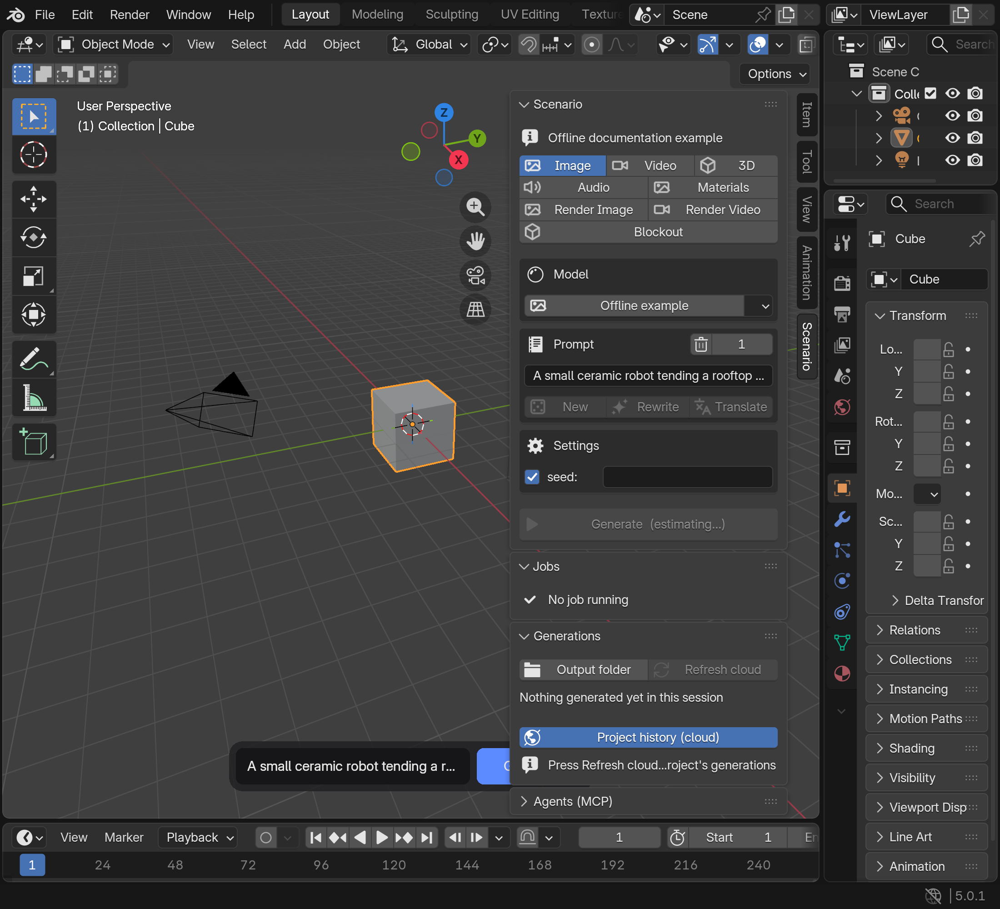

*The Image form is an offline illustration, not a live model response or price quote.*

## Install

Install Scenario from its official extension repository so that Blender can offer
you its updates:

1. Turn on **Allow Online Access** under Edit > Preferences > System > Network. Blender needs it to reach the repository, and Scenario's network actions don't run without it.
2. Open Edit > Preferences > Get Extensions > Repositories, choose **Add Remote Repository** and enter `https://blender.scenario.com/repo/index.json`.
3. Find Scenario in Get Extensions and install it. Blender installs and enables it.
4. In Scenario, open Organization settings > API Keys > Add API Key and copy the key and its secret. The [API-key quick start](https://docs.scenario.com/get-started/documentation/quick-start-guide/step-1-obtain-your-api-key) lists the account requirements.
5. In Edit > Preferences > Add-ons > Scenario, leave **Credentials** on **Saved in Blender**, paste the key and secret, and press **Test connection**. Pick an **Output Folder** (default `~/Downloads/Scenario`).

Then press `N` in the 3D viewport and open the **Scenario** tab.

**Installing from a ZIP instead.** Download `scenario-<version>.zip` from the
[releases page](https://github.com/scenario-labs/blender-plugin/releases), keep it
zipped (you can [verify it](#verify-your-download) first) and drag it onto a
Blender window, or use Get Extensions > Install from Disk. Then continue with step
4. A ZIP copy never updates itself: install each new release ZIP the same way and
restart Blender. Never keep a ZIP copy and a repository copy installed together;
to move to the repository, see
[Switch from a ZIP to the repository](#switch-from-a-zip-to-the-repository).
Historical `v*` ZIPs are earlier experimental builds that may differ from this
guide; follow the instructions attached to them.

### Credentials and project

- **Saved in Blender** keeps the key and secret in Blender's preferences, masked on screen but not in an OS keychain.
- **Environment** reads `SCENARIO_API_KEY` and `SCENARIO_API_SECRET` from the environment that launched Blender, which suits automation. Both are required.

The two sources never mix: environment values are ignored while **Saved in
Blender** is selected, and a missing value is never borrowed from the other source.
The account strip tells you when the selected source lacks its key or secret.

**Test connection** checks in the background that your credentials can read
Scenario's models. It doesn't tell you which account or project the key belongs to.
A **401** (rejected) or **403** (access denied) means you should check the key and
secret; after a 403 with a Project ID set, also check that the project belongs to
the key. A **429** means too many requests: try again shortly. Other HTTP failures
show only their code. Error messages never include service responses, credentials
or IDs.

**Project ID (optional)** works with either source. Leave it blank to use the key's
default scope, or enter a project you are allowed to use. It's an override, not a
way to gain access: a malformed ID is rejected, and a permission error never falls
back to the default project. The ID is saved with Blender's preferences.

Changing the project clears the visible catalog, history and prices, and retires
pending approvals. Jobs already submitted keep their original credentials and
project, so switch back to inspect or recover them.

### Updates

Edit > Preferences > Add-ons > Scenario > **Updates** shows your version and whether
the official repository is set up. With **Allow Online Access** on:

- **Set up official repository** shows while the repository is missing or turned off. It adds it, or turns the existing one back on, never a second copy.
- **Check for updates** takes its place once the repository is set up. It refreshes the listing and installs nothing.
- **Open Get Extensions** opens Blender's extension manager, where you install or update. It lists only releases for your Blender version and platform, and shows download errors.

If no compatible release appears, keep your version and read the release notes. A
listing left over from a failed check doesn't prove you're up to date; retry once
online. Restart Blender when asked. A repository copy updates in place and keeps its
preferences and jobs; save Blender's preferences yourself if they don't save
automatically.

A ZIP copy never updates from the repository, even after **Set up official
repository**; its Updates panel says it was installed outside it. Keep updating it
with **Install from Disk** into the same local repository, or
[switch to the repository](#switch-from-a-zip-to-the-repository).

If Scenario disappears, Updates controls included, after you disabled its repository,
enable that repository again under Get Extensions > **Repositories** (Scenario can't do it
while unloaded). Don't remove it or install a second copy to recover.

This handbook lives at [blender.scenario.com](https://blender.scenario.com/), which
the **Website** link in Get Extensions opens; its
[downloads page](https://blender.scenario.com/repo/) lists the latest release for
each supported Blender version and platform. Scenario targets Blender 5.0, 5.1 and
5.2.

### Switch from a ZIP to the repository

A ZIP copy and a repository copy are separate installations: credentials,
preferences and stored jobs don't move between them.

Uninstalling a copy makes Blender delete its storage, including the media behind
the video, sound and Film review strips Scenario added to your scenes. Images and
models in a saved `.blend` file and your Output Folder are untouched. If you rely on
such strips, keep the ZIP copy, or relink each strip afterwards to its original in
your Output Folder: the file name contains the asset ID stored in the strip's
`scenario_asset` property.

1. Let running generations finish: the new copy won't track them.
2. Uninstall the ZIP copy from Get Extensions and restart Blender.
3. Follow [Install](#install), steps 1 to 3. Skip adding the repository if it's already listed.
4. Enter your key, secret, Project ID and Output Folder again.

Your past generations stay in your Scenario project: turn on
**Project history (cloud)** in [Generations](#generations) and choose
**Save for recovery** on a completed model job to bring it into the new copy.

### Verify your download

Automated releases include `SHA256SUMS` and a build provenance attestation. GitHub
Actions builds the ZIP with Blender 5.0 and validates it on 5.0, 5.1 and 5.2; this
checks the package, not runtime compatibility. Historical `v*` releases have
neither.

Download the ZIP, `scenario-handbook-<version>.html` and `SHA256SUMS` into one
folder, then run `sha256sum -c SHA256SUMS` (macOS: `shasum -a 256 -c SHA256SUMS`)
and, with the GitHub CLI,
`gh attestation verify scenario-<version>.zip -R scenario-labs/blender-plugin`.

## Find your way around

- The **Scenario tab** in the 3D viewport sidebar (press `N`, or click **Scenario** in the viewport header) holds four panels, described below.
- The **floating composer** at the bottom of every 3D viewport is the quick way to type a prompt and generate; see [The floating composer](#the-floating-composer).
- **Studio**, next to **Scenario** in the header, opens [expanded controls](#expanded-studio-view).

The four panels:

- **Scenario**: what to generate. Choose a lane (Image, Video, 3D, Audio, Materials, Environment, Render Image, Render Video, Blockout), then fill in its [form](#the-form).
- **Jobs**: what's running; see [Jobs](#jobs).
- **Generations**: what came back, then your project's cloud history; see [Generations](#generations).
- **Agents (MCP)**: the local MCP server, its token, client setups and the Python permission; see [Agents (MCP)](#agents-mcp).

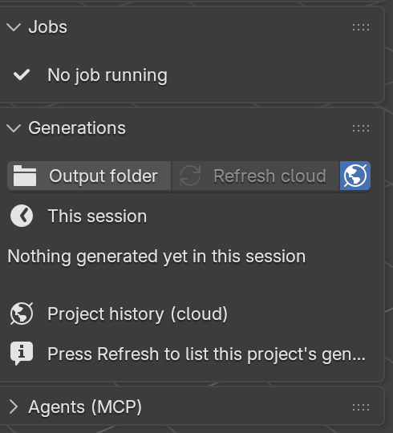

## The form

From top to bottom:

- **Account strip**: connection status, a button to reload models and a shortcut to the preferences.
- **Model**: opens the [model picker](#the-model-picker). Picking a model of another type switches to its lane.
- **Prompt**: drag the size control to make the box taller. Below it, Prompt Spark's **New** (writes a prompt for the model), **Rewrite** (improves yours) and **Translate** (into English) each show their price first; click **Approve...** to run it once. The result replaces the prompt only if you haven't changed the prompt, model, scene or credentials in the meantime. The trash button clears the prompt after asking.
- **References**: one box per file input (image, video, audio or 3D). Add a file with **Upload**, a still with **Render**, **Viewport** or **Camera**, or a clip with **Viewport clip** or **Camera clip**; then **Upload reference** sends it. For 3D, **Upload selected mesh** exports your selection. Generate never captures or uploads anything by itself.
- **Parameters**: built from the model's own settings. Tick an optional parameter to send it; unticked, Scenario uses its default. On/off settings are always sent. `(cost)` marks parameters that change the price.
- **Generate (N CU)**: the exact price for the form as it stands, refreshed as you edit (checking is free). Generate spends that price once. Pending uploads and captures must finish first.

Prices show up to three decimals, and in compact form from 10,000 CU (`12.3K CU`).
The approval always uses Scenario's exact price.

[Jobs and results](#jobs-and-results) explains what happens after you generate. Some
features below come from the earlier prototype and are still being connected; the
[known limitations](KNOWN_LIMITATIONS.md#creation-and-scene-application) say what
applies today.

### The model picker

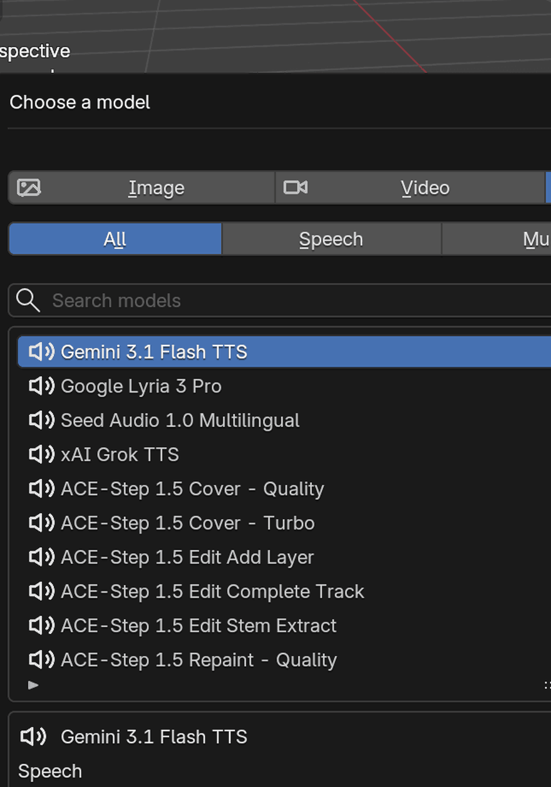

Like Scenario's "Choose a Model", the picker has type tabs, category chips, a
search field, a list with thumbnails and a description of the highlighted model.
Which models appear depends on your credentials.

| Tab | Categories |
| --- | --- |
| Image | All, Generate, Edit, Expand, Upscale, Vectorize, Remove Background, Tools, Trained |
| Video | All, Generate, Edit, Lipsync, Upscale, Reframe, Remove Background, Tools |
| Audio | All, Speech, Music, SFX, Tools |
| 3D | All, Generate, Splat, Remesh, Retexture, UV Unwrap, Rigging, Animate, Parts |

**Trained** lists LoRAs and compositions; see
[Use a LoRA or composition](#use-a-lora-or-composition). Speech-to-text and
video-to-motion models are marked **Experimental**: you can generate with them,
but their results aren't fully supported yet
([#190](https://github.com/scenario-labs/blender-plugin/issues/190)).

## The floating composer

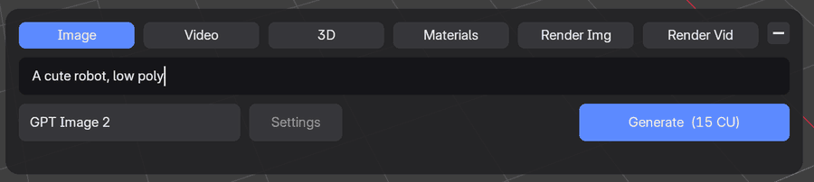

The composer is a pill at the bottom of every 3D viewport with your prompt and a
**Generate** button. It uses the current lane's settings exactly as they are in the
sidebar.

Click the pill to expand it. The card has lane tabs (Audio and Blockout stay in the
sidebar), the prompt, a model chip that opens the picker, a **Settings** chip that
opens the lane's full form in a dialog, and **Generate** with its price.

- **Environment** uses its Generate mode. When the sidebar shows another Environment mode, Audio or Blockout, the composer drives Image.
- **3D Edit**: open **Settings** and select **Edit**; choose the task in the sidebar or Settings, and select the mesh in the viewport.
- When a model takes no prompt, the field says *This model takes no prompt*.

**Moving and resizing.** Drag the pill or the card to move it; it stays inside the
viewport and clear of open toolbars and sidebars. Resize the card from its
bottom-right corner, and double-click its background to put it back in place. Only
the minus button collapses it. Narrow cards shorten the tab labels. When there's no
room for the card, the pill opens the Settings dialog instead.

**Editing the prompt.** Text editing works as usual (selection, double-click,
Home/End, Ctrl/Cmd+A, C, X, V). Enter generates and Esc leaves. Clicking outside
saves your edit and passes the click to Blender. If the form changes behind your
back (for example from another window), your text stays with the old form and
nothing is sent until you press Esc or click a lane tab.

**Japanese, Chinese or Korean input.** The composer can't show input-method
composition. Press F2 in the prompt to open Blender's own text field at the
pointer, compose there and press Enter to insert the text. Dead keys for accents
work directly.

**Following your job.** After you generate, a thin tray above the card follows your
newest job from that scene and tab, including jobs an agent started there. It shows
the prompt, the status (*Queued*, *Generating 42%*, *Ready to apply*, *Applied*),
the price and how many other jobs are unfinished. **Inspect** opens the job's
details and actions. A second chip offers the next step, such as
**Cancel generation**, **Resume download** or **Add video strip**, and asks for the
same confirmation as the sidebar. The cross hides the tray for that job only. Jobs
from before a restart, workflows and Film tasks aren't shown there; use
**Inspect saved jobs** in the Jobs panel. When collapsed, a thin line in the pill
shows the job's status and progress.

If the composer keeps failing, it switches itself off: turn it back on with
**Floating composer in the viewport** in the preferences.

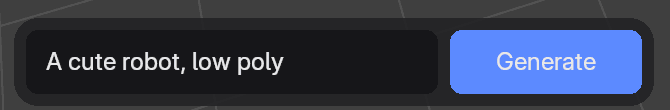

## Lanes

Model names below are examples; what's available depends on your access and each
model's current settings.

### Image

Choose a model and describe the result. To use a reference, add it to the form,
click **Upload reference** and wait for it to finish; the form then shows a fresh
price. Uploading never generates.

- While an upload runs, keep the model and slot unchanged, and for a viewport, camera or Render Result snapshot, the scene too; otherwise the late upload won't replace your new choice. A local file keeps uploading while you work.
- **Inspect uploads** shows progress, cancels an upload that hasn't started sending and cleans up finished ones; your original file is never touched. An interrupted upload can't resume: choose **Upload again**, then **Use this reference**.
- To reuse an earlier upload, choose **Use saved upload** or **Saved uploads**, then **Use this reference**, and confirm. Uploads belong to the credentials that made them; editing the original file later doesn't change them.
- The same controls work for audio, video and 3D inputs. Still captures fill image inputs, viewport and camera clips fill video inputs, and **Upload selected mesh** fills a 3D input.

Supported PNG and OpenEXR results import as packed images, which you can find in
Blender's Image Editor.

**Remove background** on an image result fills the Image form with a
background-removal model and that image, replacing the form's previous content. It
doesn't generate: upload the reference, check the price, then choose **Generate**.

#### Use a LoRA or composition

Choose the Image tab's **Trained** chip in the model picker. It lists the LoRAs and
compositions this form can run first, yours before Scenario's public ones. Each row
names the base models that can run it, for example **LoRA via FLUX.1 Dev**; a greyed
row says why it can't run in this form.

Highlight a LoRA, choose its base under **Run with** when several can run it, set
its **Strength** and click OK; if you just typed the strength, the first click only
confirms the value, so click OK again. The form switches to that base and adds the
LoRA. Strength starts at the LoRA's own value, or 0.75, within the range the base
allows. Add more LoRAs the same way to stack them. A composition already combines its LoRAs, so it replaces the form's
choice; the picker tells you before OK.

Your choice appears in the **Trained models** box under **Model** (in the sidebar,
Studio and Render Image). Adjust each LoRA's **Strength** there, remove one, or
choose **Add LoRA or composition**. A composition's strengths can't be changed. A
LoRA without a strength yet shows **Set strength**: Blender never sends a strength
you haven't seen. Each change gets a fresh price, and models that were deleted or
became inaccessible are refused before pricing. Choices belong to the credentials
and project that made them; choose again after switching.

**Reload parameters** restores a generation's LoRAs or composition when they are
still available, and says how many it couldn't restore. The **Model** button and the
composer's model chip show the choice as **FLUX.1 Dev · Studio LoRA (+1)**.

#### Project defaults for LoRAs

At the end of the **Trained models** box, **Save** makes the current choice this
form's default for your credentials and Project ID, **Use** brings it back, and
**Clear** forgets it. A form without a chosen model, such as in a new file, picks up
the default by itself. If the default can no longer run, the form says
**Project default ... is unavailable** and won't price until you choose a model or
clear it; it never falls back to the base model alone. Defaults of other
credentials or projects are never used.

Trained models are experimental: the picker shows **Experimental: LoRAs and
compositions in testing**, and the **Trained models** box shows **Experimental: in
testing**. They run, but results with them haven't been fully verified. Training
stays in Scenario's web app.

### Video

Text, images or your Blender scene to video, with Seedance, Kling, Veo, Wan, LTX and
other video models, including audio-to-video.

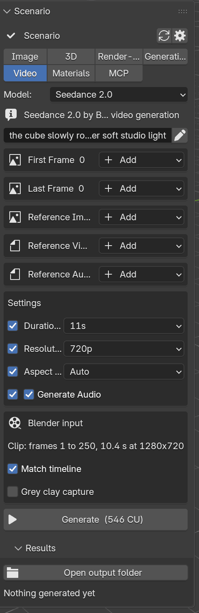

**Using your scene.** Add a **Viewport clip** or **Camera clip** reference and
choose **Upload reference**. Blender records a silent 1280x720 MP4 over the preview
range, or the scene range, and restores your settings afterwards. **Grey clay
capture** replaces viewport shading. The uploaded clip is fixed: it isn't trimmed or
padded, and later timeline changes don't affect it, so set the range first.
**Match timeline** helps set the model's duration, but check the model's own limits.

**Playing a result.** **Play video (N)** opens a private copy in your system player,
and **Play in Blender (N)** opens one in Blender's animation player (at most two at
a time; whether it plays the soundtrack hasn't been verified). Neither player gets
your credentials, and both work offline.

**Adding it to the sequencer.** **Add video strip (N)** asks you to confirm the
scene and current frame, then places the video (MP4 or WebM, up to 512 MiB) on a
free channel without generating again. The strip leaves out embedded audio and plays
at the scene's frame rate. If the scene or frame changes first, confirm again.
Select the scene in the Sequencer header to see it. The strip plays a local copy
kept by the extension, which must stay available if you move or share the file.

Results from the earlier prototype offer **Play**, **Play in Blender** and
**Add video strip** instead.

### 3D

Four modes: **Text**, **Image**, **Multi-view** (several views of one object, front
first) and **Edit** (Scenario's 3D tools on your selected mesh). Models include
Meshy, Rodin, Tripo and Hunyuan, plus worlds such as Marble, HY World and
TripoSplat.

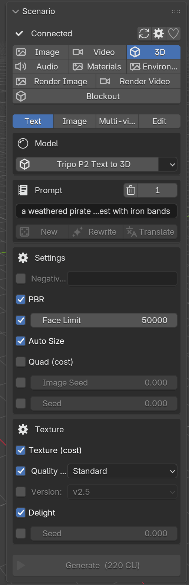

**Importing a model.** Choose **Import <format> model (N)**, such as
**Import GLB model (1)**, for the main model, or **Import alternate: <format> (N)**
for another file the provider returned. The review shows the scene, cursor position
and files, for example `OBJ + MTL + 2 maps`. Once confirmed, the model arrives as a
new group at the cursor with its materials and textures packed; your objects and
selection are untouched. Importing one result uses up the job's import: the other
files stay saved for [Reuse saved results](#reuse-saved-results). If the cursor or
scene changes first, confirm again.

- Supported: GLB, glTF, FBX, OBJ and mesh PLY, up to 256 MiB per file. Large files may pause Blender briefly.
- Rigs, skin weights, shape keys and animation clips are kept. Your timeline range doesn't change, so extend it to play a full clip.
- If a file changed or isn't supported, the job says **Nothing was imported** and nothing changes.
- With Global Undo on, one Undo removes the import and Redo restores it. Neither changes the job or refunds it. Save the blend file yourself.

See [model import](MESH_APPLICATION.md#saved-model-package-import) for format
details and limits.

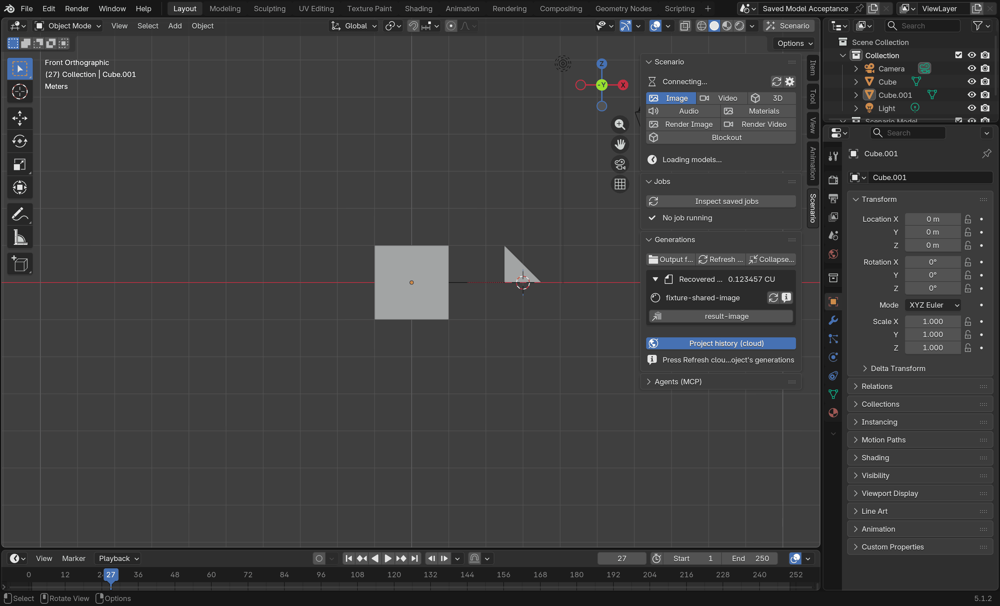

**Gaussian splat worlds.** Worlds come back as Gaussian splats, which Blender can't
render, so they import as a coloured point cloud (view it in Material Preview or
Rendered mode). The review lets you limit the number of points (1,000,000 by
default) and choose how the file stores "up". If the world arrives upside down,
delete it and import again with the other axes. The **Scenario Splat Points**
modifier controls point size. SPZ version 4 files can't be read yet. Splats import
one file at a time and wait while a Render capture or Film preparation runs; import
again once it finishes. See
[splat import](MESH_APPLICATION.md#saved-gaussian-splat-import) for details.

**Edit mode:**

1. Select the mesh in the viewport.
2. Pick the task: **Remesh**, **Retexture**, **UV Unwrap**, **Rigging**, **Animate** or **Parts**.
3. Choose **Upload selected mesh** to send a snapshot of it (modifiers applied, materials embedded), then review the price and choose **Generate**. Later edits don't change the snapshot; remove the reference and upload again to replace it.

To put the result back on your mesh, see
[Apply a saved mesh edit](#apply-a-saved-mesh-edit).

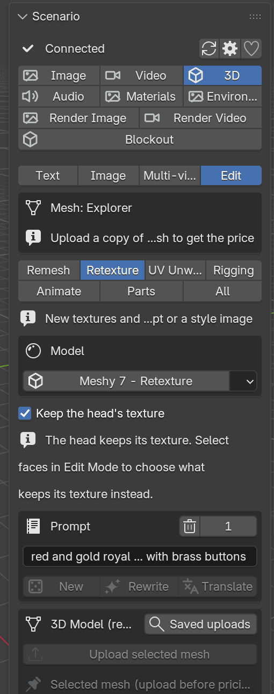

### Materials

Patina turns a prompt or photo into a seamless PBR set: base color, normal,
roughness, metalness and height. **PATINA Material** works from a prompt,
**PATINA Image to Maps** from a flat texture or photo, and
**PATINA Material Extract** isolates one material from a photo.

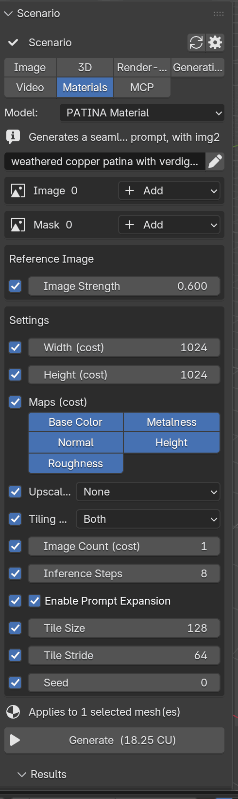

Describe the material, choose the maps and size, and generate. The texture set is
saved without touching your scene.

To apply it, select a mesh with UVs and choose **Apply saved material** on the job.
Confirm the mesh, material slot and maps. Only that slot changes; nothing is
regenerated or spent. Height is wired as bump, and AO and edge maps are kept for you
to connect by hand. Undo doesn't cover this, so keep any material you want to
restore and save the blend file yourself. See [material application](MATERIAL_APPLICATION.md) for details.

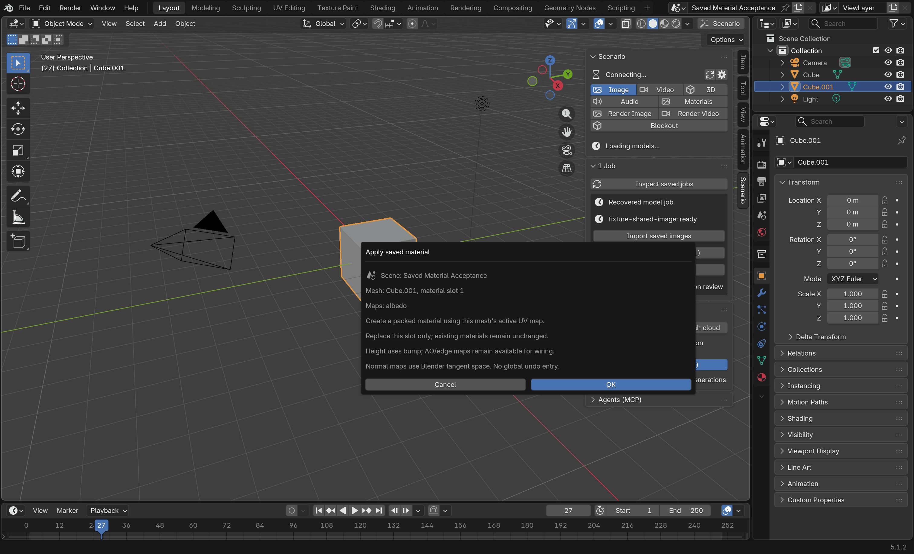

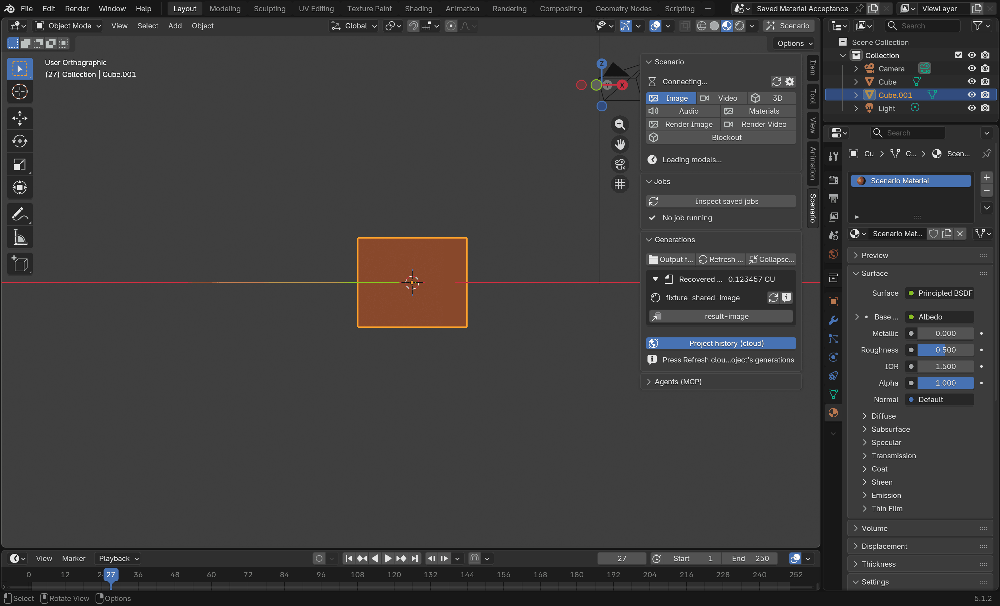

### Audio

Speech, music and sound effects with ElevenLabs, Google Lyria, ACE-Step, Minimax,
Gemini TTS, Sonilo and other audio models. When a model makes WAV audio, you get
that WAV file, not Scenario's compressed MP3 copy.

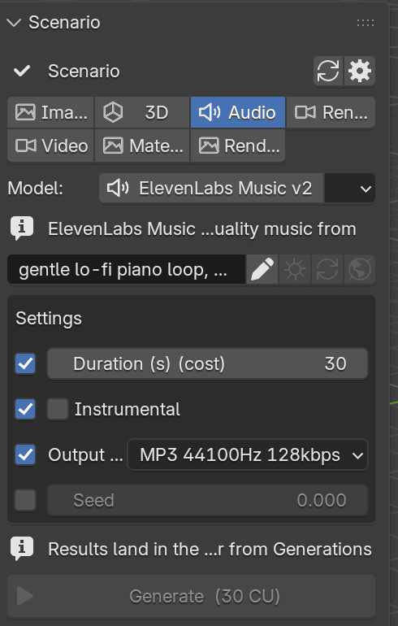

**Add audio strip (N)** places a saved MP3, WAV or OGG result on a free sequencer
channel at the frame you confirm, as for video.

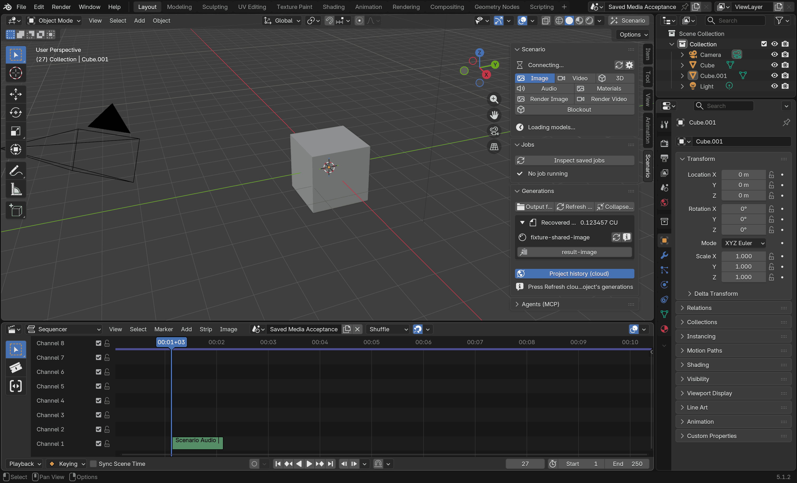

**Play audio (N)** plays the audio inside Blender, up to ten minutes long, through
the output chosen in Preferences > System > Sound, even offline. While it plays,
the button reads **Stop audio (N)**; playing another result stops the first.
**Open in system player (N)** opens a private copy in your system player instead.
**Waveform (N)** draws the audio under the job's controls without playing
it, even offline, with its duration, channels and sample rate. Waveforms support
common audio formats up to ten minutes; see
[waveform limits](RESULT_PREVIEWS.md#offline-audio-envelopes).

### Render Image

Your view, rendered as a finished still by an image-editing model. The
**Rendering Style** section holds everything that shapes the look.

- **Scene to render**: choose Viewport or Scene camera (optionally with Grey clay capture), then **Capture and upload scene**.
- **Model**: GPT Image 2 by default, or any other image-to-image model.
- **Look**: describe the result, for example "weathered steampunk copper, overcast light". Left empty, **Prepare look with Prompt Spark** (on by default) writes one, with its own price and approval before the render's; turn it off for a photoreal default.
- **Style images**: optional references for palette, materials and lighting. The capture is always image 1.

The model is told to keep your scene exactly (objects, positions, camera and
framing) and to use style images only for their look. Results are saved for you to
apply; to start a clip from one, use **Use as video first frame**
([Render Video](#render-video)). Agents can prepare the same
form through local MCP; see the
[agent preparation sequence](MCP.md#preparing-render-image-and-render-video).

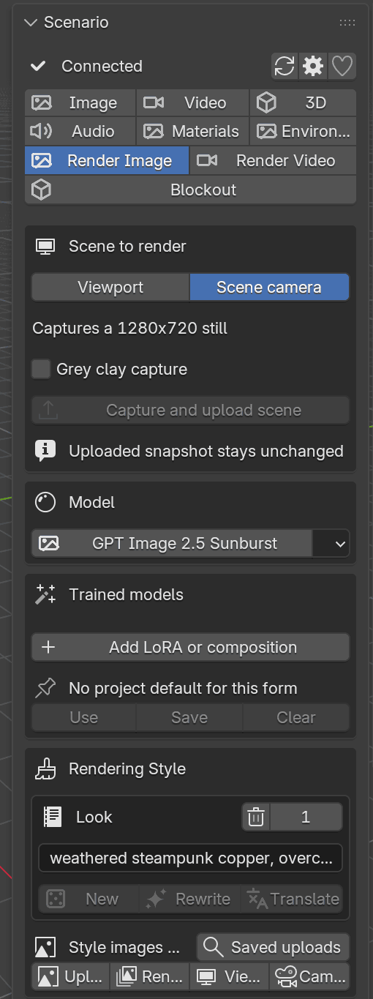

### Render Video

A playblast of your timeline, rendered as a finished clip by a video model that
takes a reference video. The look, reference frames and first frame are in the
**Rendering Style** section.

- **Clip to render**: choose Viewport or Scene camera, build a [camera path](#camera-path) if you want one, then **Capture and upload scene**. The silent 1280x720 clip covers the range shown, without padding or trimming. **Match timeline** sets the model's duration; it doesn't change a clip already uploaded.
- **Model**: Seedance, Minimax, Runway Aleph, Gemini, Grok and other video-to-video models.
- **Look** and **Reference frames**: as the look and style images in Render Image. Prompt Spark needs a [first frame](#first-frame).

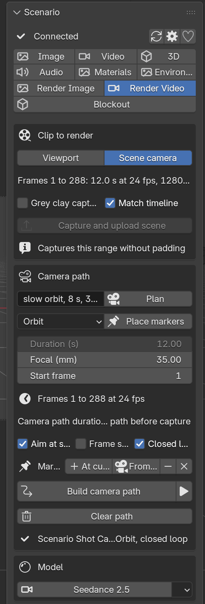

#### Camera path

Type the shot you want ("slow ellipse 2, 8 s, 35mm, hold 2 s") and press **Plan**
to place `Shot` markers and build the path in one step. Or pick a move from the
library (orbits, ellipses, dolly and truck, crane and arcs, pans and flyovers),
choose **Place markers**, move or fine-tune the numbered markers and set a hold on
any of them, then **Build camera path**. Either way, Blender animates
`Scenario Shot Camera` and asks before replacing an existing path. With **Match
timeline** on, the model's duration sets the path's. The play button previews it,
and **Clear path** removes the camera and markers. A Camera clip then records
exactly that move.

#### First frame

Choose an image and **Upload first frame**. To use a generated image instead,
choose **Use as video first frame (N)** on a PNG, JPEG or WebP result: it reuses the
image on Scenario without uploading or generating, and the slot shows
**From a saved result** (remove it to undo). Some models (Seedance 2.5, 2.0 Fast and
2.0 Mini, Minimax H3 and Wan 3.0) can't take a first frame together with the clip;
for them, the image guides the opening look instead, and the form says so.

### Blockout

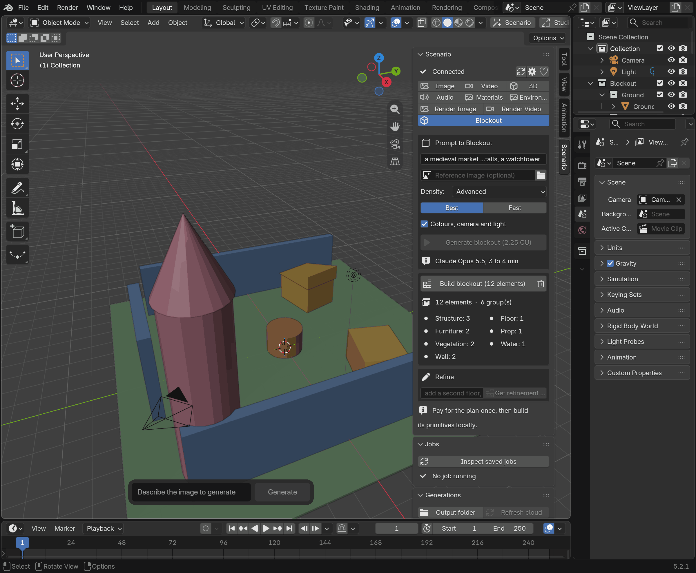

Turn a scene description into a greybox layout of coloured primitives, grouped in a
`Blockout` collection.

1. Describe the scene, choose its **Type** and **Scale**, and press **Get design price**.
2. Review the price and choose **Generate plan**. Changing the fields, scene or credentials first cancels the approval.
3. Choose **Build plan** to create the geometry. To refine, describe the change, choose **Get refinement price**, approve it, then build again.
4. **Clear** removes the collection and plan after asking. Build and Clear support Undo.

Colours mark categories such as Floor, Wall, Prop, Furniture and Vegetation. Swap
blocks for generated 3D assets as your scene develops. Rebuilding replaces only this
scene's Blockout collection, and manual edits to its objects are lost. Move any
objects you added to that collection elsewhere first: they block rebuilding and
clearing.

If a request's outcome is uncertain, don't generate again: select the scene, choose
**Inspect saved jobs**, **Read saved Blockout plan**, then
**Use saved Blockout plan**, and confirm. This updates only the stored plan (Undo
reverts it); choose **Build plan** to update the geometry.

### Environment

Generate a 360 panorama for the scene World. Modes:

- **Generate**: from a prompt, with Scenario Skybox Flux or GPT.
- **From image**: from one image of a place, with HY World.
- **HDRI**: convert a saved panorama or a local 2:1 image into an HDR OpenEXR environment.
- **Upscale**: upscale a saved panorama or a local 2:1 image. To stay within the 32-megapixel World limit, a saved panorama upscales 2x at most, and an upscaled one can't be upscaled again.

Panorama inputs take a **Saved panorama** (a downloaded result Scenario marks as
360) or a local 2:1 PNG or JPEG, which **Upload reference** checks before sending.
Results stay saved until you apply them. **Set panorama as World (N)**
[applies one](#apply-a-saved-panorama-to-world), and **Make HDRI (N)** opens the
HDRI form with it. Review seams and lighting yourself: the extension doesn't
measure them, and HY World hasn't been checked with a live run yet
([#440](https://github.com/scenario-labs/blender-plugin/issues/440)).

## Jobs and results

Every generation is saved as a job, so you can follow it, recover it after a restart
and apply its results when you're ready. Image lane results import by themselves
in the session that sent them; nothing else reaches your scene until you confirm
where it goes. If a submission's outcome is uncertain, never send it again: inspect
the saved job first.

### Jobs

The **Jobs** panel lists what's running, with statuses such as "queued",
"generating", "finished on Scenario", "downloading results" and "results saved". A
job stays here until you apply its results.

- A progress bar appears when Scenario reports progress; some models don't.
- With Online Access off, checking and downloading pause; the job continues on Scenario.
- After a restart, choose **Inspect saved jobs**, then **Refresh status** or **Resume download**.
- **Cancel prepared job** drops an approved request that hasn't been sent yet; nothing reaches Scenario. A canceled Film task keeps its name, so use a new take name to retry.
- **Cancel generation** appears only for jobs Scenario can cancel. Other running jobs finish or fail on Scenario and stay recoverable.
- While a request's outcome is unconfirmed, the same request is refused so you aren't charged twice. Check your Scenario history, then choose **Mark reviewed** on that job; this lasts until you restart Blender.

### Generations

The **Generations** panel shows this session's results, then, with
**Project history (cloud)** on, your project's history from the web app, agents and
other machines. **Load older** goes back in time.

Each entry shows the prompt, price, model, asset ID (click to copy), a thumbnail
and the actions for its kind:

| Result | Actions |
| --- | --- |
| Image | View image, Use as reference, Remove background, Apply as texture, Add as plane |
| 3D | Add to scene, Select, Delete |
| Video | Play, Play in Blender, Add video strip |
| Audio | Play audio, Waveform, Open in system player, Add strip |

- **Reload parameters** puts the lane, model, prompt, settings and references back into the form.
- **Details** shows everything that was sent and returned.
- **Select** and **Delete** find the objects a generation created, even after renames.

When a generation fails, a red marker shows the reason Scenario gave, including the
error ID (`error_...`) support asks for; **Copy error** in Details copies it. The
reason isn't saved, so after a restart only the marker remains.

This session's results show the price you approved. In cloud history, prices
include add-on fees such as quality checks, and a workflow shows the total of its
steps, or **Cost unavailable** if one can't be read; its steps are listed too, so
don't add them up again.

**Saved jobs.** **Inspect saved jobs** lets you resume downloads and apply results,
even after a restart. Opening a saved job never generates again or imports by
itself.

**Recovering a cloud job.** **Save for recovery** brings a completed cloud model job
into your saved history without downloading or changing anything; a failed read
never causes another paid generation. Then use **Inspect saved jobs** to download
and apply it. This can't restore the target mesh of an edit made in another
session.

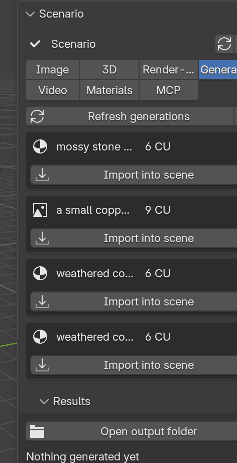

### Result previews

Saved jobs show previews of their results, four at a time: Scenario's preview image
for video, audio and 3D, and a small copy of the file for images. Scenario can take
a few minutes to prepare one; if it doesn't arrive, choose **Retry preview (N)**.
Previews never cost anything or change your scene. Agents read them with the local
MCP [`inspect_result_previews`](MCP.md#saved-result-previews) tool.

### Reuse saved results

**Reuse saved results** on a completed job applies its saved files again, for
example as another import, a material or a World, without generating or spending.
Each reuse asks you to confirm its destination. Undo reverts the scene change but
not the job's own controls: after undoing a World, its **Restore** button is gone. If
Blender can't tell whether a reuse finished, check the scene: the job blocks further
reuse until you choose **Save import receipt**. A job allows up to 128 reuse
attempts.

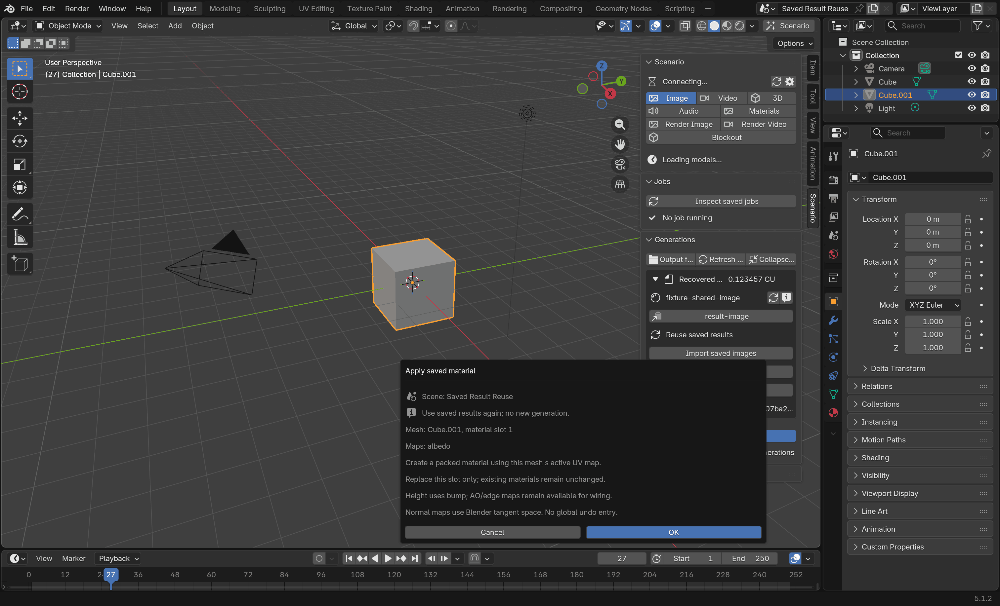

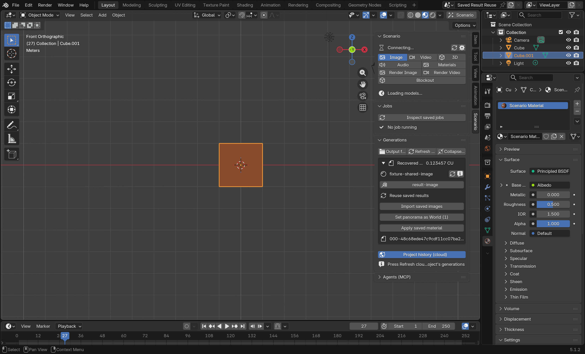

### Apply a saved panorama to World

Choose **Set panorama as World (N)** on a saved 2:1 PNG, JPEG or OpenEXR result,
including an [Environment](#environment) result, and confirm the scene and World.
The button appears only for images that can be 2:1. Until Blender has read an
image's size, it stays offered and the confirmation still checks the image.
Blender uses the image as the environment and keeps your original World. A rotated
JPEG, or an EXR in a color space Blender would misread, is refused; see
[accepted files](WORLD_APPLICATION.md#accepted-local-files).

**Restore previous World** brings back the most recent World it replaced, during
the same session only, and not if you edited the World or image since. Neither
action spends anything. Save the blend file yourself.

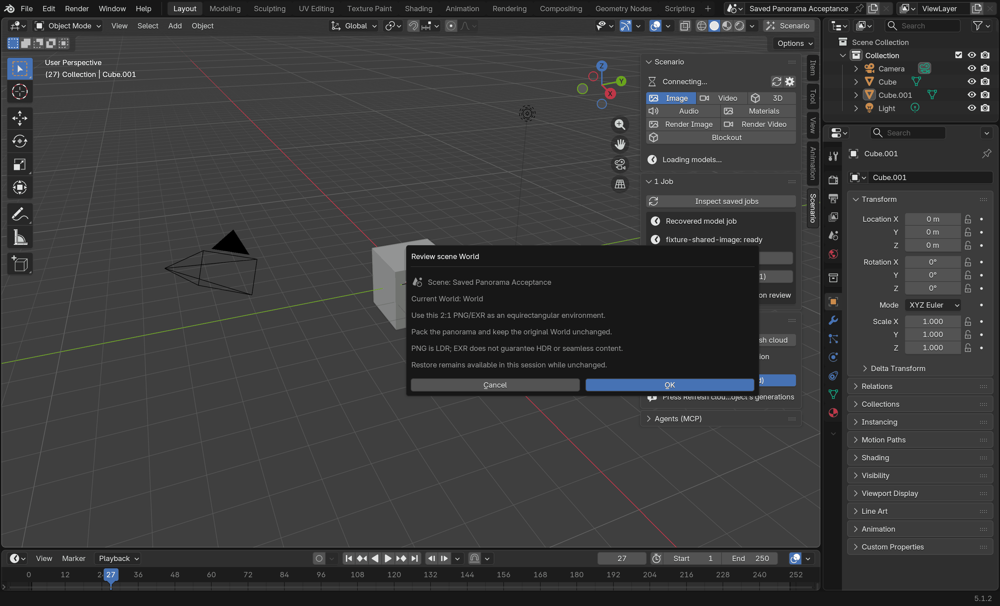

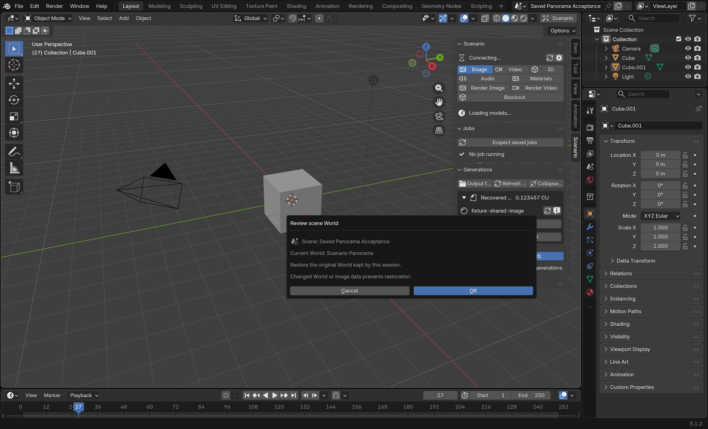

### Apply a saved mesh edit

Select your mesh, then choose **Apply mesh edit (N)** on the saved job and pick how
to apply it:

- **Replace geometry**: geometry, UVs and materials.
- **Replace active UVs** or **Replace textures**: only when the result's topology matches your mesh exactly.
- **Replace with parts**: replaces the mesh with the result's named parts, under an empty parent.
- **Attach rig**: adds the returned armature and weights to your unrigged mesh, when its geometry matches exactly. Move the new rig group with the mesh afterwards.

Choose **Scene coordinates** or **Object local coordinates** for the result's
positions; the extension doesn't realign it. **Keep original** (on by default)
leaves an unselected copy. With Global Undo on, Undo and Redo restore the scene
before and after the edit, but don't refund it. If the outcome is uncertain, inspect
it rather than applying again. See
[mesh application](MESH_APPLICATION.md#supported-policies) for requirements.

## Expanded Studio view

**Studio**, next to **Scenario** in the viewport header, opens larger pages:
**Create** (the same form as the sidebar), **Film**, **Workflows**, **Library**,
**Jobs**, **Results** and **Connection**. Switching pages keeps your work; press Esc
or click outside to go back to Blender while jobs keep running.

### Run a workflow

1. Open **Studio > Workflows**, choose **Private** or **Public**, and pick a workflow, or enter its ID and choose **Load workflow inputs**.
2. Confirm to load its inputs.
3. Fill in the inputs. Tick an input to send it; unticked inputs use the workflow's default, if it has one. File inputs accept an upload, a Library asset or an asset ID; the input shows which it takes.
4. Choose **Request workflow price**, then **Generate**, and confirm.

The form saves with the scene, but prices and approvals don't survive a restart.

To upload into a workflow input, choose a **File** and **Upload file**, or a
snapshot button, and confirm; uploading generates nothing. A snapshot captures the
scene as it is: editing the scene, changing the frame or rendering stops a snapshot
that is still sending, and it can't resume. If an upload doesn't attach, choose
**Inspect uploads** to attach it, or to cancel it if it never started sending;
**Stop waiting** to free the input and keep its values; or **Clear reference** to
empty it. See [workflow uploads](SDK_UPLOADS.md#workflow-input-attachment) for the
technical details.

Workflows that loop (For Each), or that Blender can't check for loops, show
**Generate (from N CU)**: Scenario prices one
pass, so the final charge can be higher. Check the loop's item count before you
confirm.

**When a workflow waits for you.** Scenario can't cancel a running step, but a
workflow can pause for your approval or selection. Its job then shows
**Workflow waits for your decision**. Review the step, optionally
**Load previews** of its images, then **Approve**, **Select** or **Stop workflow**
and **Send decision**. The decision is sent once; if its outcome is unknown, wait
for the step to reappear rather than sending it again.

Continuing runs the remaining steps, which spend credits; their charge isn't
checked against the approved price. Stopping keeps completed steps charged.

### Browse Library assets

In **Studio > Library**, choose **Refresh** to list your assets, or public ones with
**Public assets**. Search by text, or browse a collection by its ID, then choose
**Refresh** again. **Use as reference** adds an asset
to a model form or, with **Reference destination** set to **Workflow**, to a
workflow input, after you confirm. Existing references are kept, so remove one
first to replace it; in a workflow, **Clear reference** empties the whole input. Changing credentials, the Project ID or the open file clears
the Library.

### Organize Library assets

**Organize** on an asset adds it to or removes it from a collection, adds or removes
tags, or adds it to a new collection. To pick an existing collection, choose
**Load collections** first. Choose **OK** to see a review, then **Apply** to
send it, within 10 minutes. The card then shows what Scenario reports, such as
**Verified** or **Refused**. If it says **Unconfirmed**, refresh and check the
asset: nothing is resent automatically. These changes are free but immediate, and
Undo doesn't reverse them. Rename or delete collections in Scenario's web app.

## Film tasks

Film is experimental. It turns a JSON recipe into shots, a timeline, a composed
master, a review scene, an exported video and a shareable case study. Every step
asks for its own confirmation, and paid steps show their exact price first. See the
[Film reference](FILM_PLAN.md) for the full recipe format and MCP equivalents.

1. **Recipe and tasks**: expand **Film** in the sidebar, load your recipe, then price and generate each model task. Save the blend file to keep the recipe.
2. **Shots**: **Prepare shot** checks a shot's saved models, and **Build shot** creates its scene.
3. **Timeline**: **Build timeline** assembles completed shot scenes into an editable sequence.
4. **Capture**: **Render capture** renders a still or silent clip of a shot; **Upload capture** sends it to Scenario. Video needs ffmpeg and ffprobe (see [Troubleshooting](#troubleshooting)).
5. **Composition**: **Prepare composition**, then **Request price** and **Generate**, makes a final or previs master.
6. **Review**: **Prepare review**, then **Build review scene**, assembles your media into a new scene to watch.
7. **Export**: **Export video...**, then **Render video**, renders a review scene to a new MP4 without spending anything.
8. **Case study**: **Export case study...**, then **Save case study**, bundles a review with its media, recipe and costs into a ZIP. It leaves out credentials, IDs and local paths, but review it before sharing.

Good to know:

- Your working scene stays selected and unchanged. Changing it between preparing and building a review, or between choosing an export file and rendering, discards that preparation; prepare again.
- Reloading a recipe keeps its production, so a new take needs a new task name. **New production** starts a separate one.
- Capture files expire when the Blender session ends: upload or copy what you need first.
- If a build or upload is uncertain, inspect saved jobs and save the offered receipt; never build or send it again.
- One export or case study runs at a time. Exports never overwrite a file, and agents can export only inside the Output Folder.
- A `.blend` file can keep fragments of earlier settings, so review a case study before publishing it widely.

## Agents (MCP)

The local `scenario-blender` server connects agents to your open scene. The hosted
`mcp.scenario.com` server covers platform-wide collections, training, workflows and
usage; connect both if you need both.

The local server starts on its own while **Allow Online Access** is on and accepts
connections only from this computer, and an agent can upload only files Scenario
saved or files you chose in Blender during this session.

Copy a client setup from the **Agents (MCP)** panel. It contains a live token, so
keep it out of screenshots, logs and source control. **Allow connected agents to
run Python** is off by default. For headless use, run
`blender --background scene.blend --command scenario_blender`. The
[MCP reference](MCP.md) covers tools, setup and security.

Agent changes mark the file as modified and can be undone, but agents can't save:
save the file yourself.

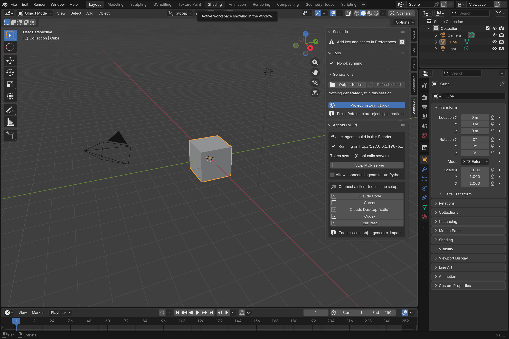

## Costs

Prices are in Creative Units (CU) and depend on the model, settings and references.

- **Generate (N CU)** is the price of the form as it stands.
- After you generate, the button keeps its price and comes back a moment later, once Scenario confirms the job. Change anything to price a different request.
- **from N CU** means the final price may be higher: some references aren't uploaded yet, or a workflow loops or can't be checked for loops.
- **Price shown after the upload** means a required mesh or capture is still missing.
- Prompt helpers and Blockout designs are paid separately.
- If a price check ever starts a job on Scenario, prices stop until you restart Blender and nothing is sent again.
- With an empty Render Image or Render Video look and automatic Spark on, the look has its own price before the render's. Turn Spark off to use the photoreal default instead.

See the [known limitations](KNOWN_LIMITATIONS.md) for current spending limits.

## What leaves your machine

With online access and credentials enabled, price checks send your prompt and
settings to `https://api.cloud.scenario.com` as you edit. Generating can send
reference files, captures and exported meshes, and spends credits. Catalogs and
thumbnails load from Scenario, and cloud history loads when you ask for it. Saved
credentials, prompts, jobs and media stay on your machine. A connected local agent
can read your scene and request paid work. See
[Privacy and data handling](PRIVACY.md) for details.

## Files and folders

- **Results**: your Output Folder (`~/Downloads/Scenario` by default), under `<kind>/<YYYYMMDD>/`.
- **Film videos**: the `.mp4` file you choose, by default in the Output Folder's `Film` subfolder.
- **Caches, jobs and strip media**: the extension's own folder under Blender's extensions directory. Uninstalling Scenario deletes it.
- **Your key**: stored as plain text in Blender's `userpref.blend` preferences file, unless you use Environment credentials (switching doesn't erase saved values). To remove it, clear both fields and save preferences; rotate the key if it leaks.

## Troubleshooting

- **"Loading models..." doesn't end**: check your key and secret (Test connection) and Allow Online Access. A Retry button appears if the request failed.
- **HTTP 401 or 403**: check the key and secret. If a 403 mentions the Project ID, check that the project belongs to the key, or clear it.
- **"Prompt is required" / "Add a reference to see the cost"**: fill in the prompt or add the required reference.
- **"Select the mesh to edit"**: the 3D tab's Edit mode needs a selected mesh.
- **"This model takes no image/video input"**: choose another model in the Render lane.
- **The result doesn't appear**: check Generations for an error. Use **Inspect saved jobs** and **Resume download** instead of generating again. After an update, restart Blender.
- **A 3D model looks untextured**: switch the viewport to Material Preview.
- **The render moved things around**: use a cleaner capture (Grey clay, camera view), fewer style images, and describe materials and light rather than content.
- **The sidebar doesn't look like the composer**: the sidebar follows your Blender theme.
- **Film can't find ffmpeg or ffprobe**: Film checks Blender's PATH and the usual Homebrew, MacPorts and Linux folders. Elsewhere, or on Windows, add the tool's folder to the PATH Blender starts with.
- **Where are the logs?** In Blender's system console (Window > Toggle System Console on Windows, the terminal on macOS and Linux), prefixed `scenario`.
- **Still stuck?** See [Support](https://github.com/scenario-labs/blender-plugin/blob/main/SUPPORT.md).

## Explorations made in Blender

Scenario's [explorations](https://www.scenario.com/explorations?q=blender) are films,
scenes and 3D projects made with Scenario, each with a look at how it was made.
These were built in Blender, several of them by an AI agent. Some used earlier
versions of the extension, so their steps can differ from this guide.

| | | |
| --- | --- | --- |
| [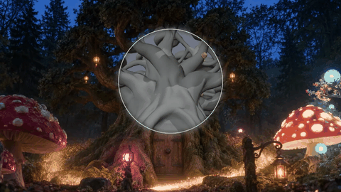 The Last Lantern](https://www.scenario.com/explorations/the-last-lantern/) | [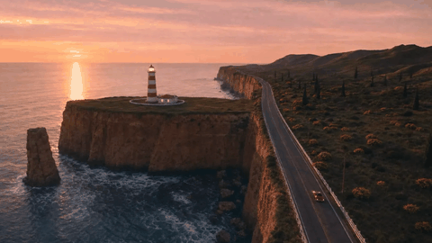 Previs to Picture](https://www.scenario.com/explorations/previs-to-picture/) | [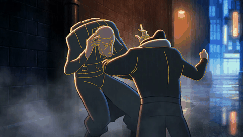 Grease Pencil to Final Frame](https://www.scenario.com/explorations/grease-pencil-to-final-frame/) |
| [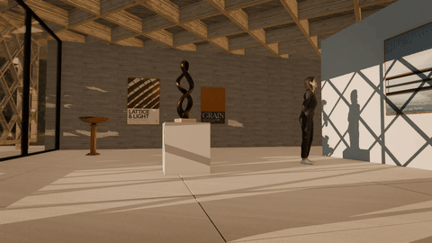 Pavilion](https://www.scenario.com/explorations/pavilion/) | [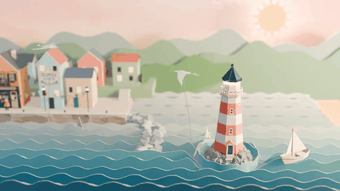 Paper Harbor](https://www.scenario.com/explorations/paper-harbor/) | [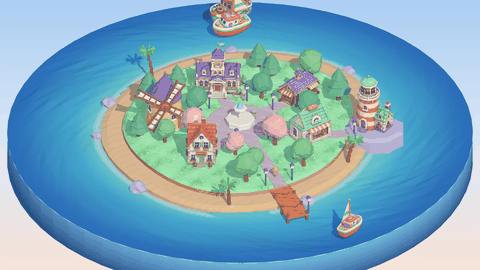 Island Builder](https://www.scenario.com/explorations/island-builder/) |
| [ Lamplight Deep](https://www.scenario.com/explorations/lamplight-deep/) | [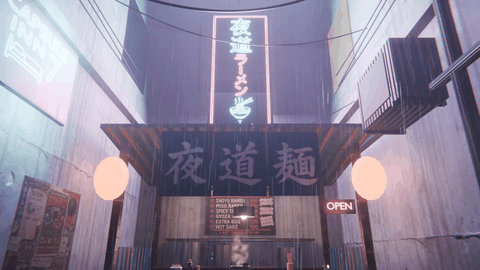 Last Order](https://www.scenario.com/explorations/last-order/) | [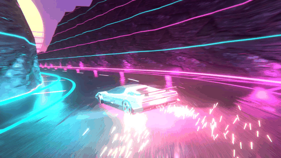 Neon Drift](https://www.scenario.com/explorations/neon-drift/) |
| [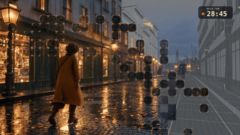 Twenty Minutes](https://www.scenario.com/explorations/twenty-minutes/) | [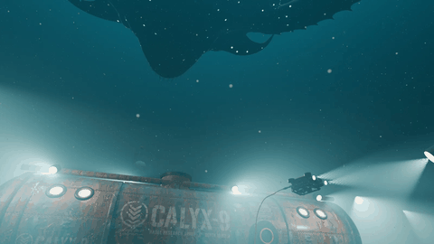 Hadal](https://www.scenario.com/explorations/hadal/) | [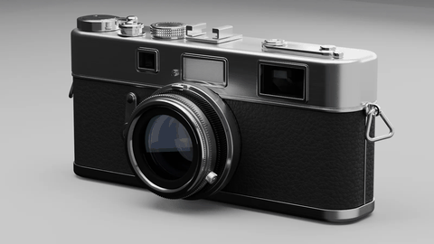 Two Rulers](https://www.scenario.com/explorations/two-rulers/) |
| [ The Stones Remember](https://www.scenario.com/explorations/the-stones-remember/) | [ Hold On](https://www.scenario.com/explorations/hold-on/) | [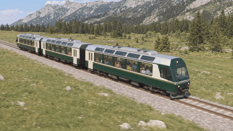 Impossible Rides](https://www.scenario.com/explorations/impossible-rides/) |
| [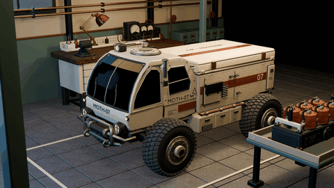 The Last Repair Shop](https://www.scenario.com/explorations/last-repair-shop/) | [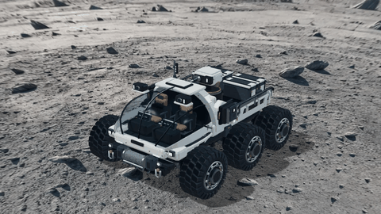 Rover Foundry](https://www.scenario.com/explorations/rover-foundry/) |   |

## Known limits

See [known limitations](KNOWN_LIMITATIONS.md) for current limits, and the
[architecture map](architecture/runtime.md) for what is still being integrated.

## Licence

Scenario for Blender's first-party extension code is free software under the
GNU General Public License, version 3 or (at your option) any later version
(GPL-3.0-or-later), without any warranty. The full text is in
[LICENSE](https://github.com/scenario-labs/blender-plugin/blob/main/LICENSE).
Bundled dependencies, adopted sources and assets retain their original licences
and notices; see the [repository licence notice](https://github.com/scenario-labs/blender-plugin#licence).

Blender is a registered trademark of the Blender Foundation. Scenario for Blender
is an independent extension, not published by or affiliated with the Blender
Foundation. See the [trademark notes](https://github.com/scenario-labs/blender-plugin/blob/main/TRADEMARKS.md).
